# Лабораторная работа 1.1. Изучение статических характеристик диода и определение основных параметров его модели для расчёта схем

## Содержание

- 1.1. Изучение статических характеристик диода и определение основных параметров его модели для расчёта схем
  - 1.1.1. Цели работы
  - 1.1.2. Краткие теоретические сведения
  - 1.1.3. Методика моделирования в программе SPICE-моделирования (на примере LTspice)
  - 1.1.4. Методика определения основных параметров модели стабилитрона в программе SPICE
  - 1.1.5. Описание макетной платы
  - 1.1.6. Задание для работы в лаборатории
  - 1.1.7. Задание для работы с программой SPICE-моделирования
  - 1.1.8. Подготовка отчёта
  - 1.1.9. Контрольные вопросы
  - 1.1.10. Рекомендуемая литература

## 1.1.1. Цели работы

- Изучение статических вольт-амперных характеристик диода;
- изучение способов и определение параметров его модели для схемотехнических расчетов;
- приобретение навыков работы с полупроводниковыми приборами;
- приобретение навыков расчета схем с помощью SPICE-симулятора.

## 1.1.2. Краткие теоретические сведения

### а) Статические уравнения диода/стабилитрона и их температурная зависимость

Общий вид вольт-амперной характеристики диода/стабилитрона (зависимости тока от приложенного напряжения) приведён на рис. 1. Пробойный участок (слева) относится только к характеристике стабилитрона, для которого именно этот участок является рабочим.

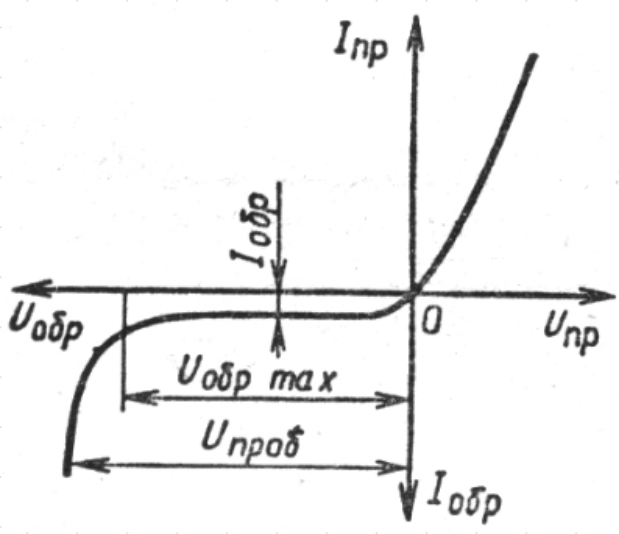

*Рис. 1. Вольт-амперная характеристика диода*

Прямая ветвь ВАХ диода/стабилитрона описывается выражением

$$
I_{\text{д}} = I_0 \cdot \left[\exp\left(\frac{U_{\text{д}}}{m \cdot \varphi_T}\right) - 1\right], \tag{1}
$$

где $I_0$ – тепловой ток, или ток насыщения (*параметр модели IS*);

$\varphi_T = kT/q$ (=25 мВ при температуре 25°C) – тепловой потенциал;

$m$ – коэффициент неидеальности (*параметр модели N*).

Обратная ветвь ВАХ стабилитрона описывается выражением

$$
I_{\text{проб}} = -I_0 \cdot \left[\exp\left(-\frac{BV + U_{\text{д}}}{m \cdot \varphi_T}\right) - 1\right], \tag{2}
$$

где BV – напряжение пробоя (*параметр модели BV*).

$m$ имеет тот же смысл, что для прямой ветви (*параметр модели NBV*).

Таким образом, выражения (1) и (2) описывают идеализированный стабилитрон; параметры этих выражений: IS, N, BV, NBV – являются параметрами модели диода.

Кроме того, в соответствии с эквивалентной схемой стабилитрона (см. рис.2), на его статические характеристики влияет последовательное сопротивление материала, из которого этот компонент изготовлен (*параметр модели RS*).

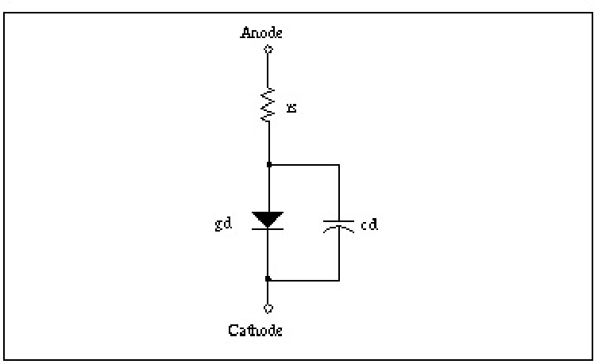

*Рис. 2. Эквивалентная схема модели стабилитрона*

Параметры любого полупроводникового компонента существенно зависят от температуры, при которой он работает. Вольт-амперная характеристика диода/стабилитрона при изменении его температуры смещается как в прямой, так и в обратной области (см. рис. 3).

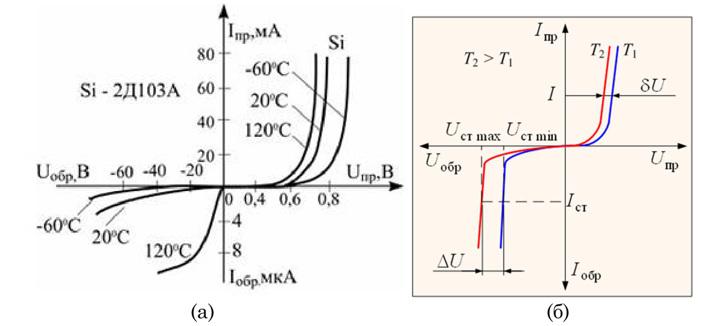

*Рис. 3. Примеры смещения ВАХ диода (а) и стабилитрона (б) при изменении температуры*

Состояние ВАХ (1) и (2) при любом значении температуры среды (в рабочем диапазоне) можно охарактеризовать с помощью набора параметров $(\text{IS, N, BV, NBV, RS})_i$, где индекс $i$ соответствует какому-либо значению температуры. При этом параметры N и NBV, как правило, не меняются с температурой, а параметры IS, BV и RS меняются.

Для каждого из параметров IS, BV и RS можно, таким образом, составить табличную функцию зависимости от температуры, а также построить дискретный график этой зависимости.

Для некоторых параметров (например, IS, BV, RS) схемотехнической модели стабилитрона в программе Spice уже введены зависимости от температуры, позволяющие описать упомянутые выше табличные функции в виде аналитических функций:

$$
IS(T) = IS(T_{norm}) \left(\frac{T}{T_{norm}}\right)^{XTI}, \tag{3}
$$

$$
BV(T) = BV(T_{norm})(1 + \Delta T \cdot TBV1 + \Delta T^2 \cdot TBV2), \tag{4}
$$

$$
RS(T) = RS(T_{norm})(1 + \Delta T \cdot TRS1 + \Delta T^2 \cdot TRS2). \tag{5}
$$

Коэффициенты этих зависимостей (XTI, TBV1, TBV2, TRS1, TRS2) называются температурными параметрами модели стабилитрона и также включены в общий перечень параметров модели.

### б) Модель диода/стабилитрона для программы Spice

Для того, чтобы использовать диод/стабилитрон в программе схемотехнического моделирования, необходимо 1) задать модель диода, 2) объявить экземпляр диода.

Формат описания модели:

```
.model <model_name> D [ <param>=<value> ] ,..
```

Здесь model_name – имя модели, param и value – имена и значения параметров.

В строке описания модели можно перечислить любой набор параметров диода (с их соответствующими значениями) из имеющегося списка допустимых параметров. В табл. 1 приведён сокращённый набор параметров – наиболее часто используемых; полный набор приведён в руководстве пользователя. Следует учитывать, что параметры, не указанные в директиве `.model`, не исчезают, а получают значения по умолчанию. В частности, модель, описанная предложением `.model <model_name> D`, задаёт статический источник тока вида (1).

**Табл. 1. Сокращённый набор параметров модели диода в программе SPICE**

| Физическое обозначение | Название парам. | Описание параметра | ед. изм. | Значение по умолчанию |
|---|---|---|---|---|
| $I_S$ | I S | Saturation current / Ток насыщения | A/AREA | 1E-14 |
| $R_S$ | RS | Parasitic resistance (series resistance) / Паразитное (последовательное) сопротивление | Ω/AREA | 0 |
| $n$ или $m$ | N | Emission (nonideality) coefficient / Коэффициент неидеальности (или эмиссии) | - | 1 |
| $V_B$ | BV | Reverse breakdown voltage / Напряжение обратного пробоя | V | ∞ |
| $I_{BV}$ | IBV | Reverse breakdown current / Ток обратного пробоя | A/AREA | 1E-3 |
| $n_{BV}$ | NBV | Reverse breakdown emission coefficient / Коэффициент эмиссии при обратном пробое | - | - |

## 1.1.3. Методика моделирования в программе SPICE-моделирования (на примере LTspice)

В этом разделе описан порядок выполнения основных операций в программе SPICE-моделирования:

1. установить компонент на рабочее поле;
2. задать модель диода;
3. прикрепить модель к экземпляру диода;
4. моделировать статическую характеристику (например, вольт-амперную или передаточную характеристику);
5. моделировать переходную характеристику;
6. задать изменение температуры;
7. произвести параметрический анализ.

**Установить компонент на рабочее поле.** Для того чтобы установить диод на рабочее поле, необходимо на панели инструментов нажать \<Components>. В открывшемся окне ввести \<diode> и выбрать соответствующий компонент (см. рис. 4). Название компонента в схеме должно начинаться с буквы D (D1 на рис. 4), оно является уникальным идентификатором в пределах схемы.

**Задать модель диода.** Модель диода в программе схемотехнического моделирования, такой как LTSpice, представляет собой непростую систему уравнений, рассчитываемых по определённому алгоритму. Коэффициенты в этих уравнениях (соответствующие физическим, технологическим, геометрическим параметрам структуры компонента, см. пример в табл. 1), задаёт пользователь – именно они называются параметрами модели. Т. к. в модели много параметров, для их задания в программах типа LTSpice используется специальный механизм.

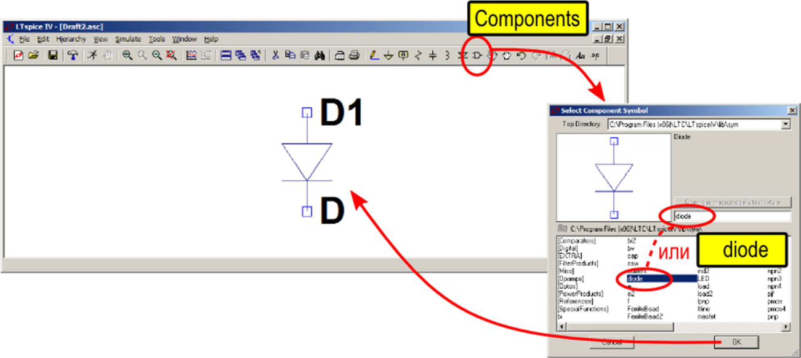

*Рис. 4. Установка диода на рабочее поле программы*

Набор параметров модели (на жаргоне пользователей LTSpice именно он часто называется моделью, или картой модели) задаётся в отдельной строке. Описание модели включает в себя *название* (произвольный идентификатор), *тип* модели (“`D`” для диода), перечисление параметров в виде `<param>=<value>` через пробел.

Текстовое описание модели с перечисленными параметрами диода вводится в специальном окне \<SPICE Directive>, которое открывается с панели инструментов (см. рис. 5). В окне нужно ввести описание модели, например, ”`.model ivanov D is=1e-15 n=1.01`”, нажать “OK”, и положить строку на любое свободное место рабочего поля.

Для того, чтобы отредактировать имеющуюся модель, нужно нажать на ней правой кнопкой мыши – снова откроется окно \<SPICE Directive>.

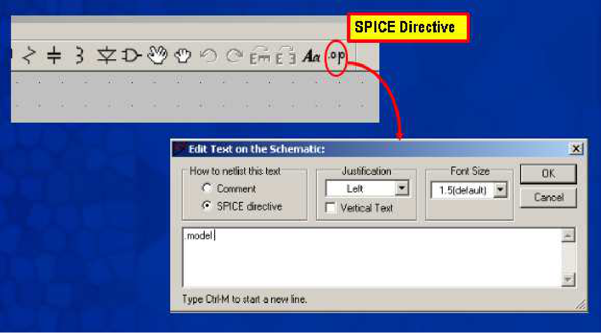

*Рис. 5. Окно для ввода описания модели*

**Прикрепить модель к экземпляру диода.** Для того, чтобы соотнести модель и конкретный экземпляр диода, расположенный на рабочем поле, нужно вписать название модели в свойство Value диода (см. рис. 6). Для редактирования свойства Value нужно нажать на нём правой кнопкой мыши, откроется простое окно для ввода.

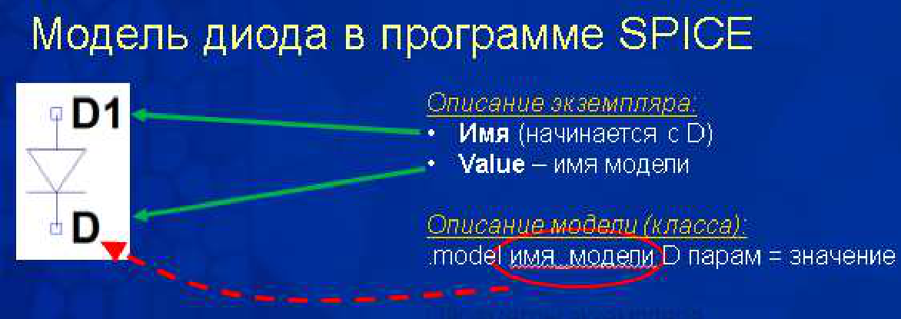

*Рис. 6. Расшифровка обозначений*

**Моделировать статическую характеристику (например, вольт-амперную или передаточную характеристику).** Статическая характеристика – это зависимость одной электрической величины (функции) от другой (аргумента) без учёта переходных процессов переключения, или, что то же самое, при медленном изменении. Значения аргумента при этом откладываются по горизонтальной оси в заданном диапазоне с заданным шагом (инкрементом) – как в описании цикла в программировании – а значения функции откладываются по вертикальной оси.

Аргументом обычно является величина какого-либо источника напряжения/тока, но можно задать и любую другую (например, величину сопротивления резистора или значение какой-либо переменной).

Таким образом, в простейшем случае в этом режиме расчёта для аргумента нужно задать три параметра: начальное и конечное значение, шаг изменения.

Перед запуском расчёта схемы нужно указать команду на расчёт. Это делается в окне \<Edit Simulation Command>, которое открывается из меню \<Simulation>. Для статической характеристики нужна вкладка \<DCsweep> (см. рис. 7).

Здесь необходимо указать аргумент (например, имя источника питания), способ его изменения (здесь линейный), начальное значение, конечное значение и шаг изменения. При вводе значений в поля этого окна в нижней строке формируется команда на моделирование, которая начинается на `.DC`. После ввода всех параметров нужно нажать “OK” и положить строку на любое свободное место рабочего поля.

Для того, чтобы отредактировать имеющуюся команду DC, нужно нажать на ней правой кнопкой мыши – снова откроется окно < Edit Simulation Command >.

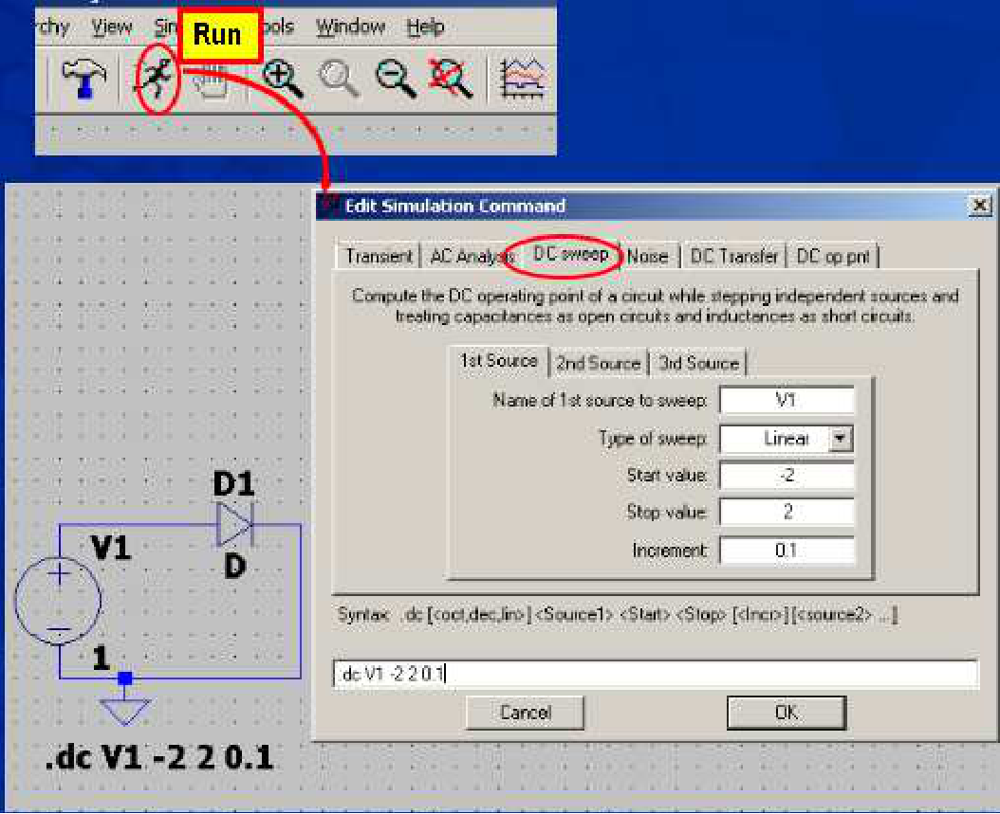

*Рис. 7. Окно для ввода команды на моделирование*

**Моделировать переходную характеристику.** Переходная характеристика – это зависимость электрической величины от времени. В этом режиме требуется задать какую-либо причину переходного процесса: переменный источник напряжения/тока, замыкание/размыкание ключа и т. д.

Для объявления источника как переменного нужно щёлкнуть на нём правой кнопкой мыши, в появившемся окне нажать \<Advanced> – откроется окно \<Independent voltage/current source> (см. рис. 8).

Здесь нужно выбрать тип зависимости от времени (синусоидальная SINE, импульсная PULSE и др.) и ввести в поля параметры функции. Например, для синусоидальной функции задаётся постоянное смещение \<DC offset>, амплитуда \<amplitude>, частота \<frequency> – всё в единицах СИ. После ввода всех параметров нужно нажать “OK”, и соответствующая строка появится рядом с источником.

Перед запуском расчёта схемы нужно указать команду на расчёт. Это делается в окне \<Edit Simulation Command>, которое открывается из меню \<Simulation>. Для переходной характеристики нужна вкладка \<Transient> (см. рис. 9). Здесь наиболее важными являются параметры:

**Stop Time** – время окончания анализа переходного процесса

**Time to Start Saving Data** – время начала записи результатов моделирования (это используется, например, чтобы пропустить начальный переходной процесс и отобразить уже установившееся значение или установившийся колебательный процесс);

**Maximum Timestep** – максимальный шаг расчёта по времени (это значение влияет на гладкость графика). Если это значение не указано, программа пытается подобрать его сама.

При вводе значений в поля этого окна в нижней строке формируется команда на моделирование, которая начинается на `.TRAN`. После ввода всех параметров нужно нажать “OK” и положить строку на любое свободное место рабочего поля.

Для того, чтобы отредактировать имеющуюся команду `.TRAN`, нужно нажать на ней правой кнопкой мыши – снова откроется окно < Edit Simulation Command >.

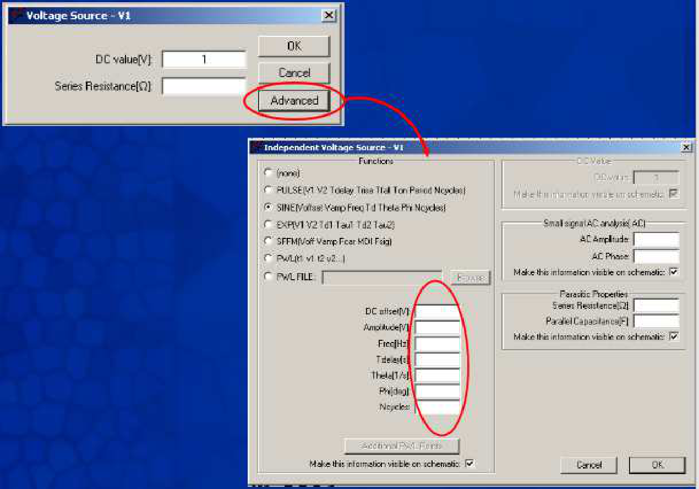

*Рис. 8. Изменение свойств источника питания*

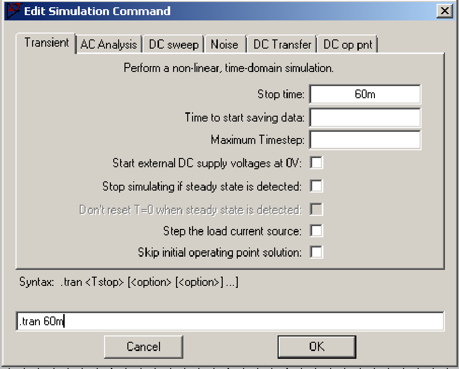

*Рис. 9. Задание команды для переходных характеристик*

**Задать изменение температуры.** Описание вводится в окне \<SPICE Directive>, которое открывается с панели инструментов (см. рис. 5). В окне с помощью директивы `.TEMP` нужно ввести перечень значений температуры через пробел, например, “`.temp -60 25 100`”, нажать “OK”, и положить строку на любое свободное место рабочего поля.

**Провести параметрический анализ.** Рассмотрим другой вид параметрического анализа. Если возникла необходимость построить статические или переходные характеристики одновременно при нескольких значениях какого либо параметра схемы (значения источника, сопротивления резистора и т. д.), то в этом случае необходимо воспользоваться директивами `.PARAM` и `.STEP`.

Используется следующая последовательность действий:

1. объявляется новая переменная с помощью директивы `.PARAM`. Описание вводится в окне \<SPICE Directive>, которое открывается с панели инструментов (см. рис. 5). В окне нужно ввести имя переменной и начальное значение, например, “`.param x=1.5`”, нажать “OK”, и положить строку на любое свободное место рабочего поля;
2. использовать эту переменную вместо конкретного числового значения, введя там название переменной в фигурных скобках, например:

   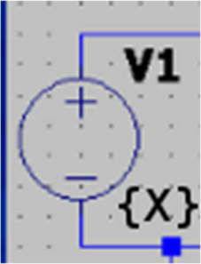

3. задать способ изменения этой переменной с помощью директивы `.STEP`, Описание вводится в окне \<SPICE Directive. В окне нужно ввести, например, “`.STEP PARAM X LIST 5 10 15`” (другие примеры см. в справке программы по слову STEP), нажать “OK”, и положить строку на любое свободное место рабочего поля.

В результате при моделировании будут одновременно выведены несколько линий графиков (по одной для каждого значения параметра).

## 1.1.4. Методика определения основных параметров модели стабилитрона в программе SPICE

### 1.1.4.1. Введение

В лабораторной работе определяются следующие основные параметры модели стабилитрона (см. [5]):

\* Для прямого смещения:

Is – ток утечки;

Nf – коэффициент неидеальности в прямом включении;

\* Для обратного смещения:

BV – напряжение пробоя;

IBV – ток обратного пробоя;

NBV – коэффициент наклона (коэффициент неидеальности на участке пробоя).

Процедура определения (или, как ещё говорят, идентификации, или экстракции) параметров модели в простейшем случае заключается в подгонке значений параметров для наилучшего совпадения измеренных вольт-амперных характеристик и таких же характеристик, смоделированных в SPICE-симуляторе с помощью полученной модели. Эта операция является итерационной.

### 1.1.4.2. Подгонка параметров

Цель данного этапа ‒ более точно определить значения параметров SPICE-модели диода, так чтобы, будучи построенными в одних осях, совпадали с графиками вольт-амперных характеристик, измеренных в ходе выполнения лабораторной работы и смоделированных с помощью полученной SPICE-модели.

Процедуры данного этапа проиллюстрированы на примере программы LTSpice.

Алгоритм выполнения задачи данного этапа состоит в том, чтобы:

1. воспроизвести в схемотехническом редакторе лабораторную схему измерения, используя в качестве начальных значений параметров модели, указанные по умолчанию в табл. 1;
2. ввести в схему фиктивный источник тока, содержащий данные о результатах измерения ВАХ;
3. промоделировать схему с имеющимися параметрами модели;
4. подобрать значения основных параметров модели диода методом подгонки;
5. сопоставить в общих осях графики измеренных и смоделированных ВАХ; в случае несовпадения изменить параметры модели и вернуться к п. 3.

#### а) Построение схемы для моделирования

Для моделирования в программе‒симуляторе электрических схем воспроизводится схема, соответствующая результатам измерения. В ходе лабораторной работы непосредственно измерялись напряжение и ток на выводах диода и не фиксировалось значение источника постоянного питания $V_{\text{ПИТ}}$. В связи с этим, 1) схема для виртуального опыта не содержит ограничительных сопротивлений; 2) источник питания $V_{\text{ПИТ}}$ подключается непосредственно к выводам объекта исследования – диода; 3) значение источника $V_{\text{ПИТ}}$ соответствует измеренным значениям напряжения на выводах диода.

Схема, построенная в соответствии с вышеизложенным, приведена на рис. 10.

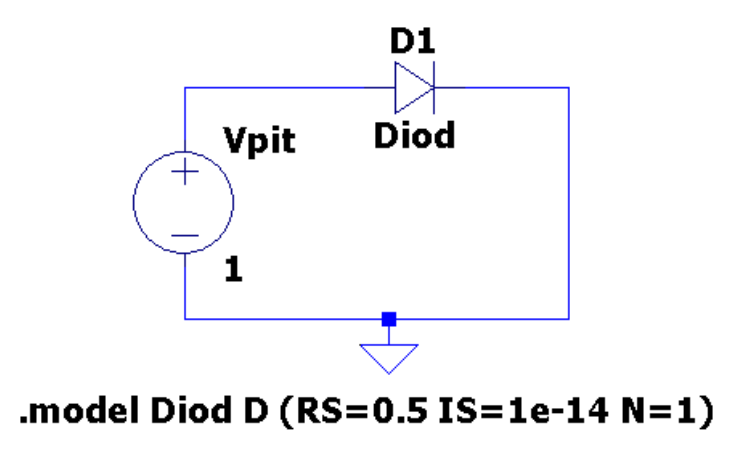

*Рис. 10. Схема, построенная в программе схемотехнического моделирования для расчёта ВАХ диода*

Для задания модели диода используется кнопка «SPICE directive» панели инструментов программы. В открывшемся окне вводится директива `.model` в формате:

```
.model <имя> <тип> [<параметр1>=<значение1>,…]
```

где \<имя> – имя модели в формате `[_A-Za-z][_A-Za-z0-9]*`, \<тип> – тип модели, для диода это “D”, \<параметр> – имя параметра модели из списка допустимых параметров (см. справку к программе), \<значение> – значение параметра модели в виде простого числа (с точкой), либо записанное в инженерном формате (например, 2.5e-12 = $2{,}5 \cdot 10^{-12}$), либо записанное с суффиксом (например, 2.5p = $2{,}5 \cdot 10^{-12}$).

На начальном этапе в модель следует ввести значения параметров по-умолчанию, а в качестве названия модели вписать свою фамилию латинскими буквами, например:

```
.model Ivanov D(RS=0.5 IS=1e-14 N=1 IBV=1e-3 NBV=0.9)
```

После нажатия на кнопку OK следует поместить текст модели на любое свободное место рабочего поля программы. Имя модели следует добавить к свойствам конкретного экземпляра диода: навести мышь на слово "D" рядом с диодом (в строке состояния при этом должно содержаться слово “Value”), щёлкнуть на нём правой кнопкой мыши и ввести имя модели.

#### б) Отображение на графиках экспериментальных данных

Для того, чтобы иметь возможность в одних и тех же осях сравнивать графики измеренных и смоделированных ВАХ, в схему необходимо ввести фиктивный источник тока, выдающий при моделировании измеренные значения.

При подготовке электрической схемы для моделирования ВАХ к источнику напряжения Vpit (аргументу) подключается один источник тока, воспроизводящий $I_{\text{Д}} = f(V_{\text{Д}})$.

Для того, чтобы задать значение источника в виде набора точек, следует щёлкнуть правой клавишей мыши на изображении источника, нажать кнопку Advanced, в открывшемся окне выбрать пункт “TABLE (v1 i1 v2 i2)”, вписать значения 0 и 0 в поля voltage1 и value1, нажать кнопку OK и поместить получившуюся строчку “TBL(0 0)” на любое свободное место рабочего поля программы. Внутрь скобок вместо значений “0 0” далее следует вписать результаты своих измерений в виде: *напряжение1 ток1 напряжение2 ток2* и т. д.

Для того, чтобы представить результаты измерений в таком виде, можно использовать следующую процедуру (см. рис. 11): 1) вставить таблицу с данными, соответствующими одной линии, в текстовый редактор (Блокнот, Word, Writer и т. п.), 2) преобразовать данные из табличного вида в строковый (при необходимости), 3) провести автозамену символов конца строки на пробелы. Получившаяся строка готова для вставки в команду TBL.

Примерные фрагменты схем, содержащих фиктивные источники для вывода измеренных значений, показаны на рис. 12.

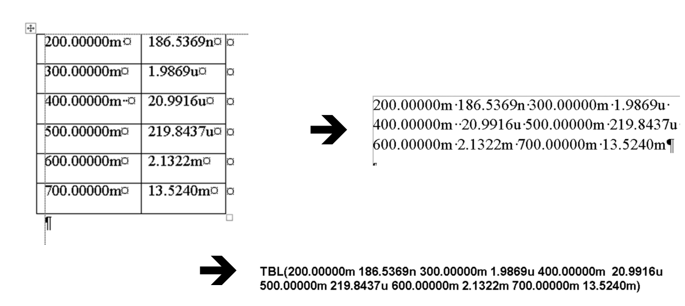

*Рис. 11. Порядок преобразования данных измерений для вставки на рабочий лист программы*

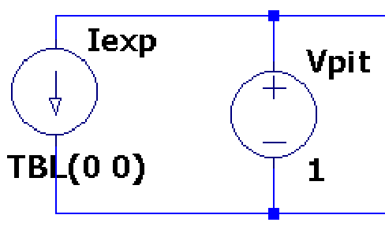

*Рис. 12. Фрагмент схем для подключения результатов измерения при моделировании ВАХ диода*

#### в) Моделирование схемы

**Указания.** Виртуальный опыт в программе схемотехнического моделирования должен воспроизводить опыт в реальной лаборатории. С этой целью значение источника питания, подключённого к выводам диода, должно соответствовать задаваемому в процессе реального опыта.

При моделировании ВАХ напряжение источника Vpit должно изменяться примерно в диапазоне от 0,3 до 1 В для прямой ветви характеристики и от $(-\mathrm{BV}-1)$ до 0 для обратной ветви характеристики – с мелким шагом (порядка 0,01 В).

**Для ввода команды на изменение значений источника** следует вызвать пункт меню Simulation ‒ Edit Simulation Cmd. В открывшемся окне следует выбрать вкладку “DC sweep”, где в поле “source name” ввести имя источника, а в поля “start value”, “stop value”, “increment” ввести начальное, конечное значение и шаг изменения источника. При вводе значений в поля окна в его нижней части автоматически формируется команда, которую после нажатия кнопки OK следует поместить на любое свободное место рабочего листа программы. Аналогичную команду можно набрать и вручную, воспользовавшись кнопкой “SPICE directive” панели инструментов. Формат команды:

```
.dc <ист1> <start1> <stop1> <step1>
```

где *ист1,* – имя источника, *start1* – начальное значение источника, *stop1* – конечне значение источника, *step1* – шаг изменения значений источника.

**Для запуска моделирования** следует вызвать пункт меню Simulation ‒ Run или нажать на кнопку Run панели инструментов. При отсутствии ошибок моделирования открывается пустое поле для построения графиков.

**Для вывода графиков** по результатам компьютерного расчёта следует щёлкнуть правой кнопкой мыши на пустом поле, выбрать пункт “Add Traces” и в открывшемся окне выбрать те величины, которые следует построить.

#### г) Корректировка параметров

Операция подгонки параметров модели диода/стабилитрона заключается в следующем: по результатам моделирования электрической схемы сравниваются графики ВАХ: измеренные и рассчитанные. В случае их несовпадения корректируются параметры модели и моделирование запускается заново.

Порядок, в котором следует изменять параметры, следующий:

1. по крутому участку прямой линии ВАХ в логарифмическом масштабе определяются параметры IS, который здесь играет роль масштабного коэффициента, и NF (коэффициент наклона). На этом этапе следует обращать внимание только на наклон линий в крутой области;
2. по точкам с самыми большими значениями тока на прямой линии ВАХ в линейном масштабе определяется параметр RS, которое здесь управляет загибом характеристики, – в случае если такой загиб есть;
3. по крутому участку обратной лини ВАХ в линейном масштабе определяются параметры BV (напряжение пробоя), IBV (ток при этом напряжении) и NBV (коэффициент наклона пробойного участка).

## 1.1.5. Описание макетной платы

Работа выполняется на макетной плате. Макетная плата предназначена для упрощения соединения компонентов схемы между собой. На ней расположены отверстия для вставки ножек компонентов или проводов – некоторые отверстия внутри платы уже связаны между собой и тогда дополнительно связывать их не нужно.

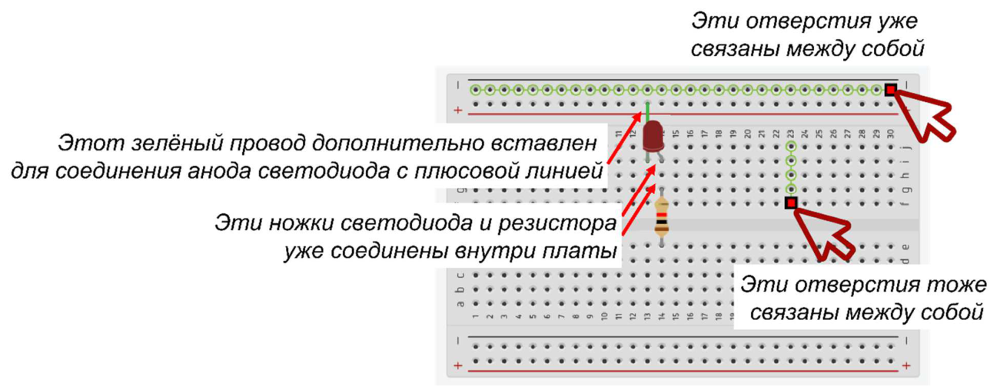

*Рис. 13. Макетная плата для сборки схемы*

Сверху и снизу проведены линии для подключения питания – плюс и минус источника питания нужно с помощью проводов подключить к этим отверстиям.

Исследуемая цепь собирается на основе внешних приборов и устройств: одного вольтметра, амперметра и регулируемого источника напряжения, одного стабилитрона D1 и внешнего сопротивления R1 (см. рис. 14). Внешнее сопротивление включено в схему измерения для ограничения тока и предупреждения повреждения стабилитрона и источника питания.

## 1.1.6. Задание для работы в лаборатории

### 1.1.6.1. Проведение измерений вольт-амперной характеристики

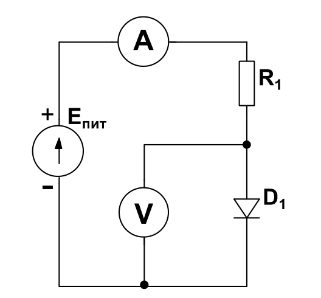

*Рис. 14. Схема измерения ВАХ диода/стабилитрона*

1. Снимите **прямую ветвь** вольт-амперной характеристики стабилитрона по схеме рис. 14 (8–10 точек), меняя напряжение питания так, чтобы напряжение стабилитрона менялось в диапазоне 0 В до 1 В. Занесите в таблицу 1 показания вольтметра и амперметра.

*Указания*. Начинать измерение прямой ветви характеристики рекомендуется с бóльших по модулю значений тока.

**Табл. 1. Измерения прямой ветви ВАХ**

| $V_{\text{Д}}$, В | | | |
|---|---|---|---|
| $I_{\text{Д}}$, А | | | |

2. Снимите **обратную ветвь** вольт-амперной характеристики стабилитрона по схеме рис. 14, меняя напряжение питания так, чтобы напряжение стабилитрона менялось в диапазоне от 0 В до $(-|BV| - 1)$. Занесите в таблицу 2 показания вольтметра и амперметра.

**Табл. 2. Измерения обратной ветви ВАХ**

| $V_{\text{Д}}$, В | | | |
|---|---|---|---|
| $I_{\text{Д}}$, А | | | |

*Указания*. Особенность этого этапа в том, что вначале стабилитрон находится в закрытом состоянии, и здесь можно использовать большие значения шага изменения напряжения. Однако, при наметившемся возрастании обратного тока следует существенно уменьшить шаг.

То напряжение, при котором появился обратный ток – и есть значение параметра $BV$. Далее необходимо менять напряжение так, чтоб получилось 8–10 точек в диапазоне от $(-|BV|)$ до $(-|BV| - 1)$.

3. По результатам измерений постройте графики зависимостей тока стабилитрона от напряжения стабилитрона $I_{\text{Д}} = f(V_{\text{Д}})$: прямой ветви в линейном и логарифмическом масштабе и обратной ветви в линейном масштабе (см. для примера рис. 15, 16).

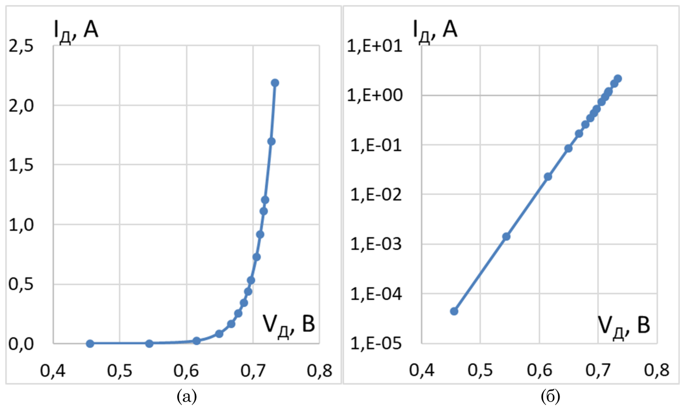

*Рис. 15. Измеренная прямая ветвь вольт-амперной характеристики диода/стабилитрона в линейном (а) и логарифмическом (б) масштабе*

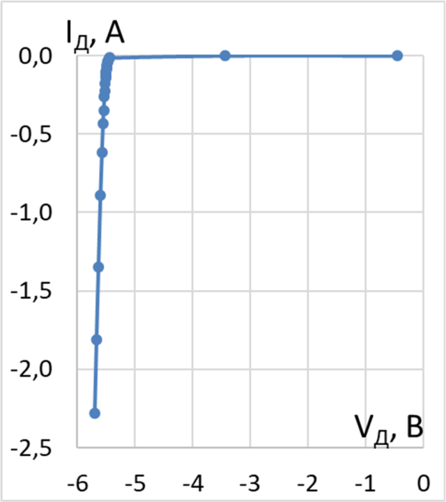

*Рис. 16. Измеренная обратная ветвь вольт-амперной характеристика диода/стабилитрона*

### 1.1.6.2. Указания к фиксации результатов измерения

1. Основными результатами в таблице являются показания измерительных приборов (амперметра и вольтметров), а не источников питания. Все значения в одной колонке, относящиеся к одной и той же физической величине, должны вноситься в одних и тех же единицах измерения.
2. При построении графиков в программах Microsoft Excel, OpenOffice Calc и т. п. следует выбирать тип графика «точечный», а не «график», – это подходит для графиков физических величин.

## 1.1.7. Задание для работы с программой SPICE-моделирования

1. Постройте в программе моделирования схемы для расчёта прямой и обратной ветвей ВАХ диода/стабилитрона; внедрите в схемы фиктивные источники для отображения результатов измерения;
2. определите параметры модели в соответствии с процедурой п. 1.1.4; добейтесь максимального совпадения измеренных и смоделированных прямой и обратной ветвей ВАХ; в качестве названия модели впишите свою фамилию;
3. постройте графики ВАХ, на которых совмещены результаты измерений и компьютерного моделирования.

## 1.1.8. Подготовка отчёта

Отчёт должен содержать следующие части:

1. титульный лист;
2. оглавление;
3. цель работы;
4. теоретическое введение;
5. схема измерений;
6. таблицы с результатами измерений;
7. графики, построенные по результатам измерений;
8. схемы для компьютерного расчёта прямой и обратной ветвей ВАХ из программы моделирования; должны быть различимы параметры модели;
9. графики прямой ветви ВАХ в линейном и логарифмическом масштабе и обратной ветви ВАХ в линейном масштабе, на которых совмещены результаты измерений и компьютерного моделирования.

*Указания.* Страницы отчёта должны быть пронумерованы. Части отчёта должны иметь нумерованные заголовки. Линии графиков и значения по осям должны быть хорошо различимы; рекомендуется использовать тёмные линии на светлом фоне.

## 1.1.9. Контрольные вопросы

1. Структура и принцип работы диода/стабилитрона;
2. прямая и обратная ВАХ;
3. статическая модель диода/стабилитрона;
4. ёмкости в структуре диода/стабилитрона;
5. методика определения параметров схемотехнической модели диода/стабилитрона.

## 1.1.10. Рекомендуемая литература

1. Новожилов О. П. Электротехника и электроника: учебник (серия Бакалавр. Базовый курс). – М.: Юрайт, 2016. – 654 с.
2. О. В. Миловзоров, И. Г. Панков, Основы электроники. Учебник. – М.: Юрайт, 2016. – 407 с.
3. Сохор Ю.Н. Моделирование устройств в пакете LTspice. – Псков: ППИ, 2008.
4. P. Antognetti, G. Massobrio. Semiconductor device modeling with SPICE,- McGraw-Hill, 1988;
5. LTSpice IV User Manual. – Режим доступа: ltspice.linear.com/software/scad3.pdf
