# Лабораторная работа 1.2. Изучение статических характеристик биполярного транзистора и определение основных параметров его модели для расчёта схем

## Содержание

- 1.2. Изучение статических характеристик биполярного транзистора и определение основных параметров его модели для расчёта схем
  - 1.2.1. Цели работы
  - 1.2.2. Краткие теоретические сведения. Структура транзистора и принцип его работы
  - 1.2.3. Схемотехнические (SPICE) модели биполярного транзистора
  - 1.2.4. Методика определения основных параметров модели Гуммеля‒Пуна биполярного транзистора
  - 1.2.5. Описание макетной платы
  - 1.2.6. Задание для работы в лаборатории
  - 1.2.7. Задание для работы с программой SPICE-моделирования
  - 1.2.8. Подготовка отчёта
  - 1.2.9. Контрольные вопросы
  - 1.2.10. Рекомендуемая литература

## 1.2.1. Цели работы

- Экспериментальное исследование входных и выходных вольт-амперных характеристик (ВАХ) биполярного транзистора;
- Приобретение навыков измерения характеристик биполярных транзисторов и определения основных параметров схемотехнической модели Гуммеля‒Пуна транзистора по результатам измерения его ВАХ;
- Приобретение навыков расчёта схем и моделирования характеристик транзисторов с помощью программы схемотехнического анализа SPICE.

## 1.2.2. Краткие теоретические сведения. Структура транзистора и принцип его работы

*Биполярным транзистором* называют полупроводниковый прибор с двумя взаимодействующими p-n переходами и тремя или более выводами. Полупроводниковый кристалл такого транзистора состоит из трех различных областей с чередующимися типами электропроводности, между которыми находятся два p-n перехода, расположенные в непосредственной близости один от другого. В зависимости от порядка расположения трёх областей в полупроводниковом кристалле различают транзисторы n-p-n и p-n-p типов. Их упрощенные структуры и условные обозначения показаны на рис. 1,а,б. Центральную область кристалла называют *базой* (Б), а наружные области ‒ соответственно, *эмиттером* (Э) и *коллектором* (К). P-n переход между эмиттером и базой называют *эмиттерным*, а p-n переход между коллектором и базой ‒ *коллекторным*. Часть поверхностей эмиттера, базы и коллектора покрывают металлическими пленками. К этим пленкам приваривают или припаивают выводы, с помощью которых на переходы транзистора подается внешнее напряжение.

На каждый p-n переход транзистора может быть подано как прямое, так и обратное напряжение. Прямым считается такое напряжение на переходе, при котором происходит инжекция носителей в переходе («+» на р-области, «–» на n-области). Соответственно различают четыре режима работы биполярного транзистора: *режим отсечки* ‒ на оба перехода поданы обратные напряжения; *режим двойной инжекции* ‒ на оба перехода поданы прямые напряжения; *нормальный активный режим* – на эмиттерный переход подано прямое напряжение, а на коллекторный обратное; *инверсный активный режим* – на эмиттерный переход подано обратное напряжение, а на коллекторный прямое.

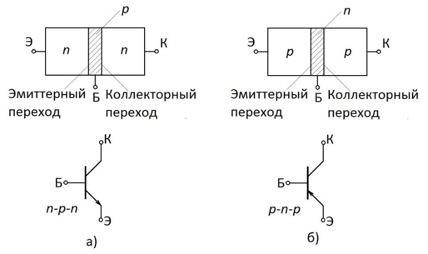

*Рис. 1. Структуры и схемное обозначение npn (а) и pnp (б) транзисторов*

*В режиме отсечки* через оба перехода протекают незначительные обратные токи, что эквивалентно большому сопротивлению. Это позволяет в первом приближении считать, что между всеми выводами транзистора будет обрыв, а токи в его внешних цепях равны нулю.

*В режиме двойной инжекции (иногда называемого режимом насыщения)* через оба перехода одновременно инжектируются носители в базу и собираются носители, дошедшие с противоположной стороны. В этом режиме между коллектором и эмиттером сохраняется лишь остаточное напряжение порядка 0,1‒0,3 В, а токи выводов определяются только внешними цепями.

*В активном режиме* работы транзистора наблюдается более сложная картина. В этом случае источник питания $E_{\text{БЭ}}$ подключен к эмиттерному переходу в прямом направлении («минус» на эмиттере), и через эмиттерный переход проходит достаточно большой прямой ток (рис. 2).

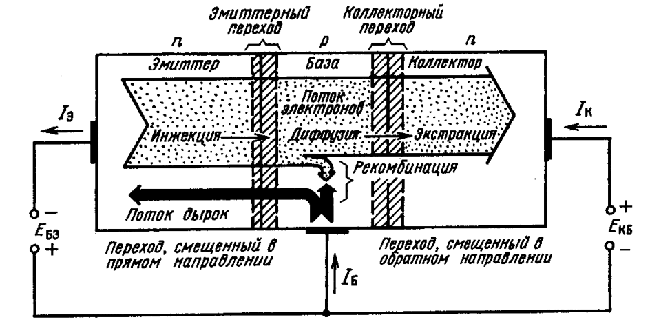

*Рис. 2. Процессы в биполярном транзисторе в нормальном активном режиме работы*

При этом из эмиттера в базу инжектируются электроны, а из базы в эмиттер ‒ дырки. Однако в связи с тем, что эмиттер легирован значительно сильнее базы, поток электронов намного больше потока дырок, и именно он определяет основные процессы, происходящие в транзисторе. Из-за разности концентраций (в бездрейфовых транзисторах) и разности концентраций и наличия внутреннего электрического поля (в дрейфовых транзисторах) электроны движутся к коллектору, стремясь равномерно распределиться по всему объёму базы. Так как толщина базы мала, большинство электронов не успевает рекомбинировать в ней и почти все они достигают коллекторного перехода. Вблизи коллекторного перехода электроны попадают под действие электрического поля этого обратносмещённого перехода (источник питания $E_{\text{БК}}$ подключён минусом к базе). А так как они являются в базе неосновными носителями, то происходит переброс электронов через коллекторный переход в область коллектора (их экстракция). В коллекторе электроны становятся основными носителями зарядов и легко доходят до коллекторного вывода, создавая ток во внешней цепи транзистора. Дрейф электронов через коллекторный переход снижает их концентрацию в той части области базы, которая расположена непосредственно около коллекторного перехода, что создает направленную диффузию инжектируемого эмиттером потока электронов. Всё это приводит к тому, что большинство электронов, инжектированных эмиттером в базу, попадает в область коллектора, но всё-таки небольшая часть их успевает рекомбинировать в области базы. Поэтому коллекторный ток $I_{\text{К}}$ всегда оказывается меньше эмиттерного $I_{\text{Э}}$, а рекомбинация электронов вызывает соответствующий ток во внешней цепи ‒ ток базы $I_{\text{Б}}$.

При количественном анализе процессов, происходящих в биполярном транзисторе, работающем в активном режиме, прежде всего вводят *коэффициент передачи эмиттерного тока* $\alpha_N$, под которым понимают отношение коллекторного тока к эмиттерному

$$
\alpha_N = I_{\text{К}} / I_{\text{Э}}. \tag{1}
$$

Выражение для полного тока коллектора, который является суммой тока, переданного из эмиттера, и обратного тока коллектора, имеет вид

$$
I_{\text{К}} = \alpha_N I_{\text{Э}} - I_{\text{КБ0}} \, [\exp (U_{\text{К}} / \varphi_{\text{т}}) - 1]. \tag{2}
$$

На практике вместо (2) часто пользуются более простым, приближенным выражением. Учитывая, что для биполярных транзисторов рабочим является участок, где $(U_{\text{К}} / \varphi_{\text{т}}) \ll 1$, обратный ток коллекторного перехода практически постоянен и равен $I_{\text{К0}}$, а (2) записывают так

$$
I_{\text{К}} = \alpha_N I_{\text{Э}} + I_{\text{КБ0}}. \tag{3}
$$

Между всеми токами биполярного транзистора существует очевидное соотношение (в соответствии с законом Кирхгофа)

$$
I_{\text{Э}} = I_{\text{К}} + I_{\text{Б}}. \tag{4}
$$

Выражая ток коллектора через ток базы, из (3) и (4) нетрудно получить полный ток коллектора:

$$
\begin{aligned}
I_{\text{К}} &= [\alpha_N / (1 - \alpha_N)] \, I_{\text{Б}} + [1 / (1 - \alpha_N)] \, I_{\text{КБ0}} = \\
&= \beta_N I_{\text{Б}} + (\beta_N + 1) \, I_{\text{КБ0}} = \beta_N I_{\text{Б}} + I_{\text{КЭ0}},
\end{aligned} \tag{5}
$$

$$
\text{где } \beta_N = \alpha_N / (1 - \alpha_N) \approx I_{\text{К}} / I_{\text{Б}} \tag{6}
$$

называют *коэффициентом передачи базового тока*, или *коэффициентом усиления*.

Коэффициенты $\alpha_N$ и $\beta_N$ являются важнейшими физическими параметрами биполярного транзистора, причём $\alpha_N \sim 1$, a $\beta_N \gg 1$. Так, для современных транзисторов $\alpha_N = 0{,}9 \text{ – } 0{,}995$, a $\beta_N = 10 \text{ – } 1000$.

Наиболее полно свойства биполярного транзистора описываются его вольт-амперными характеристиками (ВАХ). Однако, прежде чем рассматривать их, необходимо заметить следующее. Во-первых, биполярный транзистор ‒ «токовый» прибор, так как основные процессы, протекающие в таком транзисторе, определяются его входным током. Поэтому кроме выходных ВАХ для него важны также и входные ВАХ. А в связи с тем, что входные и выходные токи и напряжения транзистора достаточно сильно связаны друг с другом, для полной характеристики транзистора нужно иметь не отдельные характеристики, а семейства ВАХ: входных и выходных. Конечно, при любой схеме включения физические процессы в транзисторе не меняются, но существенно изменяются входные и выходные величины, что и приводит к соответствующим изменениям в семействах ВАХ транзистора.

Различают три **схемы включения** биполярного транзистора: *с общей базой* (ОБ), *с общим эмиттером* (ОЭ) и *с общим коллектором* (ОК). В данной лабораторной работе транзистор включен по схеме с ОЭ.

В *схеме с ОБ* (рис. 3,a) входным током транзистора является ток эмиттера, входным напряжением ‒ напряжение между эмиттером и базой, а входными ВАХ ‒ семейство $I_{\text{Э}} (U_{\text{ЭБ}})$ при $U_{\text{КБ}} = \text{const}$. Выбор напряжения $U_{\text{КБ}}$ в качестве параметра этого семейства ВАХ связан с тем, что в активном режиме на коллекторный переход подаётся обратное напряжение, а в этом случае, при большом изменении напряжения, ток через переход меняется очень мало. Фактически это характеристики эмиттерного перехода, учитывающие влияние второго перехода транзистора ‒ коллекторного. Характеристика с параметром $U_{\text{КБ}} = 0$ является обычной характеристикой p-n-перехода ‒ такой же, как и в диоде (большой прямой ток $I_{\text{Э}}$ при $U_{\text{ЭБ}} < 0$, который сильно зависит от $U_{\text{ЭБ}}$, и малый обратный, почти не изменяющийся ток при $U_{\text{ЭБ}} > 0$). Взаимодействие эмиттерного и коллекторного переходов связано с тем, что изменение $U_{\text{КБ}}$ приводит к изменению ширины коллекторного перехода, а значит, и ширины базы, за счет чего меняется величина тока $I_{\text{Э}}$. При $U_{\text{КБ}} > 0$ ширина базы уменьшается, ток $I_{\text{Э}}$ увеличивается, а кривые $I_{\text{Э}} (U_{\text{ЭБ}})$ сдвигаются влево; при $U_{\text{КБ}} < 0$ эти кривые сдвигаются вправо. Но все входные ВАХ располагаются очень близко друг к другу, что говорит о слабом влиянии коллектора на процессы, протекающие во входной цепи транзистора. Кроме того, входные ВАХ биполярного транзистора обладают существенной нелинейностью, что приводит к значительным искажениям сигналов во входной цепи транзистора (рис. 3,б).

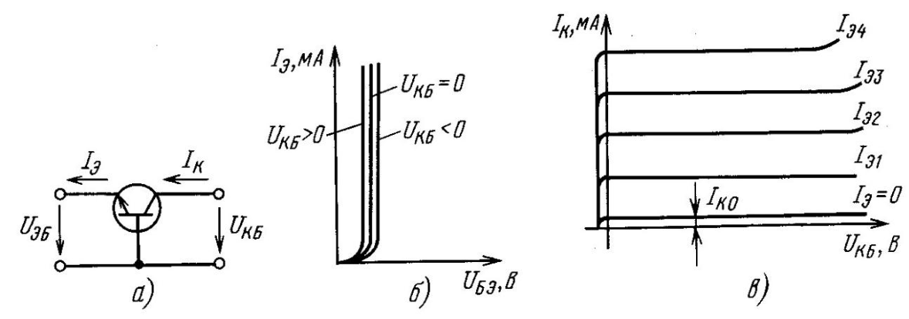

*Рис. 3. Схема включения (а) биполярного транзистора с общей базой и соответствующие входные (б) и выходные (в) вольт-амперные характеристики*

Выходным напряжением транзистора в схеме с ОБ является напряжение между коллектором и базой, выходным током ‒ ток коллектора, а выходными ВАХ ‒ семейство $I_{\text{К}} (U_{\text{КБ}})$ при $I_{\text{Э}} = \text{const}$. (рис. 3,в). Здесь в качестве параметра семейства выходных ВАХ уже выбирают ток $I_{\text{Э}}$. Во время измерений величину $I_{\text{Э}}$ гораздо проще поддерживать постоянной в отличие от $U_{\text{БЭ}}$ , незначительное изменение величины которого вызывает резкий скачок тока $I_{\text{Э}}$. Выходные BAX являются характеристиками коллекторного p-n перехода, в базу которого инжектируются свободные носители заряда. Характеристика этого семейства для $I_{\text{Э}} = 0$ также является обычной BAX p-n перехода. При $U_{\text{КБ}} > 0$ выходным током транзистора является малый обратный ток коллекторного перехода $I_{\text{К0}}$, который определяется собственной электропроводностью полупроводникового кристалла и мало зависит от напряжения на переходе. Поэтому в области $U_{\text{КБ}} > 0$ характеристика $I_{\text{К}} (U_{\text{КБ}})$ при $I_{\text{Э}} = 0$ идёт параллельно оси абсцисс и почти с ней совпадает. При $U_{\text{КБ}} < 0$ ток коллекторного перехода практически спадает до нуля.

При $I_{\text{Э}} > 0$ и $U_{\text{КБ}} > 0$ на величину выходного тока транзистора основное влияние оказывает ток $I_{\text{Э}}$, обусловленный инжекцией электронов через эмиттерный переход, и его изменения приводят к пропорциональному изменению тока коллектора. Поэтому семейство BAX транзистора в схеме с ОБ при $I_{\text{Э}} > 0$ и положительных напряжениях на коллекторе представляет собой ряд прямых, идущих почти параллельно оси абсцисс. В области больших значений $U_{\text{КБ}}$ выходные ВАХ начинают заметно изгибаться, так как напряжение на коллекторном переходе приближается к напряжению пробоя p-n-перехода (рис. 3,в).

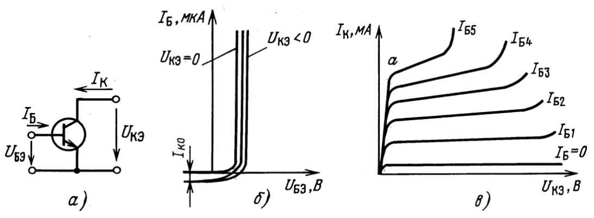

*Рис. 4. Схема включения (а) биполярного транзистора с общим эмиттером и соответствующие входные (б) и выходные (в) ВАХ*

В *схеме с ОЭ* (рис. 4,а) *входные ВАХ транзистора* представляют собой семейство зависимостей тока базы ($I_{\text{Б}}$) от напряжения между базой и эмиттером ($U_{\text{БЭ}}$) при $U_{\text{КЭ}} = \text{const}$ (рис. 4,б).

Выходным током транзистора в схеме с ОЭ является ток коллектора, выходным напряжением ‒ напряжение между коллектором и эмиттером, а выходными ВАХ ‒ семейство $I_{\text{К}} (U_{\text{КЭ}})$ при $I_{\text{Б}} = \text{const}$. В зависимости от соотношений между $U_{\text{КЭ}}$ и $U_{\text{БЭ}}$ режим транзистора меняется. При $U_{\text{КЭ}} < U_{\text{БЭ}}$ и одинаковой полярности напряжений («плюс» на базе и на коллекторе) транзистор находится в режиме двойной инжекции, так как и на эмиттерном, и на коллекторном переходах прямое напряжение. При увеличении $U_{\text{КЭ}}$ напряжение на коллекторном переходе сначала становится равным нулю, а затем (при $U_{\text{КЭ}} > U_{\text{БЭ}}$) оказывается обратным. При этом транзистор переходит в активный режим. В активном режиме выходной ток транзистора в основном определяется током, обусловленным инжекцией электронов из эмиттера, а на семействе выходных ВАХ наблюдаются пологие участки (рис. 4,в). «Эти участки семейства выходных ВАХ транзистора в схеме с ОЭ имеют гораздо больший и неодинаковый наклон по сравнению со схемой с ОБ. Наклон характеристик вызван тем, что при увеличении напряжения $U_{\text{КЭ}}$ , а следовательно, и $U_{\text{КБ}}$ , увеличивается толщина обеднённого слоя перехода база‒коллектор, уменьшается толщина слоя базы и, соответственно возрастает коэффициент передачи тока базы. Этот эффект называется эффектом Эрли. Эффектом Эрли объясняется также сдвиг входных ВАХ (рис. 4,б) вправо при $U_{\text{КЭ}} > 0$ . Одновременно с уменьшением толщины слоя базы уменьшается ее объем, а следовательно, и ток рекомбинации в базе.

## 1.2.3. Схемотехнические (SPICE) модели биполярного транзистора

Для анализа электронных схем необходимо иметь *модель* каждого элемента схемы с соответствующими *параметрами*. Для биполярного транзистора такими моделям являются, например, модели Эберса-Молла (рис. 5,а) и зарядоуправляемая модель Гуммеля‒Пуна (рис. 5,б). Модель Эберса-Молла преимущественно используется для предварительного (оценочного) ручного расчёта, в то время как модель Гуммеля‒Пуна включена во все SPICE-подобные программы схемотехнического анализа.

### 1.2.3.1. Модель Эберса‒Молла

Простая и удобная для простых расчётов физическая модель биполярного транзистора предложена Дж. Дж. Эберсом и Дж. Л. Моллом в 1954 г. Её эквивалентная схема в статическом режиме для п-р-п транзистора имеет вид, показанный на рис. 5,а.

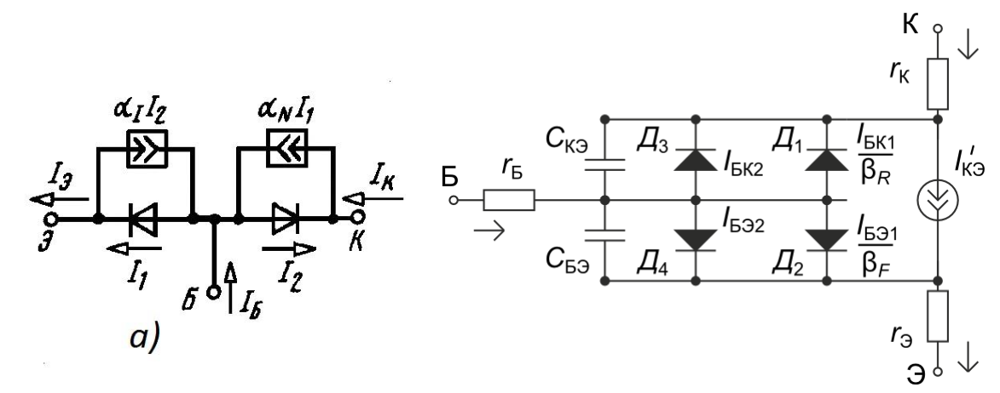

*Рис. 5. Схемотехнические модели биполярного транзистора: Эберса‒Молла (а) и Гуммеля‒Пуна (б)*

В модели Эберса‒Молла p-п переходы транзистора представлены диодами, а их взаимодействие отражается управляемыми источниками тока. При нормальном включении транзистора (индексы N) с помощью источника тока $a_N I_1$ учитывается влияние тока $I_1$, проходящего через эмиттерный переход, на цепь коллектора. При инверсном включении (индексы I) влияние тока $I_2$, проходящего через коллекторный переход, на цепь эмиттера учитывается с помощью источника тока $\alpha_I I_2$. Диоды описываются ВАХ неидеального р-п перехода:

$$
I_1 = I_{\text{Э0}}' \, [\exp \left( \frac{U_{\text{БЭ}}}{m_{\text{Э}} \varphi_T} \right) - 1], \quad I_2 = I_{\text{К0}}' \, [\exp \left( \frac{U_{\text{БК}}}{m_{\text{К}} \varphi_T} \right) - 1], \tag{7}
$$

где $m_{\text{э}}, m_{\text{к}} > 1$

$$
I_{\text{К0}}' = I_{\text{К0}} / (1 - \alpha_N \alpha_I), \quad I_{\text{Э0}}' = I_{\text{Э0}} / (1 - \alpha_N \alpha_I). \tag{8}
$$

$$
\text{Так как } I_{\text{Э}} = I_1 - \alpha_I I_2, \text{ и } I_{\text{К}} = \alpha_N I_1 - I_2, \tag{9}
$$

то в модели Эберса‒Молла выражения для эмиттерного и коллекторного токов транзистора имеют вид:

$$
I_{\text{Э}} = \frac{I_{\text{Э0}} \left( \exp \dfrac{U_{\text{БЭ}}}{m_{\text{Э}} \varphi_T} - 1 \right) - \alpha_I I_{\text{К0}} \left( \exp \dfrac{U_{\text{БК}}}{m_{\text{К}} \varphi_T} - 1 \right)}{1 - \alpha_N \alpha_I}, \tag{10}
$$

$$
I_{\text{К}} = \frac{I_{\text{К0}} \left( \exp \dfrac{U_{\text{БК}}}{m_{\text{К}} \varphi_T} - 1 \right) - \alpha_N I_{\text{Э0}} \left( \exp \dfrac{U_{\text{БЭ}}}{m_{\text{Э}} \varphi_T} - 1 \right)}{1 - \alpha_N \alpha_I} \tag{11}
$$

$$
I_{\text{Б}} = I_{\text{Э}} - I_{\text{К}}. \tag{12}
$$

Выражения (10) и (11) представляют собой соответственно уравнения семейства входных и выходных ВАХ биполярного транзистора в схеме с ОБ. Их называют формулами Эберса‒Молла, и они с достаточной степенью точности отражают базовые процессы в биполярном транзисторе. Однако уравнения (10), (11) описывают лишь идеализированные ВАХ транзистора, так как в модели не учитывается ряд факторов, имеющих место в реальных транзисторах. К числу таковых относятся, например, внутренняя обратная связь, пробой р-п перехода, зависимость $\alpha$ от тока, эффект Эрли.

Модель Эберса‒Молла справедлива для всех четырех областей работы транзистора: отсечки, двойной инжекции, нормальной активной и инверсной активной. При моделировании работы транзистора в области двойной инжекции транзистор в первом приближении можно заменить коротким замыканием, а в области отсечки ‒ разрывом.

### 1.2.3.2. Модель Гуммеля‒Пуна

Как видно из рисунка 5,б, модель Гуммеля‒Пуна включает в себя:

- два диода, отображающие переходы база‒эмиттер и база‒коллектор;
- генератор тока $I_{\text{КЭ}}$, описывающий передачу тока от эмиттера к коллектору и наоборот;
- емкости переходов база‒эмиттер и база‒коллектор, включающие барьерную и диффузионную составляющие;
- сопротивления областей базы, эмиттера и коллектора.

Основным элементом модели является источник передаточного тока $I'_{\text{КЭ}}$:

$$
I'_{\text{КЭ}} = \frac{I_{\text{БЭ1}} - I_{\text{БК1}}}{K_{QB}}, \tag{13}
$$

где $I_{\text{БЭ1}}$, $I_{\text{БК1}}$ – токи инжекции эмиттерного и коллекторного переходов, а $K_{QB}$ – коэффициент, учитывающий заряд в базе.

$$
I_{\text{БЭ1}} = I_S \left[ \exp \left( \frac{U_{\text{БЭ}}}{n_F \varphi_T} \right) - 1 \right], \quad I_{\text{БК1}} = I_S \left[ \exp \left( \frac{U_{\text{БК}}}{n_R \varphi_T} \right) - 1 \right] \tag{14}
$$

$$
K_{QB} = \frac{K_{Q1}}{2} + \sqrt{\left( \frac{K_{Q1}}{2} \right)^2 + K_{Q2}}, \tag{15}
$$

где $I_S$ – обратный ток насыщения, $K_{Q1}$ – коэффициент для учёта эффекта Эрли, $K_{Q2}$ – коэффициент для учёта эффекта высокого уровня инжекции:

$$
K_{Q1} = 1 + \frac{U_{\text{БЭ}}}{V_{AR}} + \frac{U_{\text{БК}}}{V_{AF}} \quad \text{и} \quad K_{Q2} = \frac{I_{\text{БЭ1}}}{I_{KF}} + \frac{I_{\text{БК1}}}{I_{KR}}. \tag{16}
$$

Здесь $n_F$ и $n_R$ – коэффициенты неидеальности в прямом и инверсном включении транзистора соответственно;

$\varphi_T = kT/q$ – тепловой потенциал, $\varphi_T = 0{,}026$ при $t=27^{\circ}\,\text{С}$;

$I_{KF}$ и $I_{KR}$ – точки на графиках $\beta_F (I_{\text{К}})$ и $\beta_R (I_{\text{Э}})$ соответственно, определяющие спад $\beta$ на границе области высокого уровня инжекции;

$V_{AF}$ и $V_{AR}$ – напряжение Эрли в прямом и инверсном включении;

Пара диодов Д1 и Д2 задаёт токи рекомбинации в базе:

$$
I_{\text{Д1}} = \frac{I_{\text{БК1}}}{\beta_R} \quad \text{и} \quad I_{\text{Д2}} = \frac{I_{\text{БЭ1}}}{\beta_F}, \tag{17}
$$

где $\beta_F$ , $\beta_R$ – коэффициенты усиления в активном и инверсном режимах.

Пара диодов Д3 и Д4 задаёт токи генерации и рекомбинации в обеднённых областях p-n-переходов и на поверхности базы (отражают эффекты низкого уровня инжекции):

$$
I_{\text{Д3}} = I_{\text{БК2}} = I_{S\text{К}} \left[ \exp \left( \frac{U_{\text{БК}}}{n_c \varphi_T} \right) - 1 \right] \quad \text{и} \quad I_{\text{Д4}} = I_{\text{БЭ2}} = I_{S\text{Э}} \left[ \exp \left( \frac{U_{\text{БЭ}}}{n_e \varphi_T} \right) - 1 \right], \tag{18}
$$

где $I_{S\text{Э}}$, $I_{S\text{К}}$ – обратные токи насыщения при низком уровне инжекции; $n_e$, $n_c$ – коэффициенты неидеальности при низком уровне инжекции в прямом и инверсном включении.

В составе модели присутствуют элементы $r_{\text{Э}}$, $r_{\text{Б}}$, $r_{\text{К}}$, учитывающие сопротивления областей Э, Б, К, а также элементы $C_{\text{БК}}$, $C_{\text{БЭ}}$, являющиеся суммами барьерной и диффузионной составляющих ёмкостей p-n-переходов:

$$
C_{\xi,\text{бар}} = \frac{C_{\xi,\text{бар0}}}{\left( 1 - \dfrac{U_{\xi}}{\phi_{\xi}} \right)^{\theta}}, \quad C_{\xi,\text{диф}} = \frac{\tau_{\xi} I_{\xi}}{m_{\xi} \varphi_T},
$$

где $\xi$ – Э или К.

## 1.2.4. Методика определения основных параметров модели Гуммеля‒Пуна биполярного транзистора

### 1.2.4.1. Введение

Основными параметрами модели Гуммеля‒Пуна, определяемыми в лабораторной работе, являются:

- is ‒ ток насыщения (А);
- nf ‒ коэффициент неидеальности в прямом включении;
- bf ‒ коэффициент усиления тока базы в прямом включении;
- vaf ‒ напряжение Эрли в прямом включении (В);
- rb ‒ сопротивление базы транзистора (Ом);
- rс ‒ сопротивление коллектора транзистора (Ом);

Процедура определения (или, как ещё говорят, идентификации, или экстракции) параметров модели включает два основных этапа: 1) расчёт приближённых значений параметров по простым формулам (см. п. 1.2.4.2); 2) подгонка значений параметров для наилучшего совпадения измеренных вольт-амперных характеристик и таких же характеристик, смоделированных в SPICE-симуляторе с помощью полученной модели (см. п. 1.2.4.3) (второй этап является итерационным).

### 1.2.4.2. Процедуры расчёта начальных значений основных параметров модели

#### а) Расчёт начального значения сопротивления коллектора RC

Используются выходные вольт-амперные характеристики транзистора $I_{\text{К}} = f(U_{\text{КЭ}})$, измеренные по схеме рис. 11. Метод основан на том, что в области двойной инжекции наклон ВАХ определяется величиной коллекторного сопротивления (рис. 6,б). На линии ВАХ, соответствующей наибольшему значению тока базы на крутом участке (т. е. в режиме двойной инжекции) выбирается достаточно прямой участок с наибольшим коэффициентом наклона и берётся приращение напряжения $\Delta U_1$ и приращение тока коллектора $\Delta I_1$ на этом участке. Рассчитывается сопротивление коллектора:

$$
\mathit{RC} = \frac{\Delta U_1}{\Delta I_1} \tag{19}
$$

#### б) Расчёт начального значения напряжения Эрли VAF

Используются выходные вольт-амперные характеристики. Метод основан на том, что в пологой области выходных ВАХ наклон вызван эффектом Эрли. На линии ВАХ, соответствующей наибольшему или среднему значению тока базы $I^{*}_{\text{Б}}$, на пологом участке выбирается достаточно прямой участок (рис. 6,б). От начальной точки этого участка с координатами $(U_1, I_1)$ берётся приращение напряжения коллектора $\Delta U_2$ и тока коллектора $\Delta I_2$. Рассчитывается величина VAF:

$$
\mathit{VAF} = \frac{\Delta U_2}{\Delta I_2} \cdot I_1 - U_1. \tag{20}
$$

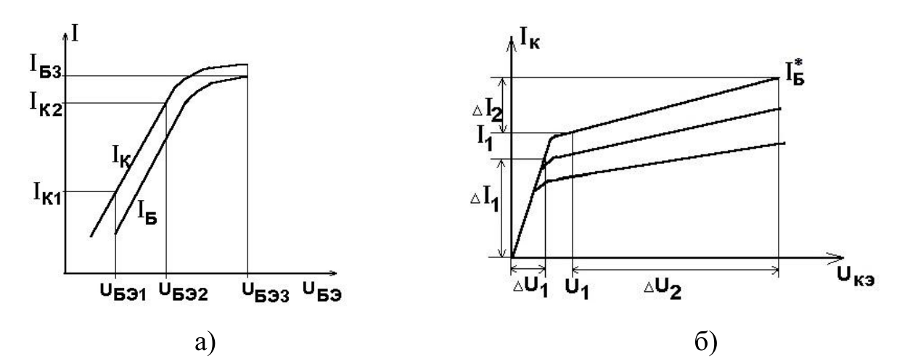

*Рис. 6. Обработка результатов измерения входных (а) и выходных (б) ВАХ биполярного транзистора*

#### в) Расчёт начальных значений коэффициентов IS, NF

Используются вольт-амперные характеристики $I_{\text{К}} = f(U_{\text{БЭ}})$, $I_{\text{Б}} = f(U_{\text{БЭ}})$, измеренные по схеме рис. 11 и построенные в полулогарифмическом масштабе (логарифмический масштаб используется для оси токов). Для расчёта параметров Is, nf выбирается участок $I_{\text{К}} = f(U_{\text{БЭ}})$, на котором зависимость тока от напряжения является экспоненциальной (ещё нет влияния сопротивлений). На графике 6,а, построенном в полулогарифмическом масштабе, это линейный участок с наибольшим коэффициентом наклона. На этом участке выбираются две точки, достаточно далеко отстоящие одна от другой. Используя (14), можно выразить ток коллектора для этих точек:

$$
I_{\text{К1}} \approx \mathrm{Is} \; (\exp \left( \frac{U_{\text{БЭ1}}}{\mathrm{nf} \cdot \varphi_T} \right) - 1) \tag{21}
$$

$$
I_{\text{К2}} \approx \mathrm{Is} \; (\exp \left( \frac{U_{\text{БЭ2}}}{\mathrm{nf} \cdot \varphi_T} \right) - 1) \tag{22}
$$

Чтобы найти Is и nf, выражения (21), (22) логарифмируются и составляется система уравнений для этих двух точек. Принимая при комнатной температуре $\varphi_T=0{,}026$ В:

$$
U_{\text{БЭ1}} = \mathrm{nf} \cdot 0{,}026 \ln \left( \frac{I_{\text{К1}}}{\mathit{Is}} \right), \tag{23}
$$

$$
U_{\text{БЭ2}} = \mathrm{nf} \cdot 0{,}026 \ln \left( \frac{I_{\text{К2}}}{\mathit{Is}} \right). \tag{24}
$$

При совместном решении этих двух уравнений определяются Is и nf (Is должен иметь значение в пределах от $10^{-15}$ до $10^{-19}$ А; nf должен быть немного больше единицы). Для решения системы рекомендуется использовать программу математического расчёта.

#### г) Расчёт начального значения сопротивления базы RB

Используются входные ВАХ транзистора $I_{\text{Б}} = f(U_{\text{БЭ}})$, измеренные по схеме рис. 11. Для достаточно больших значений прямого напряжения между базой и эмиттером зависимость тока от напряжения отклоняется от экпоненциальной вследствие падения напряжения, прежде всего, на сопротивлении базы (рис. 6,а). В этом случае напряжение между базой и эмиттером складывается из напряжения на p-n-переходе и напряжения на сопротивлении rb. Для точки с какими-либо координатами $(U_{\text{БЭ3}}, I_{\text{Б3}})$, выбранной на участке, где заметно отклонение графика от экспоненциального, можно записать:

$$
U_{\text{БЭ3}} = \mathrm{nf} \cdot 0{,}026 \ln \left( \frac{I_{\text{К3}}}{\mathit{Is}} + 1 \right) + I_{\text{Б3}} \, \mathrm{rb}. \tag{25}
$$

С использованием значений Is и nf, определенных на предыдущем этапе, из уравнения (24) определяется rb.

#### д) Расчёт начального значения коэффициента усиления по току BF

Используются ВАХ транзистора (рис. 6,а). Bf приближённо определяется как максимальное значение отношения тока коллектора к току базы (во всём диапазоне измеренных значений токов):

$$
\mathrm{Bf} = \max \, (I_{\text{К}} / I_{\text{Б}}) \tag{26}
$$

### 1.2.4.3. Процедура подгонки параметров SPICE-модели с помощью программы моделирования схем

Цель данного этапа ‒ более точно определить значения параметров SPICE-модели биполярного транзистора, так чтобы, будучи построенными в одних осях, графики вольт-амперных характеристик, измеренных в ходе выполнения лабораторной работы и смоделированных с помощью полученной SPICE-модели, были максимально близки друг к другу.

Процедуры данного этапа выполняются с помощью программы LTSpice [2].

Алгоритм выполнения задачи данного этапа состоит в том, чтобы:

1. воспроизвести в схемотехническом редакторе лабораторную схему измерения, использовав в качестве начальных значений параметров модели значения, рассчитанные по формулам п. 1.2.4.2;
2. ввести в схему фиктивные источники тока, содержащие данные о результатах измерения ВАХ;
3. промоделировать схему с имеющимися параметрами модели;
4. сопоставить в общих осях графики измеренных и смоделированных ВАХ; в случае несовпадения изменить параметры модели и вернуться к п. 3.

#### а) Построение схемы для моделирования

Для моделирования в программе‒симуляторе электрических схем воспроизводится схема, соответствующая результатам измерения. В ходе лабораторной работы непосредственно измерялись напряжения и токи выводов транзистора (точки 3 и 8 лабораторного стенда, рис. 10) и не фиксировались значения источников питания (точки 4 и 6), следовательно: 1) схема для виртуального опыта не содержит ограничительные сопротивления; 2) источники питания Vc и Vb/Ib подключаются непосредственно к выводам объекта исследования – транзистора; 3) значения источников Vc и Vb/Ib соответствуют измеренным значениям напряжений и токов на выводах транзистора.

Схемы для моделирования входной и выходной характеристик отличаются: для входной характеристики задаётся напряжение базы (используется источник напряжения Vb), а для выходной характеристики задаётся ток базы (используется источник тока Ib).

Примерные схемы, построенные в соответствии с вышеизложенным, приведены на рис. 7.

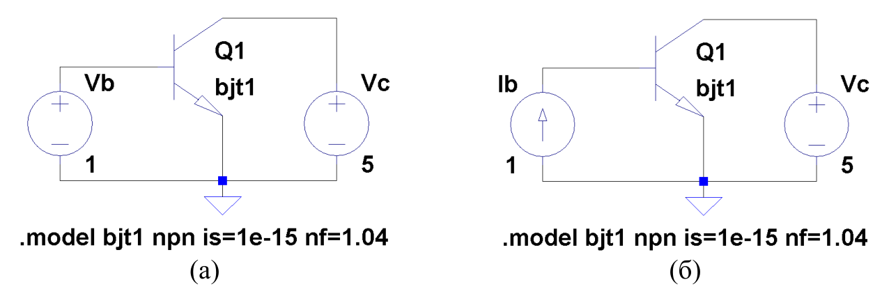

*Рис. 7. Схемы, заланные в программе схемотехнического моделирования для расчёта входных (а) и выходных (б) ВАХ биполярного транзистора*

Для задания модели транзистора используется кнопка «SPICE directive» панели инструментов программы. В открывшемся окне вводится директива model в формате:

```
.model <имя> <тип> [<параметр1>=<значение1>,…]
```

где `<имя>` – имя модели в формате `[_A-Za-z][_A-Za-z0-9]*`, `<тип>` – тип модели, для биполярного транзистора это может быть “npn” или “pnp”, `<параметр>` – имя параметра модели из списка допустимых параметров (см. справку к программе), `<значение>` – значение параметра модели в виде простого числа (с точкой), либо записанное в инженерном формате (например, `2.5e-12` = $2{,}5 \cdot 10^{-12}$), либо записанное с суффиксом (например, `2.5p` = $2{,}5 \cdot 10^{-12}$).

На данном этапе в модель следует ввести параметры, рассчитанные по формулам п. 1.2.4.2, например:

```
.model kt315 NPN(Is=1e-14 Bf=100 Vaf=70 Nf=1.1 Rb=76 Rc=35)
```

После нажатия кнопки OK следует поместить текст модели на любое свободное место рабочего поля программы. Имя модели следует добавить к свойствам конкретного экземпляра транзистора: навести мышь на слово NPN рядом с транзистором (в строке состояния при этом должно содержаться слово “Value”), щёлкнуть на нём правой кнопкой мыши и ввести имя модели.

#### б) Отображение на графиках экспериментальных данных

Для того, чтобы иметь возможность в одних и тех же осях сравнивать графики измеренных и смоделированных ВАХ, в схему необходимо ввести фиктивные источники питания, выдающие при моделировании измеренные значения.

Наборы зависимых источников при моделировании входной и выходной характеристик различаются: при моделировании входной ВАХ основным аргументом функции является напряжение базы, а снимается одна линия тока базы и одна линия тока коллектора; при моделировании выходной ВАХ основным аргументом функции является напряжение коллектора, а снимаются три линии тока коллектора.

Соответственно, при подготовке электрической схемы для моделирования входных характеристик к источнику напряжения базы (аргументу) подключаются два источника тока: один воспроизводит $I_{\text{Б}} = f(U_{\text{БЭ}})$, другой воспроизводит $I_{\text{К}} = f(U_{\text{БЭ}})$; для моделирования выходных характеристик к источнику напряжения коллектора (аргументу) подключаются три источника тока, соответствующие трём линиям семейства $I_{\text{К}} = f(U_{\text{КЭ}})$.

Для того, чтобы задать значение источника в виде набора точек, следует щёлкнуть правой клавишей мыши на изображении источника, нажать кнопку Advanced, в открывшемся окне выбрать пункт “TABLE (v1 i1 v2 i2)”, вписать значения 0 и 0 в поля voltage1 и value1, нажать кнопку OK и поместить получившуюся строчку “TBL(0 0)” на любое свободное место рабочего поля программы. Внутрь скобок вместо значений “0 0” далее следует вписать результаты своих измерений в виде `<U1 I1 U2 I2>` и т. д.

Для того, чтобы представить результаты измерений в таком виде, можно использовать следующую процедуру (см. рис. 8): 1) вставить таблицу с данными, соответствующими одной линии, в текстовый редактор (Блокнот, Word, Writer и т. п.), 2) преобразовать данные из табличного вида в строковый (при необходимости), 3) провести автозамену символов конца строки на пробелы. Получившаяся строка готова для вставки в команду TBL.

Примерные фрагменты схем, содержащих фиктивные источники для вывода измеренных значений, показаны на рис. 9.

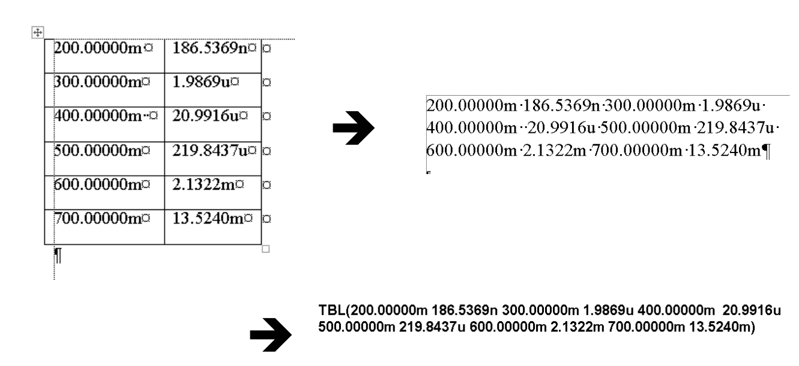

*Рис. 8. Порядок преобразования данных измерений для вставки на рабочий лист программы*

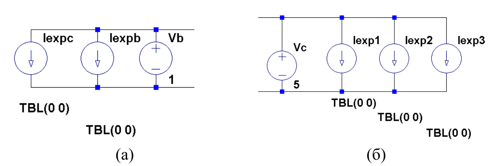

*Рис. 9. Фрагменты схем для подключения результатов измерения при моделировании входных (а) и выходных (б) ВАХ*

#### в) Моделирование схемы

*Указания.* Виртуальный опыт в программе схемотехнического моделирования должен воспроизводить опыт в реальной лаборатории. С этой целью значения источников питания, подключённых к выводам транзистора, должны соответствовать задаваемым в процессе реального опыта.

При моделировании входных ВАХ необходимо задать постоянное значение источника напряжения коллектора 5 В. Для этого нужно щёлкнуть правой клавишей мыши по изображению источника и ввести значение в поле “DC value”. Напряжение же источника базы должно изменяться примерно в диапазоне от 0,3 до 0,7 В с мелким шагом (порядка 0,01 В).

При моделировании выходных ВАХ напряжение источника коллектора должно изменяться примерно в диапазоне от 0 до 5 В с мелким шагом (порядка 0,01 В), а ток источника базы должен последовательно принять три фиксированных значения: 30, 50, 70 мкА.

*Для ввода команды на изменение значений источников* следует вызвать пункт меню Simulation ‒ Edit Simulation Cmd. В открывшемся окне следует выбрать вкладку “DC sweep”, где в поле “source name” ввести имя источника, а в поля “start value”, “stop value”, “increment” ввести начальное, конечное значение и шаг изменения источника. При вводе значений в поля окна в его нижней части автоматически формируется команда, которую после нажатия кнопки OK следует поместить на любое свободное место рабочего листа программы. Аналогичную команду можно набрать и вручную, воспользовавшись кнопкой “SPICE directive” панели инструментов. Формат команды:

```
.dc <ист1> <start1> <stop1> <step1>
+ <ист2> <start2> <stop2>  <step2>,
```

где *ист1, ист2* – имена источников, *start1, start2* – начальные значения источников, *stop1, stop2* – конечные значения источников, *step1, step2* – шаги изменения значений источников; символ «+» использован для перехода на новую строку.

*Для запуска моделирования* следует вызвать пункт меню Simulation ‒ Run или нажать на кнопку Run панели инструментов. При отсутствии ошибок моделирования открывается пустое поле для построения графиков.

*Для вывода графиков* по результатам компьютерного расчёта следует щёлкнуть правой кнопкой мыши на пустом поле, выбрать пункт “Add Traces” и в открывшемся окне выбрать те величины, которые следует построить.

#### г) Подгонка параметров

Операция подгонки параметров модели биполярного транзистора заключается в следующем: по результатам моделирования электрической схемы сравниваются графики ВАХ: измеренные и рассчитанные. В случае их несовпадения изменяются какие-либо параметры модели и моделирование запускается заново.

Порядок, в котором следует изменять параметры, следующий:

1. По выходным ВАХ в крутой области определяется значение сопротивления коллектора RC, которое здесь играет роль коэффициента наклона. На этом этапе следует обращать внимание только на наклон линий в крутой области.
2. По выходным ВАХ в пологой области определяется значение напряжения Эрли VAF, который здесь играет роль коэффициента наклона. На этом этапе следует обращать внимание только на наклон линий в пологой области.
3. По линии тока коллектора из состава входных ВАХ, построенных в полулогарифмическом масштабе, на линейном участке определяются параметры IS и NF, причём IS играет роль масштабного коэффициента, а NF – коэффициента наклона.
4. При моделировании входных ВАХ дополнительно строится отношение тока коллектора к току базы $I_{\text{К}} / I_{\text{Б}} (U_{\text{БЭ}})$. По этому графику определяются значения коэффициентов BF и IKF, причём BF примерно соответствует максимальному значению $I_{\text{К}} / I_{\text{Б}}$, а IKF равен значению тока коллектора, при котором отношение $I_{\text{К}} / I_{\text{Б}}$ падает в два раза по сравнению с максимальным значением. Значение BF нужно дополнительно проконтролировать по расстоянию между линиями $I_{\text{К}}$ и $I_{\text{Б}}$ на линейном участке входных ВАХ.
5. По входным ВАХ, построенным в полулогарифмическом масштабе, в диапазоне правее линейного участка определяются значения сопротивления базы RB и эмиттера RE.

## 1.2.5. Описание макетной платы

Работа выполняется на макетной плате (рис. 10). Макетная плата предназначена для упрощения соединения компонентов схемы между собой. На ней расположены отверстия для вставки ножек компонентов или проводов – некоторые отверстия внутри платы уже связаны между собой и тогда дополнительно связывать их не нужно.

Сверху и снизу проведены линии для подключения питания – плюс и минус источника питания нужно с помощью проводов подключить к этим отверстиям.

Исследуемая цепь собирается на основе внешних приборов и устройств: двух вольтметров, двух амперметров, двух регулируемых источников постоянного напряжения, одного биполярного транзистора VT1 и двух внешних сопротивлений Rб и Rк (см. рис. 11). Внешние сопротивления цепей базы Rб и коллектора Rк включены в схему измерения для ограничения тока и предупреждения повреждения транзистора и источников питания.

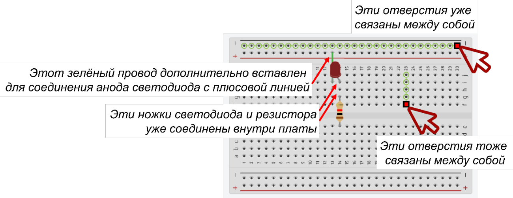

*Рис. 10. Макетная плата для сборки схемы*

## 1.2.6. Задание для работы в лаборатории

### 1.2.6.1. Проведение измерений входных вольт-амперных характеристик

1. Снять входные вольт-амперные характеристики транзистора $I_{\text{Б}} = f(U_{\text{БЭ}})$ и $I_{\text{К}} = f(U_{\text{БЭ}})$ по схеме рис. 11 (10‒15 точек) при постоянном напряжении на коллекторе 5 В. Результаты измерений занести в таблицу 1.

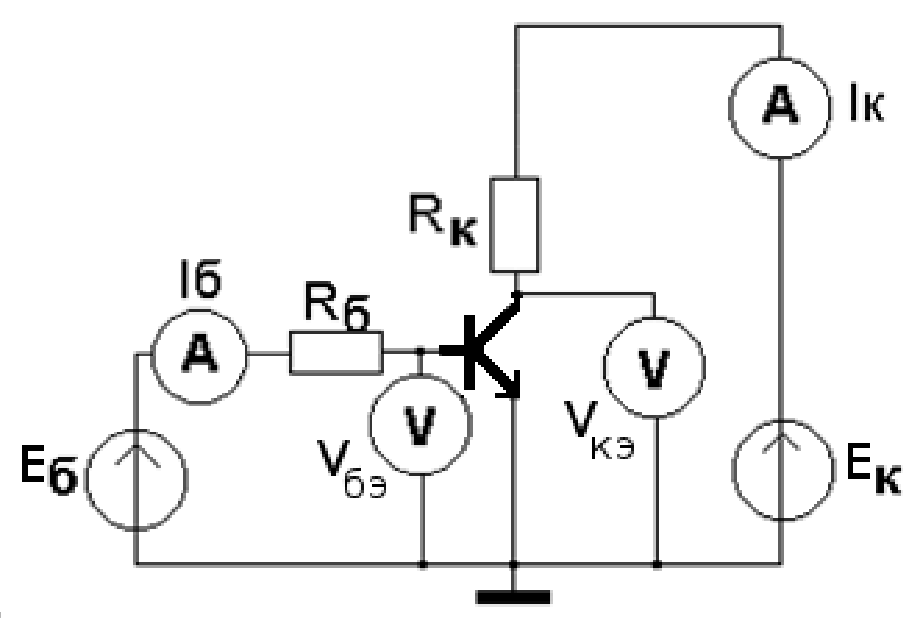

*Рис. 11. Схема измерения входных и выходных ВАХ БТ*

**Табл. 1**

| $U_{\text{БЭ}}$ |  |  |  |
|---|---|---|---|
| $I_{\text{Б}}$ |  |  |  |
| $I_{\text{К}}$ |  |  |  |

*Указания.*

*А. К определению первой точки характеристики.* Начинать измерение рекомендуется с правой стороны графика, т. е. с бо́льших значений тока.

В схеме измерения ВАХ биполярного транзистора источники напряжения подключаются к базе и коллектору через токоограничительные сопротивления, следовательно: i) напряжения базы и коллектора всегда ниже, чем выходные напряжения источников; ii) при повышении напряжения базы напряжение коллектора снижается (из-за возрастания тока коллектора и, как следствие, напряжения на сопротивлении Rк).

Таким образом, при слишком большом напряжении базы оказывается невозможным установить требуемое постоянное напряжение коллектора. В этой ситуации необходимо снижать напряжение базы до тех пор, пока напряжение коллектора не поднимется до требуемого значения.

*Б) К определению остальных точек характеристики.* Для входных ВАХ биполярного транзистора характерна экспоненциальная зависимость от приложенного напряжения базы, что означает *резкий* рост тока при увеличении напряжения базы. В этих условиях первые несколько точек должны находиться очень близко друг к другу – на расстоянии 1—3 мВ, – что нормально для этого участка характеристики. Значение напряжения коллектора при снятии, по крайней мере, первых нескольких точек, необходимо каждый раз возвращать к заданному уровню, если оно изменяется (как говорят, «уплывает», или «уходит»).

Пройдя участок резкого падения тока, можно прекратить тщательный контроль тока коллектора и заметно увеличить шаг изменения напряжения базы (вплоть до 0,1 В).

2. По результатам измерений построить графики характеристик $I_{\text{Б}} = f(U_{\text{БЭ}})$ и $I_{\text{К}} = f(U_{\text{БЭ}})$ на одном поле в полулогарифмическом масштабе (логарифмический масштаб по оси токов), а также график $I_{\text{К}} / I_{\text{Б}} = f(U_{\text{БЭ}})$ на отдельном поле.

*Указания.* В программах наподобие Microsoft Excel, OpenOffice Calc и т. п. следует выбирать тип графика «точечный», а не «график», что подходит к графикам физических величин (даёт равномерный шаг по осям).

### 1.2.6.2. Проведение измерений выходных вольт-амперных характеристик

1. Снять три линии выходных вольт-амперных характеристик $I_{\text{К}} = f(U_{\text{КЭ}})$ транзистора по схеме, изображённой на рис. 11 (8‒10 точек в крутой области и переходе к пологой области и 5‒7 точек в пологой области), поддерживая в каждой точке постоянное значение тока базы: 30, 50, 70 мкА. Результаты измерений занести в таблицу 2.

**Табл. 2**

$I_{\text{Б}} = 30$ мкА

| $U_{\text{КЭ}}$ |  |  |  |
|---|---|---|---|
| $I_{\text{К}}$ |  |  |  |

$I_{\text{Б}} = 50$ мкА

| $U_{\text{КЭ}}$ |  |  |  |
|---|---|---|---|
| $I_{\text{К}}$ |  |  |  |

$I_{\text{Б}} = 70$ мкА

| $U_{\text{КЭ}}$ |  |  |  |
|---|---|---|---|
| $I_{\text{К}}$ |  |  |  |

*Указания.* Задавать ток базы следует меняя напряжение источника базы, контролируя ток с помощью амперметра.

Особенность этого этапа в том, что вначале транзистор находится в пологой области характеристики, и здесь можно использовать большие значения шага изменения напряжения коллектора (вплоть до 1 В). Однако, при наметившемся переходе в крутую область следует существенно уменьшить шаг (до 0,1 В и меньше).

При снятии нескольких первых точек возможен уход значения тока базы, так что перед занесением значений в таблицу его необходимо возвращать к заданному уровню.

2. По результатам измерений построить графики характеристик $I_{\text{К}} = f(U_{\text{КЭ}})$ на одном поле и в линейном масштабе.

*Указания.* В программах наподобие Microsoft Excel, OpenOffice Calc и т. п. следует выбирать тип графика «точечный», а не «график», что подходит к графикам физических величин (даёт равномерный шаг по осям).

## 1.2.7. Задание для работы с программой SPICE-моделирования

1. Рассчитать начальные значения параметров модели Гуммеля‒Пуна в соответствии с процедурой п. 1.2.4.2.
2. Построить в программе моделирования схемы для расчёта входных и выходных ВАХ биполярного транзистора в соответствии с процедурой п. 1.2.4.3; внедрить в схемы описание модели транзистора, использовав значения, полученные в предыдущем пункте; внедрить в схемы фиктивные источники для отображения результатов измерения.
3. Подогнать параметры модели в соответствии с процедурой п. 1.2.4.3,г; добиться максимального совпадения измеренных и смоделированных входных и выходных ВАХ.
4. Построить графики входных и выходных ВАХ, на которых совмещены результаты измерений и компьютерного моделирования.

*Указания.* Линии графиков и числа по осям должны быть хорошо различимы; рекомендуется использовать тёмные линии на светлом фоне.

## 1.2.8. Подготовка отчёта

Отчёт должен содержать следующие части:

1. титульный лист;
2. оглавление;
3. цель работы;
4. теоретическое введение;
5. схемы измерений;
6. таблицы с результатами измерений;
7. графики, построенные по результатам измерений;
8. ход и результаты вычисления предварительных значений параметров модели Гуммеля‒Пуна по результатам измерений;
9. схемы для компьютерного расчёта входных и выходных ВАХ из программы моделирования; должны быть различимы параметры модели;
10. графики входных и выходных ВАХ, на которых совмещены результаты измерений и компьютерного моделирования;

*Указания.* Страницы отчёта должны быть пронумерованы. Части отчёта должны иметь нумерованные заголовки. Линии графиков и значения по осям должны быть хорошо различимы; рекомендуется использовать тёмные линии на светлом фоне.

## 1.2.9. Контрольные вопросы

1. Структура и принцип работы биполярного транзистора.
2. Режимы работы транзистора.
3. Схемы включения транзистора, ВАХ.
4. Схемотехнические модели биполярного транзистора.
5. Методика определения параметров схемотехнической модели биполярного транзистора.

## 1.2.10. Рекомендуемая литература

1. Новожилов О. П. Электротехника и электроника: учебник (серия Бакалавр. Базовый курс). – М.: Юрайт, 2016. – 654 с.
2. О. В. Миловзоров, И. Г. Панков, Основы электроники. Учебник. – М.: Юрайт, 2016. – 407 с.
3. Сохор Ю.Н. Моделирование устройств в пакете LTspice. – Псков: ППИ, 2008.
4. P. Antognetti, G. Massobrio. Semiconductor device modeling with SPICE,- McGraw-Hill, 1988.
