# Лабораторная работа 1.3. Изучение статических характеристик МОП-транзистора и определение основных параметров его модели для расчёта схем

## Содержание

- 1.3. Изучение статических характеристик МОП-транзистора и определение основных параметров его модели для расчёта схем
  - 1.3.1. Цели работы
  - 1.3.2. Краткие теоретические сведения
  - 1.3.3. Схемотехническая (SPICE) модель МОПТ
  - 1.3.4. Методика определения основных параметров модели МОПТ level = 1 в программе SPICE
  - 1.3.5. Описание лабораторного стенда
  - 1.3.6. Задание для работы в лаборатории
  - 1.3.7. Задание для работы с программой SPICE-моделирования
  - 1.3.8. Подготовка отчёта
  - 1.3.9. Контрольные вопросы
  - 1.3.10. Рекомендуемая литература

## 1.3.1. Цели работы

- Изучение статических вольт-амперных характеристик МДП транзистора;
- Изучение способов и определение параметров его модели для схемотехнических расчетов
- Приобретение навыков работы с полупроводниковыми приборами;
- Приобретение навыков расчета схем с помощью SPICE-симулятора.

## 1.3.2. Краткие теоретические сведения

### а) Общие сведения

МДП-транзистор – одна из разновидностей униполярного (полевого) транзистора. Суть любого полевого транзистора состоит в следующем: в его основе лежит проводящий канал с двумя контактами, называемыми *сток* и *исток*; концентрация же носителей заряда в канале (а значит и электрическая проводимость канала) управляется *электрическим полем*, возникающим при подаче напряжения на третий вывод, называемый *затвором*. Отсюда и название всех *полевых* транзисторов [1].

Особенностью МДП-транзисторов является то, что в них затвор отделён от проводящего канала слоем диэлектрика, так что управляющая структура такого транзистора составлена из слоёв Металла – Диэлектрика – Полупроводника (МДП). *МДП-транзистор*, таким образом, – это полевой транзистор с изолированным затвором – он представляет собой полупроводниковый прибор, работа которого основана на использовании эффекта поля в структуре металл–диэлектрик–полупроводник. В том распространённом частном случае, когда в качестве диэлектрика применяется оксид кремния $\text{SiO}_2$, используется название *МОП-транзистор* (МОПТ, Metal–Oxide–Semiconductor Field Effect Transistor – MOSFET). В современных транзисторах вместо $\text{SiO}_2$ нередко используются другие материалы с бо́льшей диэлектрической проницаемостью (на основе гафния, циркония, тантала и др.), а в качестве материала затвора поликремний, однако закрепившееся название «МОП-транзистор» распространяется и на эти структуры [2].

Работа всех униполярных транзисторов, и в том числе МОПТ, основана на использовании только одного типа носителей – основных (или электронов, или дырок); процессы инжекции и диффузии в таких транзисторах не играют принципиальной роли. Основным способом движения носителей является дрейф в электрическом поле. Отметим, что в современных нанометровых МОП-транзисторах подзатворный диэлектрик настолько тонкий, что сквозь него возможно туннелирование носителей, так что в этом случае становится заметным ток затвора.

### б) Классификация

Первый признак классификации МОП-транзисторов – тип заряда в канале, или тип проводимости канала. Рабочими носителями заряда в канале транзистора могут являться электроны – такая разновидность называется n-канальный МОПТ, области стока, истока и канала в нём имеют тип проводимости n+, а подложка p–. В случае p-канального МОПТ рабочие носители заряда дырки, области стока, истока и канала имеют тип проводимости p+, а подложка n–. При одинаковой конструкции n- и p-канальный транзисторы имеют противоположные по знаку управляющие напряжения и выходные токи.

Второй признак классификации – наличие/отсутствие структурно выраженного канала при нулевом напряжении затвора. При производстве транзистора в области между стоком и истоком создаётся мелкая примесная область, насыщенная основными или же неосновными носителями заряда; это позволяет определить для транзистора напряжение, при котором он открывается (что означает, образуется проводящий канал). В современных схемах высокого уровня сложности нередко используются МОПТ, открытые в разной степени (т. е. в их приповерхностные области внедрена примесь различного типа проводимости и различной концентрации); это позволяет более тонко регулировать состояние схемы и снижать энергопотребление. Два крайних типа структуры: 1) структура МОПТ, которая достаточно сильно открыта в отсутствие напряжения затвора (рис. 1,*а*); 2) структура МОПТ, которая закрыта в отсутствие напряжения затвора (рис. 1,*б*) – называются, соответственно, МОПТ со встроенным (или собственным) каналом и МОПТ с наведённым (или индуцированным) каналом; схемы их управления различаются.

Обозначения различных типов МОПТ на электрических схемах приведены на рис. 2.

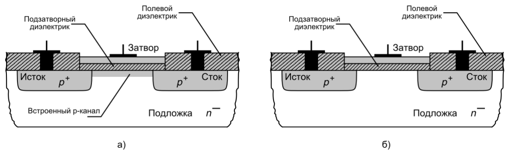

*Рис. 1. Структуры p-канальных МОП-транзисторов со встроенным (а) и индуцированным (б) каналами*

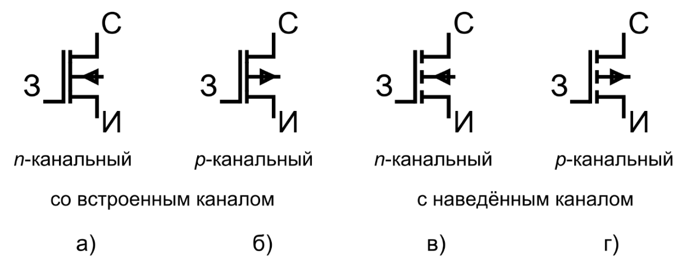

*Рис. 2. Обозначения МОПТ на электрических схемах*

### в) Принцип действия МОПТ

**Принцип действия МОПТ с наведённым каналом.** Работа МОПТ определяется в основном двумя управляющими напряжениями: затвора и стока, которые обычно отсчитываются относительно потенциала истока: $V_{\text{ЗИ}}$, $V_{\text{СИ}}$ (см. рис. 3).

При изменении напряжения затвора $V_{\text{ЗИ}}$ формируется (или наоборот перекрывается) проводящий канал. При $V_{\text{ЗИ}} = 0$ канал отсутствует, ток в выходной цепи равен обратному тепловому току p-n-переходов (см. рис. 4,*а*). При повышении $V_{\text{ЗИ}}$ сначала образуется обеднённый слой (объёмный заряд ионов: акцепторов в случае n-МОПТ и доноров в случае p-МОПТ) (см. рис. 4,*б*), а затем – при напряжении затвора $V_{\text{ЗИ}} = V_{\text{пор}}$, называемом пороговым, – инверсионный слой электронов, который как раз и является проводящим каналом (см. рис. 4,*в*). Свободные носители заряда, составляющие канал, притягиваются электрическим полем затвора частично из области подложки, но большей частью из областей стока и истока. На сток-затворной (ещё говорят: передаточной, или проходной[^1]) вольт-амперной характеристике $I_{\text{С}}(V_{\text{ЗИ}})$ значение $V_{\text{ЗИ}} = V_{\text{пор}}$ разделяет два участка (см. рис. 5,*а*). Согласно физическому определению, пороговым напряжением затвора называется такое, при котором концентрация свободных электронов в тонком приповерхностном слое становится равной исходной концентрации свободных дырок в объёме подложки. При $V_{\text{ЗИ}} > V_{\text{пор}}$ транзистор условно считается открытым.

[^1]: Иногда такую характеристику неверно называют «входной»

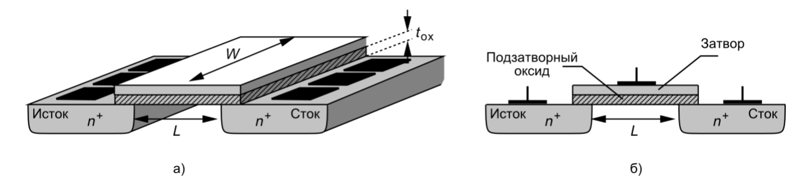

*Рис. 3. Общий вид (а) и продольный разрез (б) n-канального МОП-транзистора*

При изменении напряжения стока меняется форма канала. При $V_{\text{СИ}} > 0$ потенциал в канале является неравномерным: вблизи истока ($x = 0$, если отсчитывать от начала канала) он определяется практически только полем затвора и равен $V_{\text{ЗИ}} - V_{\text{пор}}$, а вблизи стока ($x = L$, где $L$ – длина затвора) совместным действием полей затвора и стока и равен $V_{\text{ЗИ}} - V_{\text{пор}} - V_{\text{СИ}}$. Соответственно, с увеличением $V_{\text{СИ}}$ толщина канала со стороны стока уменьшается (см. рис. 4,*д*). При достижении напряжением стока некоторого критического значения, называемого напряжением насыщения: $V_{\text{СИ,нас}} = V_{\text{ЗИ}} - V_{\text{пор}}$, сечение канала вблизи стока в точке $x = L$ уменьшается до 0 (это называется отсечкой канала), так как напряжение между затвором и поверхностью полупроводника в этой точке становится равным пороговому напряжению (см. рис. 4,*е*).


*Рис. 4. Процесс открытия и насыщения МОП-транзистора: Увеличение $V_{\text{ЗИ}}$: а) МОПТ закрыт; б) образован обеднённый слой ионов; в) образован инверсионный слой носителей заряда (канал) – МОПТ открыт; Увеличение $V_{\text{СИ}}$: г) канал равномерен; д) канал деформирован; е) канал начинает отсекаться; ж) канал отсечён; и) проброс носителей через ОПЗ стока*

При дальнейшем увеличении напряжения стока $V_{\text{СИ}} > V_{\text{СИ,нас}}$ фактическая («эффективная») длина канала $L_{\text{эфф}} = L - \Delta L$ становится меньше $L$ (см. рис. 4,*ж*)[^2], а оставшееся до области стока расстояние $\Delta L$ занимает расширившаяся обеднённая область (ОПЗ) обратносмещённого стокового p-n-перехода. Проводимость транзистора обеспечивается следующим образом: носители заряда, прошедшие из области истока к концу канала, подхватываются сильным электрически полем стокового p-n-перехода и дрейфуют к области стока (см. рис. 4,*и*). В итоге ток стока слабо увеличивается, график его зависимости от напряжения стока имеет небольшой наклон. Геометрическое место значений $V_{\text{СИ,нас}} = V_{\text{ЗИ}} - V_{\text{пор}}$ разделяет триодный (крутой) и пентодный (пологий) участки на выходных характеристиках (см. рис. 5,*б*).

[^2]: Этот эффект называется эффектом модуляции длины канала (channel length modulation). По аналогии с эффектом модуляции толщины базы (эффекту Эрли) в биполярных транзисторах, данный эффект приводит к насыщению выходной проводимости МДП-транзистора.

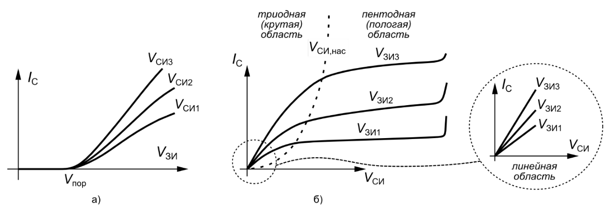

*Рис. 5. Вид сток-затворных $I_{\text{С}}(V_{\text{ЗИ}})$ (а) и выходных $I_{\text{С}}(V_{\text{СИ}})$ (б) вольт-амперных характеристик МОПТ*

**Принцип действия МОПТ со встроенным каналом** отличается тем, что пороговое напряжение у такого прибора (называемое здесь напряжением отсечки) имеет отрицательное значение, что влияет на вид его вольт-амперных характеристик.

## 1.3.3. Схемотехническая (SPICE) модель МОПТ

Описанные далее выражения относятся к модели под номером 1 (level = 1), встроенной в SPICE-подобные программы и верной для МОП-транзисторов с большой длиной канала. Рассмотрим вначале простую модель МОП-транзистора, не учитывающую эффект модуляции длина канала, эффект подложки, ёмкости и сопротивления, которой удобно пользоваться при инженерных расчётах. Эквивалентная схема модели показана на 6.

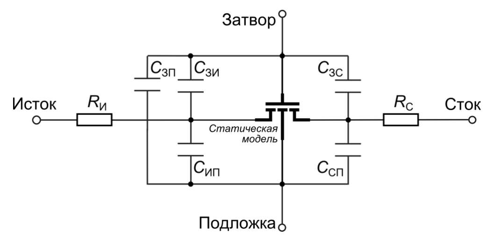

*Рис. 6. Эквивалентная схема модели МОПТ*

*В крутой области* ($V_{\text{ЗИ}} \ge V_{\text{пор}}$, $V_{\text{СИ}} < V_{\text{СИ,нас}}$):

$$
I_{\text{С}} = kp \frac{W}{L} \left[ \left(V_{\text{ЗИ}} - V_{\text{пор}}\right) V_{\text{СИ}} - \frac{1}{2} V_{\text{СИ}}^2 \right], \tag{1}
$$

где $kp \cdot W/L$ – удельная крутизна, а $kp$ – параметр крутизны:

$$
kp = \mu C_{ox} = \frac{\varepsilon_0 \varepsilon_{ox} \mu}{t_{ox}}, \tag{2}
$$

$L, W$ ‒ длина и ширина канала, $t_{ox}$, $\varepsilon_0 \varepsilon_{ox}$ ‒ толщина и абсолютная диэлектрическая проницаемость подзатворного диэлектрика, $\mu$ ‒ подвижность носителей заряда, $C_{ox} = \varepsilon_{ox} \varepsilon_0 / t_{ox}$ – удельная ёмкость подзатворного оксида, Ф/м².

*В области малых напряжений (линейной области)* ($V_{\text{СИ}} \ll V_{\text{СИ,нас}}$, т. е. $V_{\text{СИ}}^2 / 2 \ll \left(V_{\text{ЗИ}} - V_{\text{пор}}\right) V_{\text{СИ}}$) выражение (1) упрощается:

$$
I_{\text{С}} = kp \frac{W}{L} \left(V_{\text{ЗИ}} - V_{\text{пор}}\right) V_{\text{СИ}}, \tag{3}
$$

Из выражения (1) для заданного напряжения затвора $V_{\text{ЗИ}}$ легко приближённо найти напряжение насыщения, полагая $dI_{\text{С}} / V_{\text{СИ}} = 0$:

$$
V_{\text{СИ,нас}} = V_{\text{ЗИ}} - V_{\text{пор}}. \tag{4}
$$

*В области насыщения* ($V_{\text{ЗИ}} \ge V_{\text{пор}}$, $V_{\text{СИ}} \ge V_{\text{СИ,нас}}$):

Значение тока $I_{\text{С}} (V_{\text{СИ,нас}})$ сохраняется при всех значениях $V_{\text{СИ}} > V_{\text{СИ,нас}}$. Поэтому подстановка (4) в (1) даёт вольт-амперную характеристику в области насыщения:

$$
I_{\text{С}} = \frac{kp}{2} \frac{W}{L} \left(V_{\text{ЗИ}} - V_{\text{пор}}\right)^2. \tag{5}
$$

Для учёта эффекта модуляции длины канала (приводящего к наклону выходных ВАХ в пологой области) в модель вводится дополнительный множитель, зависящий от параметра $\lambda$:

$$
I_{\text{С}} = \frac{kp}{2} \cdot \frac{W}{L} \left(V_{\text{ЗИ}} - V_{\text{пор}}\right)^2 (1 + \lambda \cdot V_{\text{СИ}}) \tag{6}
$$

В области достаточно больших значений напряжения $V_{\text{СИ}}$ наступают предпробойные явления, а затем и пробой, сопровождающийся резким возрастанием тока $I_{\text{С}}$ и столь же резким уменьшением внутреннего сопротивления $R_i$.

**Ёмкости в модели МОПТ.** Для анализа переходных процессов в МДП-транзисторе необходимо, прежде всего, рассмотреть паразитные ёмкости его структуры. Выделяют 3 основных типа (см. рис. 7):

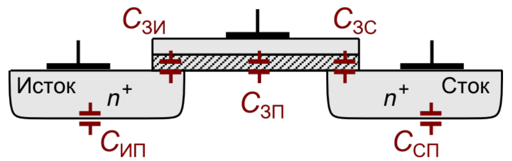

*Рис. 7. Ёмкости в структуре МОПТ*

1. $C_{\text{ЗС}}$ и $C_{\text{ЗИ}}$ – ёмкости перекрытия затвором областей стока и истока через подзатворный оксид. Каждая из этих ёмкостей существенно зависит от режима работы МДП-транзистора.
2. $C_{\text{СП}}$ и $C_{\text{ИП}}$ – барьерные ёмкости стокового и истокового p-n-переходов (такие же, как в БТ). Каждая из этих ёмкостей складывается из ёмкостей донной и боковой частей примесной области стока/истока. В случае симметричного прибора:

$$
C_{\text{СП}} = C_{\text{ИП}} = S_{\text{С}} C_j + P_{\text{С}} C_{jsw}, \tag{7}
$$

где $Cj$ – удельная ёмкость донной части, измеряется в фарадах на единицу площади донной части, зависит от напряжения p-n-перехода,  
$Cjsw$ – удельная ёмкость боковой части, измеряется в фарадах на единицу периметра боковой части,  
$S_{\text{С}} = W \cdot L_{\text{С}}$ – площадь области стока/истока,  
$P_{\text{С}} = 2(W + L_{\text{С}})$ – периметр области стока/истока,  
$W$ и $L_{\text{С}}$ – ширина и длина области стока/истока.

3. $C_{\text{ЗП}}$ – последовательное соединение ёмкости перекрытия через подзатворный оксид и ёмкости канала:

$$
C_{\text{ЗП}} = \frac{C_1 C_2}{C_1 + C_2}, \tag{8}
$$

где $C_1 = WLC_{ox}$ – ёмкость подзатворного слоя оксида,  
$C_2 = WL\sqrt{\left(q \varepsilon_{Si} \varepsilon_0 N_{\text{П}}\right) / \left(4 \varphi_F\right)}$ – ёмкость обеднённого слоя,  
$C_{ox}$ – удельная ёмкость подзатворного оксида.

Данной ёмкостью можно пренебречь в триодной и пентодной областях работы МДП-транзистора, так как в этих условиях инверсионный слой действует как защитный экран между затвором и подложкой.

## 1.3.4. Методика определения основных параметров модели МОПТ level = 1 в программе SPICE

### 1.3.4.1. Введение

Основными параметрами модели МОПТ level = 1 (см. [2, 3]), определяемыми в лабораторной работе, являются:

Vto – пороговое напряжение, В;

kp – удельная крутизна, А/В;

lambda – коэффициент модуляции длины канала, отн.;

Rd – сопротивление стока, Ом.

Процедура определения (или, как ещё говорят, идентификации, или экстракции) параметров модели включает два основных этапа: 1) расчёт приближённых значений параметров по простым формулам (см. п. 1.3.4.2); 2) подгонка значений параметров для наилучшего совпадения измеренных вольт-амперных характеристик и таких же характеристик, смоделированных в симуляторе с помощью полученной SPICE-модели (см. п. 1.3.4.3) (второй этап является итерационным).

### 1.3.4.2. Процедуры расчёта начальных значений основных параметров модели

#### а) Расчёт начального значения порогового напряжения VTO

Для расчёта порогового напряжения существует множество методов; рассмотрим два наиболее простых. В обоих задействуется сток-затворная вольт-амперная характеристика транзистора $I_{\text{С}} = f(V_{\text{ЗИ}})$ при малом напряжении на стоке $V_{\text{СИ}} = 0{,}05..0{,}1$ В (см. рис. 5). Первый метод использует наиболее простое практическое определение: пороговым называется такое напряжение затвора $V_{\text{ЗИ}}$, при котором значение тока стока равно по модулю 10 мкА. Достоинство этого метода в его простоте, недостаток в достаточно большом значении погрешности результата.

Второй метод, называемый «экстраполяция в линейной области», реализуется следующим образом (см. рис. 8,*а*):

1. на линии сток-затворной характеристики отыскивается достаточно короткий участок $\Delta V_{\text{ЗИ1}}$‒$\Delta I_{\text{С1}}$ с наибольшим коэффициентом наклона;
2. проводится линейная экстраполяция этого участка от его начальной точки с координатами ($V_{\text{ЗИ1}}$, $I_{\text{С1}}$) до точки с координатами ($V_1$, 0), где касательная пересекается с горизонтальной осью:

$$
\left. V_1 \right|_{I_{\text{С}} = 0} = V_{\text{ЗИ1}} - \frac{\Delta V_{\text{ЗИ1}}}{\Delta I_{\text{С1}}} \cdot I_{\text{С1}}; \tag{9}
$$

3. к полученному значению $V_1$ прибавляется значение $V_{\text{СИ}}/2$, в результате чего и получается пороговое напряжение:

$$
V_{\text{пор}} = V_1 + V_{\text{СИ}}/2. \tag{10}
$$

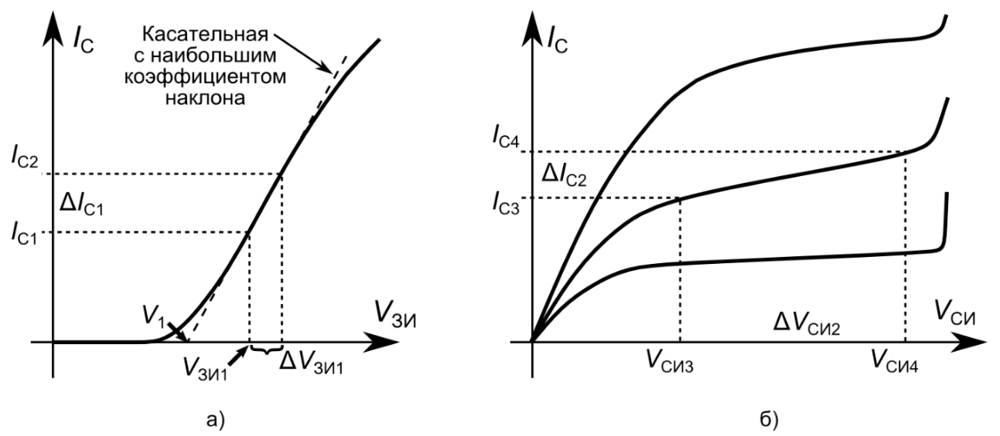

*Рис. 8. Иллюстрация к определению параметров по сток-затворным и выходным характеристикам*

#### б) Расчёт начального значения параметра крутизны kp

Используется тот же самый участок $\Delta V_{\text{ЗИ1}}$‒$\Delta I_{\text{С1}}$ с наибольшим коэффициентом наклона, определённый в предыдущем пункте (см. рис. 8,*а*). При таком малом напряжении стока ($V_{\text{СИ}} = 0{,}05..0{,}1$ В) рассматриваемый участок принадлежит линейной области работы транзистора. Используя формулу (3), можно выразить ток стока для точек на концах этого участка:

$$
\begin{cases} I_{\text{С1}} = kp \dfrac{W}{L} \left(V_{\text{ЗИ1}} - V_{\text{пор}}\right) V_{\text{СИ}} \\ I_{\text{С2}} = kp \dfrac{W}{L} \left(V_{\text{ЗИ2}} - V_{\text{пор}}\right) V_{\text{СИ}} \end{cases}, \tag{11}
$$

$$
\text{откуда} \quad \frac{\Delta I_{\text{С1}}}{\Delta V_{\text{ЗИ1}}} = kp \frac{W}{L} V_{\text{СИ}}. \tag{12}
$$

Так как точные значения ширины $W$ и длины канала $L$ транзистора не известны, а отношение $W / L$ в формуле (1) является таким же коэффициентом, что и kp, можно задаться конкретным значением $W / L$, например, 10, и для этого случая найти kp по выражению (12).

#### в) Расчёт начального значения коэффициента модуляции длины канала lambda

Метод основан на том, что в пологой области выходных ВАХ наклон вызван эффектом модуляции длины канала. На линии ВАХ, соответствующей наибольшему или среднему значению напряжения затвора, на пологом участке выбирается достаточно прямой участок $\Delta V_{\text{СИ2}}$–$\Delta I_{\text{С2}}$ (см. рис. 8,*б*). Используя формулу (6), можно выразить ток стока для точек на концах этого участка:

$$
\begin{cases} I_{\text{С3}} = \dfrac{kp}{2} \cdot \dfrac{W}{L} \left(V_{\text{ЗИ}} - V_{\text{пор}}\right)^2 (1 + lambda \cdot V_{\text{СИ3}}) \\ I_{\text{С4}} = \dfrac{kp}{2} \cdot \dfrac{W}{L} \left(V_{\text{ЗИ}} - V_{\text{пор}}\right)^2 (1 + lambda \cdot V_{\text{СИ4}}) \end{cases}, \tag{13}
$$

$$
\text{откуда} \quad \frac{\Delta I_{\text{С2}}}{\Delta V_{\text{СИ2}}} = \frac{kp}{2} \cdot \frac{W}{L} \left(V_{\text{ЗИ}} - V_{\text{пор}}\right)^2 \cdot lambda. \tag{14}
$$

С использованием известных значений $V_{\text{пор}}$, отношения $W / L$ рассчитывается lambda.

### 1.3.4.3. Процедура подгонки параметров SPICE-модели с помощью программы моделирования схем

Цель данного этапа ‒ более точно определить значения параметров SPICE-модели МОП-транзистора, так чтобы, будучи построенными в одних осях, были максимально близки графики вольт-амперных характеристик, измеренных в ходе выполнения лабораторной работы и смоделированных с помощью полученной SPICE-модели.

Процедуры данного этапа проиллюстрированы на примере программы LTSpice.

Алгоритм выполнения задачи данного этапа состоит в том, чтобы:

1. воспроизвести в схемотехническом редакторе лабораторную схему измерения, используя в качестве начальных значений параметров модели значения, рассчитанные по формулам п. 1.3.4.2;
2. ввести в схему фиктивные источники тока, содержащие данные о результатах измерения ВАХ;
3. промоделировать схему с имеющимися параметрами модели;
4. сопоставить в общих осях графики измеренных и смоделированных ВАХ; в случае несовпадения изменить параметры модели и вернуться к п. 3.

#### а) Построение схемы для моделирования

Для моделирования в программе‒симуляторе электрических схем воспроизводится схема, соответствующая результатам измерения. В ходе лабораторной работы непосредственно измерялись напряжения и токи выводов транзистора (точки 8 и 11 лабораторного стенда, приведённого на рис. 12) и не фиксировались значения источника питания стока (точка 10). В связи с этим, 1) схема для виртуального опыта не содержит ограничительных сопротивлений; 2) источники питания Eс и Eз подключаются непосредственно к выводам объекта исследования – транзистора; 3) значения источников Eс и Eз соответствуют измеренным значениям напряжений выводов транзистора.

Схема, построенная в соответствии с вышеизложенным, приведена на рис. 9, где Vg и Vd принятые в программе Spice обозначения источников Eз и Eс, соответственно.

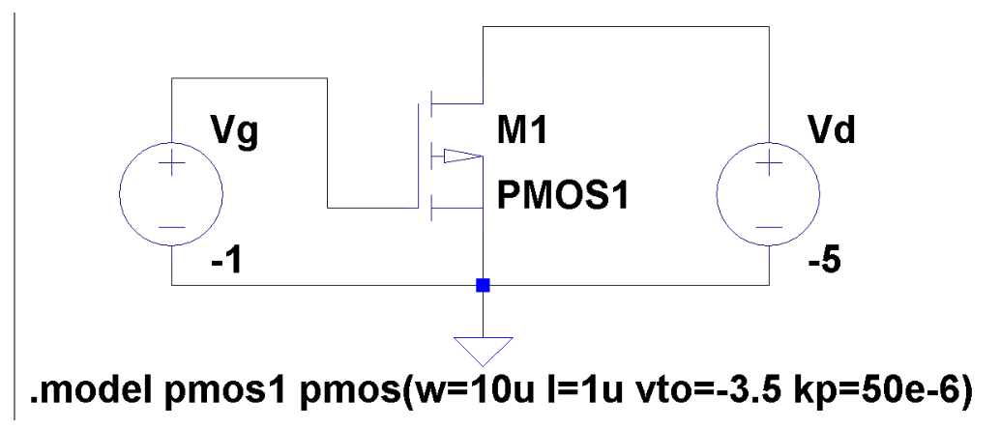

*Рис. 9. Схема, построенная в программе схемотехнического моделирования для расчёта сток-затворных и выходных ВАХ МОП-транзистора*

Для задания модели транзистора используется кнопка «SPICE directive» панели инструментов программы. В открывшемся окне вводится директива model в формате:

```
.model <имя> <тип> [<параметр1>=<значение1>,…]
```

где \<имя> – имя модели в формате `[_A-Za-z][_A-Za-z0-9]*`, \<тип> – тип модели, для МОП-транзистора это может быть “nmos” или “pmos”, \<параметр> – имя параметра модели из списка допустимых параметров (см. справку к программе), \<значение> – значение параметра модели в виде простого числа (с точкой), либо записанное в инженерном формате (например, 2.5e-12 = $2{,}5 \cdot 10^{-12}$), либо записанное с суффиксом (например, 2.5p = $2{,}5 \cdot 10^{-12}$).

На данном этапе в модель следует ввести параметры, рассчитанные по формулам п. 1.3.4.2, например (здесь знак «+» в первой позиции строки означает, что данная строка является продолжением предыдущей):

```
.model kp301 nmos(w=10u l=1u vto=-3.5 kp=50e-6
+ lambda=0.2 rd=0.5)
```

После нажатия кнопки OK следует поместить текст модели на любое свободное место рабочего поля программы. Имя модели следует добавить к свойствам конкретного экземпляра транзистора: навести мышь на слово pmos рядом с транзистором (в строке состояния при этом должно содержаться слово “Value”), щёлкнуть на нём правой кнопкой мыши и ввести имя модели.

#### б) Отображение на графиках экспериментальных данных

Для того, чтобы иметь возможность в одних и тех же осях сравнивать графики измеренных и смоделированных ВАХ, в схему необходимо ввести фиктивные источники питания, выдающие при моделировании измеренные значения.

Наборы зависимых источников при моделировании сток-затворной и выходной характеристик различаются: при моделировании сток-затворной ВАХ основным аргументом функции является напряжение затвора, а снимается одна линия тока стока; при моделировании выходной ВАХ основным аргументом функции является напряжение стока, а снимаются три линии тока стока.

Соответственно, при подготовке электрической схемы для моделирования сток-затворной характеристики к источнику напряжения затвора (аргументу) подключается один источник тока, воспроизводящий $I_{\text{С}} = f(V_{\text{ЗИ}})$; для моделирования выходных характеристик к источнику напряжения стока (аргументу) подключаются три источника тока, соответствующие трём линиям семейства $I_{\text{С}} = f(V_{\text{СИ}})$.

Для того, чтобы задать значение источника в виде набора точек, следует щёлкнуть правой клавишей мыши на изображении источника, нажать кнопку Advanced, в открывшемся окне выбрать пункт “TABLE (v1 i1 v2 i2)”, вписать значения 0 и 0 в поля voltage1 и value1, нажать кнопку OK и поместить получившуюся строчку “TBL(0 0)” на любое свободное место рабочего поля программы. Внутрь скобок вместо значений “0 0” далее следует вписать результаты своих измерений в виде \<U1 I1 U2 I2> и т. д.

Для того, чтобы представить результаты измерений в таком виде, можно использовать следующую процедуру (см. рис. 10): 1) вставить таблицу с данными, соответствующими одной линии, в текстовый редактор (Блокнот, Word, Writer и т. п.), 2) преобразовать данные из табличного вида в строковый (при необходимости), 3) провести автозамену символов конца строки на пробелы. Получившаяся строка готова для вставки в команду TBL.

Примерные фрагменты схем, содержащих фиктивные источники для вывода измеренных значений, показаны на рис. 11.

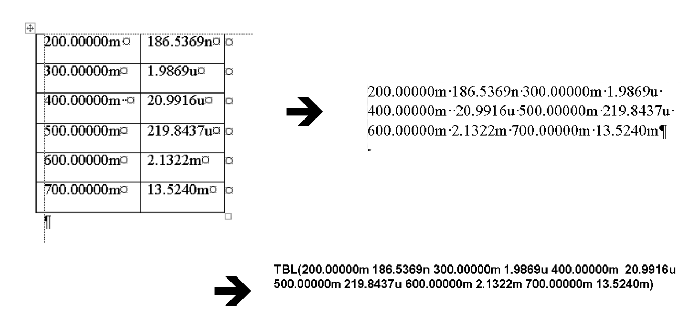

*Рис. 10. Порядок преобразования данных измерений для вставки на рабочий лист программы*

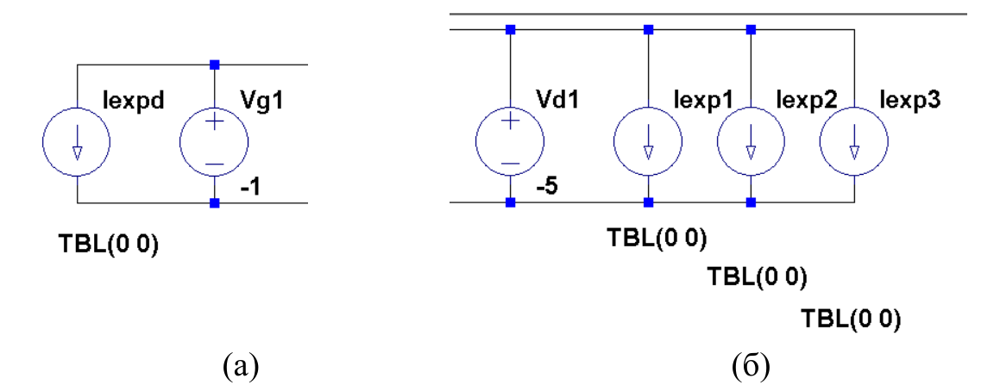

*Рис. 11. Фрагменты схем для подключения результатов измерения при моделировании сток-затворной (а) и выходных (б) ВАХ*

#### в) Моделирование схемы

*Указания.* Виртуальный опыт в программе схемотехнического моделирования должен воспроизводить опыт в реальной лаборатории. С этой целью значения источников питания, подключённых к выводам транзистора, должны соответствовать задаваемым в процессе реального опыта.

При моделировании сток-затворной ВАХ необходимо задать постоянное значение источника напряжения стока минус 0,5 В. Для этого нужно щёлкнуть правой клавишей мыши по изображению источника и ввести значение в поле “DC value”. Напряжение же источника затвора должно изменяться примерно в диапазоне от 0 до 5 В с мелким шагом (порядка 0,01 В).

При моделировании выходных ВАХ напряжение источника стока должно изменяться примерно в диапазоне от 0 до 10 В с мелким шагом (порядка 0,01 В), а напряжение источника затвора должно последовательно принять три фиксированных значения, использованных в эксперименте, например, минус 3; 4; 5 В.

*Для ввода команды на изменение значений источников* следует вызвать пункт меню Simulation ‒ Edit Simulation Cmd. В открывшемся окне следует выбрать вкладку “DC sweep”, где в поле “source name” ввести имя источника, а в поля “start value”, “stop value”, “increment” ввести начальное, конечное значение и шаг изменения источника. При вводе значений в поля окна в его нижней части автоматически формируется команда, которую после нажатия кнопки OK следует поместить на любое свободное место рабочего листа программы. Аналогичную команду можно набрать и вручную, воспользовавшись кнопкой “SPICE directive” панели инструментов. Формат команды:

```
.dc <ист1> <start1> <stop1> <step1>
+ <ист2> <start2> <stop2>  <step2>,
```

где *ист1, ист2* – имена источников, *start1, start2* – начальные значения источников, *stop1, stop2* – конечные значения источников, *step1, step2* – шаги изменения значений источников; символ «+» использован для перехода на новую строку.

*Для запуска моделирования* следует вызвать пункт меню Simulation ‒ Run или нажать на кнопку Run панели инструментов. При отсутствии ошибок моделирования открывается пустое поле для построения графиков.

*Для вывода графиков* по результатам компьютерного расчёта следует щёлкнуть правой кнопкой мыши на пустом поле, выбрать пункт “Add Traces” и в открывшемся окне выбрать те величины, которые следует построить.

#### г) Подгонка параметров

Операция подгонки параметров модели МОП-транзистора заключается в следующем: по результатам моделирования электрической схемы сравниваются графики ВАХ: измеренные и рассчитанные. В случае их несовпадения корректируются параметры модели и моделирование запускается заново.

Порядок, в котором следует изменять параметры, следующий:

1. По выходным ВАХ в крутой области определяется значение сопротивления стока Rd, которое здесь играет роль коэффициента наклона. На этом этапе следует обращать внимание только на наклон линий в крутой области.
2. По выходным ВАХ в пологой области определяется значение коэффициента модуляции длины канала lambda, который здесь играет роль коэффициента наклона. На этом этапе следует обращать внимание только на наклон линий в пологой области.
3. По линии тока стока из состава сток-затворной ВАХ на крутом участке определяются параметры Vto и kp.

## 1.3.5. Описание лабораторного стенда

Работа выполняется на универсальном стенде (рис. 12). Исследуемые цепи собираются на основе одного из блоков стенда и внешних приборов и устройств: двух вольтметров, одного микроамперметра, двух регулируемых источников постоянного напряжения.

Для данной работы из состава блока используется p-канальный МОП-транзистор VT2 и внешнее сопротивление цепи стока R6; истоковое сопротивление R7 не используется. Сопротивление цепи стока включено в схему измерения для ограничения тока и предупреждения повреждения транзистора и источников питания.

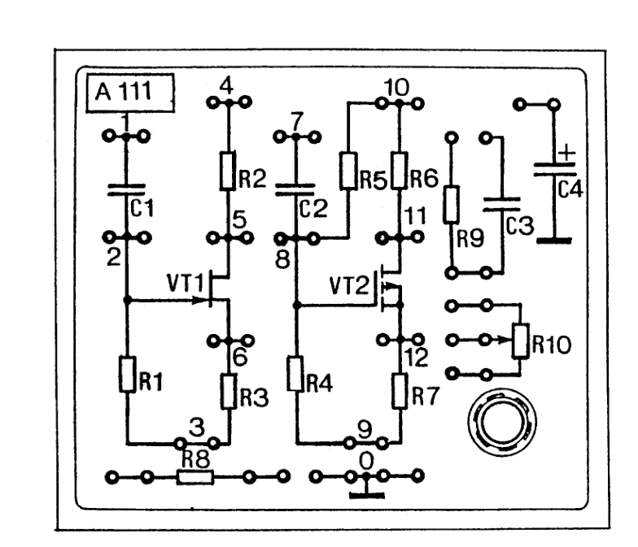

*Рис. 12. Блок лабораторного стенда, на котором выполняется работа*

## 1.3.6. Задание для работы в лаборатории

### 1.3.6.1. Проведение измерений сток-затворной вольт-амперной характеристики

1. Снять одну линию сток-затворной вольт-амперной характеристики транзистора $I_{\text{С}} = f(V_{\text{ЗИ}})$ по схеме рис. 13 (10‒15 точек) при постоянном напряжении на стоке минус 0,1 В. Результаты измерений занести в таблицу 1.

**Табл. 1**

| $V_{\text{ЗИ}}$ |  |  |  |
|---|---|---|---|
| $I_{\text{С}}$ |  |  |  |

*Указания.* Значения всех напряжений и токов **меньше нуля**, т. к. транзистор *р*-канальный. Начинать измерение рекомендуется с правой стороны графика, т. е. с бо́льших по модулю значений тока. Значение напряжения стока при снятии первых нескольких точек, вероятнее всего, изменится, так что его необходимо каждый раз возвращать к заданному уровню. Следует прекратить измерения, когда значение тока стока составит по модулю 10 мкА; значение напряжения затвора при этом будет приблизительно соответствовать пороговому напряжению транзистора.

2. По результатам измерений построить график характеристики $I_{\text{С}} = f(V_{\text{ЗИ}})$ в линейном масштабе.

*Указания:*

В программах наподобие Microsoft Excel, OpenOffice Calc и т. п. следует выбирать тип графика «точечный», а не «график», что подходит к графикам физических величин (даёт равномерный шаг по осям).

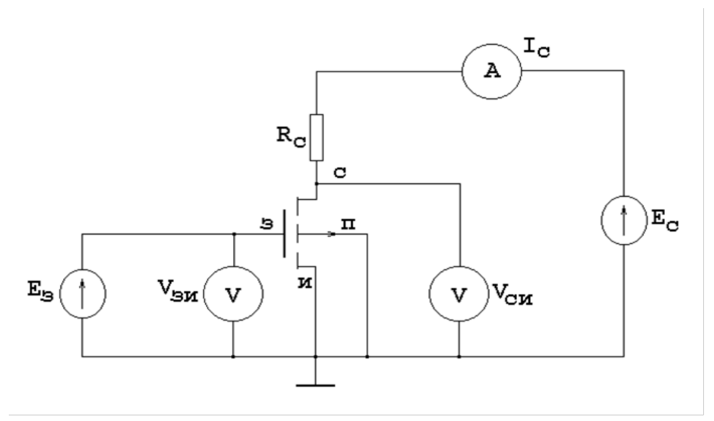

*Рис. 13. Схема измерения сток-затворных и выходных ВАХ МОП-транзистора*

### 1.3.6.2. Проведение измерений выходных вольт-амперных характеристик МОП-транзистора

1. Снять три линии выходных вольт-амперных характеристик $I_{\text{С}} = f(V_{\text{СИ}})$ транзистора по схеме, изображённой на рис. 13 (8‒10 точек в крутой области и переходе к пологой области и 5‒7 точек в пологой области), поддерживая в каждой точке постоянное значение напряжения затвора. Результаты измерений занести в таблицу 2.

*Указания*. Выбор значений напряжения затвора для трёх линий ВАХ следует производить следующим образом. При измерении сток-затворной характеристики было определено пороговое напряжение затвора. Выбирать для измерения выходной ВАХ значения напряжения затвора $V_{\text{пор}}$, меньшие порогового, не имеет смысла, т. к. транзистор при этом окажется закрыт. Соответственно, следует выбрать три значения в диапазоне от ($V_{\text{пор}}$ + 0,5 В) до 5 В для трёх линий выходных ВАХ.

Значения всех напряжений и токов **меньше нуля**, т. к. транзистор *р*-канальный. Начинать измерение рекомендуется с правой стороны графика, т. е. с бо́льших по модулю значений тока. Значение напряжения затвора при снятии первых нескольких точек, вероятнее всего, изменится, так что его необходимо каждый раз возвращать к заданному уровню. Следует прекратить измерения очередной линии, когда значение тока стока составит по модулю 10 мкА.

**Табл. 2**

$V_{\text{ЗИ}} = V_{\text{ЗИ1}}$

| $V_{\text{СИ}}$ |  |  |  |
|---|---|---|---|
| $I_{\text{С}}$ |  |  |  |

$V_{\text{ЗИ}} = V_{\text{ЗИ2}}$

| $V_{\text{СИ}}$ |  |  |  |
|---|---|---|---|
| $I_{\text{С}}$ |  |  |  |

$V_{\text{ЗИ}} = V_{\text{ЗИ3}}$

| $V_{\text{СИ}}$ |  |  |  |
|---|---|---|---|
| $I_{\text{С}}$ |  |  |  |

2. По результатам измерений построить графики характеристик $I_{\text{С}} = f(V_{\text{СИ}})$ на одном поле и в линейном масштабе.

*Указания:*

В программах наподобие Microsoft Excel, OpenOffice Calc и т. п. следует выбирать тип графика «точечный», а не «график», что подходит к графикам физических величин (даёт равномерный шаг по осям).

## 1.3.7. Задание для работы с программой SPICE-моделирования

1. Рассчитать начальные значения параметров модели level = 1 в соответствии с процедурой п. 1.3.4.2.
2. Построить в программе моделирования схемы для расчёта сток-затворных и выходных ВАХ МОП-транзистора (см. рис. 9) в соответствии с процедурой п. 1.3.4.3,*а*; внедрить в схемы описание модели транзистора, использовав значения, полученные в предыдущем пункте; внедрить в схемы фиктивные источники для отображения результатов измерения.
3. Подогнать параметры модели в соответствии с процедурой п. 1.3.4.3,*г*; добиться максимального совпадения измеренных и смоделированных сток-затворных и выходных ВАХ.
4. Построить графики сток-затворных и выходных ВАХ, на которых совмещены результаты измерений и компьютерного моделирования.

*Указания.* Линии графиков и числа по осям должны быть хорошо различимы; рекомендуется использовать тёмные линии на светлом фоне.

## 1.3.8. Подготовка отчёта

Отчёт должен содержать следующие части:

1. титульный лист;
2. оглавление;
3. цель работы;
4. теоретическое введение;
5. схемы измерений;
6. таблицы с результатами измерений;
7. графики, построенные по результатам измерений;
8. ход и результаты вычисления предварительных значений параметров модели level = 1 по результатам измерений;
9. схемы для компьютерного расчёта сток-затворных и выходных ВАХ из программы моделирования; должны быть различимы параметры модели;
10. графики сток-затворных и выходных ВАХ, на которых совмещены результаты измерения и компьютерного моделирования.

*Указания.* Страницы отчёта должны быть пронумерованы. Части отчёта должны иметь нумерованные заголовки.

## 1.3.9. Контрольные вопросы

1. Принцип работы МДП-транзистора.
2. Разновидности МДП-транзисторов.
3. Сток-затворные и выходные характеристики для всех типов МДП-транзисторов и различия между ними.
4. Эффект модуляции длины канала в МДП-транзисторе и его проявление на электрических характеристиках.
5. Статическая модель МДП-транзистора.
6. Ёмкости в структуре МДП-транзистора.
7. Способ определения параметров схемотехнической модели по результатам измерений.

## 1.3.10. Рекомендуемая литература

1. О. В. Миловзоров, И. Г. Панков, Основы электроники. Учебник. – М.: Юрайт, 2016. – 407 с.
2. Денисенко В.В. Компактные модели МОП-транзисторов для SPICE в микро- и наноэлектронике. ‒ М.: ФИЗМАТЛИТ, 2010. ‒ 408 с.
3. LTSpice IV User Manual. – Режим доступа: ltspice.linear.com/software/scad3.pdf
4. Ortiz-Conde A. et al. A review of recent MOSFET threshold voltage extraction methods //Microelectronics Reliability. – 2002. – Т. 42. – №. 4. – С. 583-596;
5. Karlsson P. R., Jeppson K. O. An efficient parameter extraction algorithm for MOS transistor models //IEEE Transactions on Electron Devices. – 1992. – Т. 39. – №. 9. – С. 2070-2076;
6. Picos R. et al. Optimized parameter extraction using fuzzy logic //Solid-state electronics. – 2007. – Т. 51. – №. 5. – С. 683-690;
7. Melikian V., Mnatsakanian V., Uzunoglou N. Optimization of SPICE system LEVEL3 MOSFET transistor models based on dc measurements //Microelectronics journal. – 1998. – Т. 29. – №. 3. – С. 151-156;
