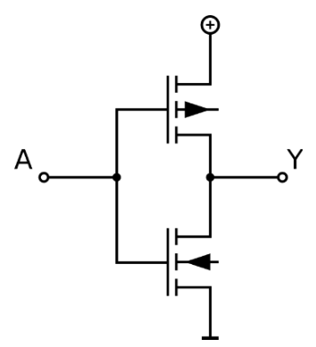
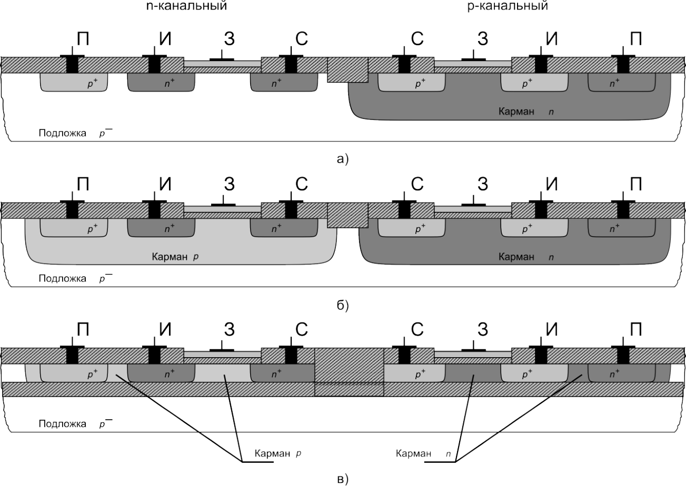
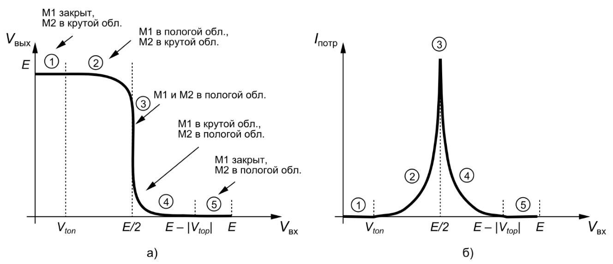
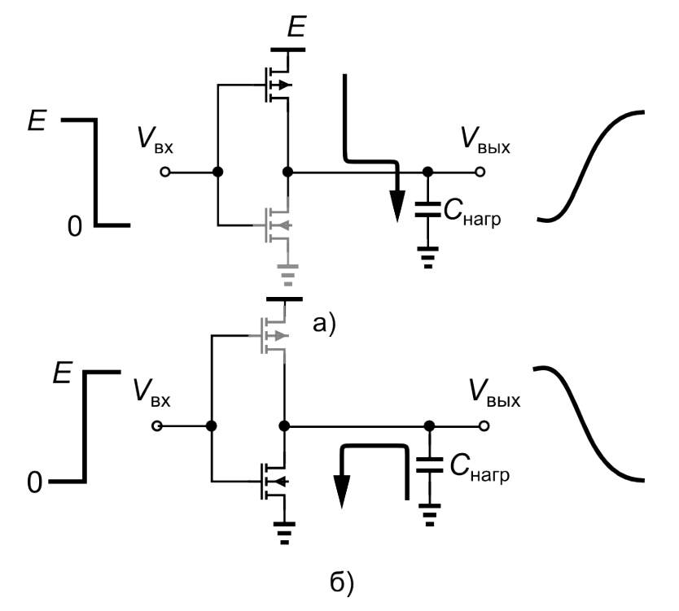
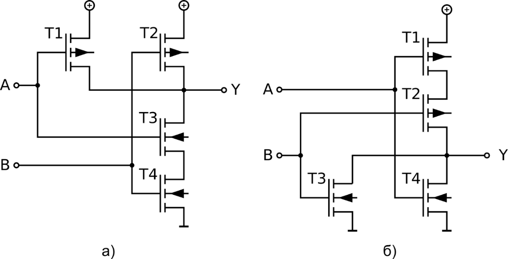
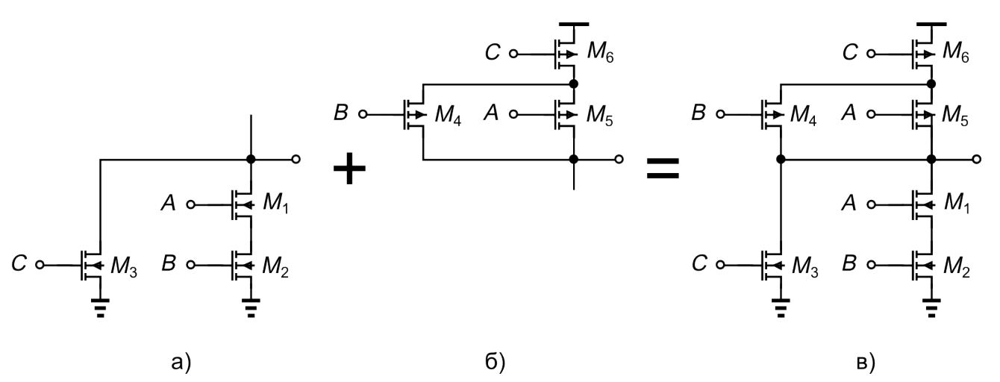
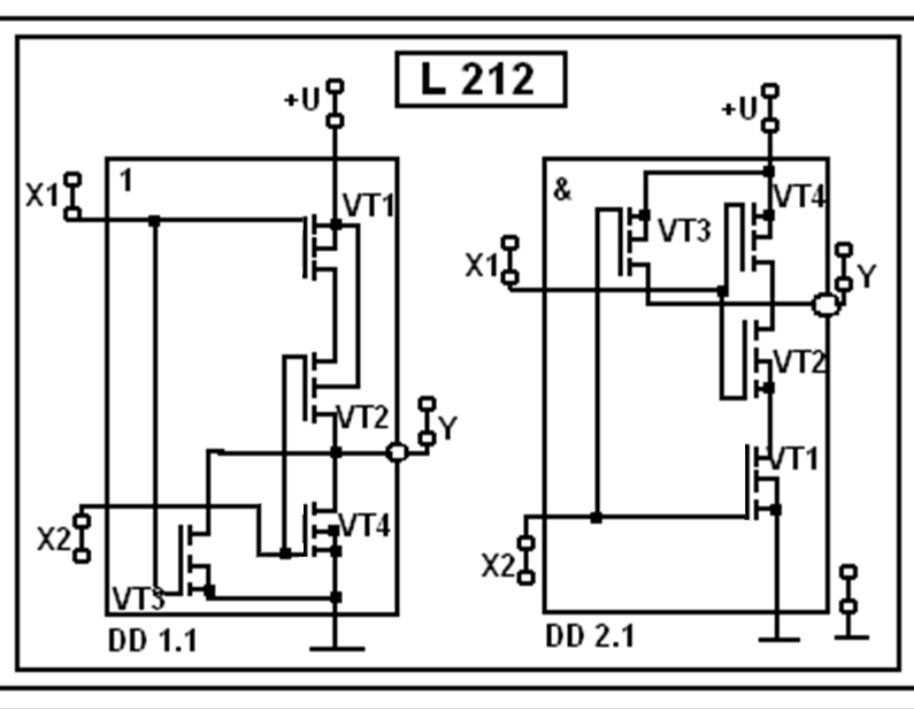
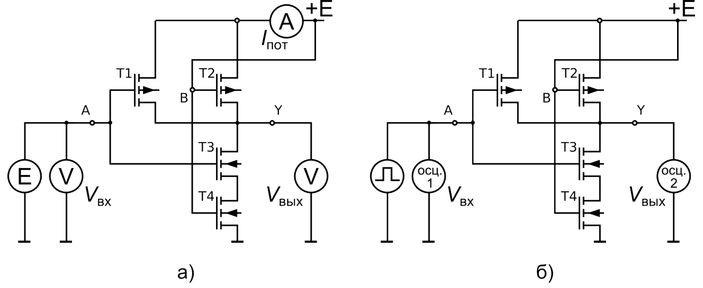
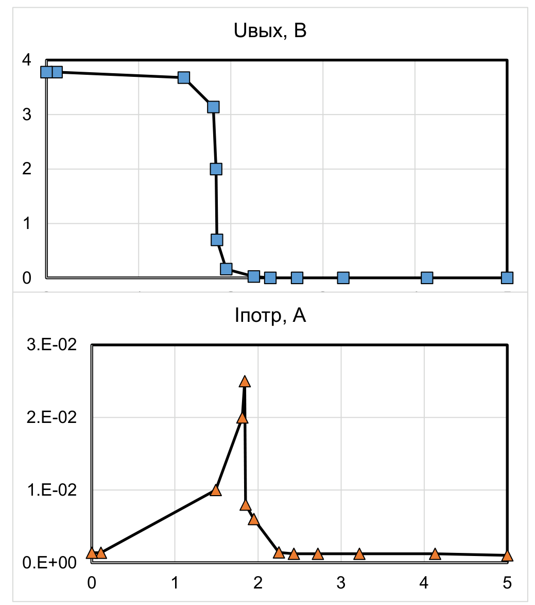
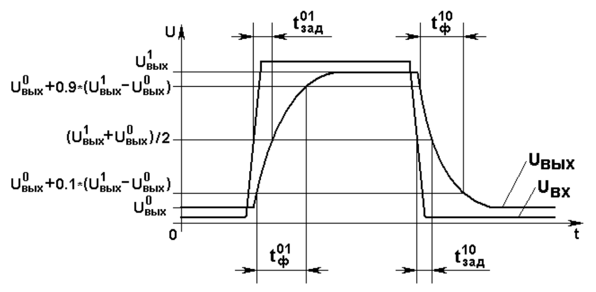

# Лабораторная работа 1.4. Изучение статических и динамических характеристик логических интегральных схем на комплементарных МОП-транзисторах (КМОП)

## Содержание

- 1.4. Изучение статических и динамических характеристик логических интегральных схем на комплементарных МОП-транзисторах (КМОП)
  - 1.4.1. Цели работы
  - 1.4.2. Краткие теоретические сведения
  - 1.4.3. Описание лабораторного стенда
  - 1.4.4. Задание для работы в лаборатории
  - 1.4.5. Задание для работы в программе SPICE-моделирования
  - 1.4.6. Требования к отчёту
  - 1.4.7. Контрольные вопросы
  - 1.4.8. Рекомендуемая литература

## 1.4.1. Цели работы

- Изучение особенностей режимов работы и параметров интегральных схем с КМОП-транзисторами;
- Исследование передаточных характеристик КМОП-схем;
- Исследование переходных характеристик КМОП-схем;
- Приобретение навыков работы с интегральными схемами;
- Приобретение навыков расчёта схем с помощью программы SPICE-моделирования.

## 1.4.2. Краткие теоретические сведения

### 1.4.2.1. Введение

Логические интегральные КМОП-схемы в настоящее время являются наиболее распространёнными элементами цифровой электроники. Развитие КМОП-технологии, обеспечивающей простоту изготовления, очень низкое потребление энергии, высокое быстродействие и в итоге низкую стоимость в расчёте на вентиль, дало импульс развития всей цифровой электронике, позволило ей очень широко распространиться и стать доминирующей технологией для создания электронных устройств вычислительной техники (микропроцессоров, блоков памяти, логических элементов и др.), телекоммуникационных систем и средств связи, измерительных систем и систем обработки данных и передачи информации, различных видов бытовой электроники и для многих других применений. Следует отметить, что области применения электронной аппаратуры, построенной на КМОП-схемах, непрерывно расширяются [1‒3].

### 1.4.2.2. Электрическая схема и структура КМОП-схем

**Состав схемы.** Логические схемы, изготовленные по комплементарной МОП-технологии (КМОП), содержат в своей структуре «комплементарные», т. е. взаимодополняющие, МОП-транзисторы. В каждой КМОП-паре находятся транзисторы с каналами различного типа: n-канальные и p-канальные, имеющие равные по модулю значения порогового напряжения и крутизны; в выполнении этих трёх условий и состоит их комплементарность.

Простейшей КМОП-схемой является инвертор (см. схему на рис. 1).



*Рис. 1. Электрическая схема КМОП-пары (инвертора)*

В конструкции любой КМОП-схемы, содержащей любое количество КМОП-пар, выделяется две части: подтягивающая к земле (*англ.* pull-down) и подтягивающая к питанию (*англ.* pull-up). При чередовании высокого и низкого уровня входного сигнала (как в обычном цифровом сигнале) то один из них, то другой поочерёдно оказывается открытым и, как говорят, «подтягивает» выходное напряжение то к уровню земли, то к уровню питания.

В схеме инвертора каждый из подтягивающих фрагментов содержит лишь один транзистор: n-канальный, нижний на схеме, и р-канальный, верхний на схеме. Следует отметить, что транзисторы в этой схеме соединяются стоками вместе, т.е. исток n-канального транзистора имеет потенциал земли, а исток р-канального – потенциал источника питания.

**Изоляция элементов.** Изоляция между транзисторами схемы необходима для того, чтобы существенно снизить значения токов утечки между ними, препятствовующих выполнению схемой заданной функции.

При изготовлении КМОП-схем часто n-канальные транзисторы создаются непосредственно в р-подложке, а для р-канальных транзисторов создаётся локальная подложка – специальный карман n-типа (см. рис. 2,*а*). Для того, чтобы подать электрическое напряжение между подложкой и карманом (для обратного смещения их общей границы – p-n-перехода), вводятся контакт к подложке и контакт к карману.

Достаточно распространена технология, в которой каждый из транзисторов находится в своём кармане (рис. 2,*б*). Всё более широко используются более надёжные методы диэлектрической изоляции: мелкая или глубокая канавка, заполненная диэлектриком, вокруг каждого элемента (такая структура называется мелкощелевая/глубокощелевая изоляция), либо полная диэлектрическая изоляция (рис. 2,*в*): в этом случае каждый элемент окружён диэлектриком со всех сторон (такая структура называется «кремний на изоляторе», КНИ).



*Рис. 2. Способы изоляции элементов КМОП-пары: а) один из транзисторов в кармане (обратносмещённом p-n-переходе); б) каждый транзистор в своём кармане; в) полная диэлектрическая изоляция («кремний на изоляторе», КНИ)*

**Масштабирование.** С каждым новым поколением (англ. technology node) КМОП-технологии уменьшаются размеры элементов интегральных схем (в первую очередь, МОП-транзисторов), что позволяет увеличить быстродействие схемы. Напряжение питания также снижается. Такой процесс называется масштабированием, или скейлингом (англ. scaling). В таблице 1 приведены типовые данные по минимальному размеру $L_{\min}$ затвора транзистора, соответствующему напряжению питания $E_{\text{пит}}$ и рабочей частоте микропроцессоров для микронных (т. е. таких, где $L_{\min} > 1\ \text{мкм}$), субмикронных ($0{,}35\ \text{мкм} < L_{\min} < 1\ \text{мкм}$) и глубоко субмикронных ($0{,}1\ \text{мкм} > L_{\min} > 0{,}35\ \text{мкм}$) технологических процессов.

**Табл. 1**

| $L_{\min}$, мкм | 2 | 1,2 | 0,8 | 0,5 | 0,35 | 0,25 | 0,18 | 0,13 |
|---|---|---|---|---|---|---|---|---|
| $E_{\text{пит}}$, В | 5 | 5 | 5 | 3,3 | 3,3 | 2,5 | 1,8 / 1,5 | 1,5 / 1,2 |
| $f_{\text{раб}}$, ГГц | 0,07 | 0,25 | 0,35 | 0,7 | 1,5 | 2,5 | 2,8 | 3,2 |

Уровень логической единицы равен напряжению питания, а уровень логического нуля равен 0 В.

По сравнению с другими типами логических схем, КМОП-схемы имеют симметричную передаточную характеристику с высокой помехозащищённостью, большое входное и малое выходное сопротивления, малое потребление мощности в статическом режиме, большую нагрузочную способность.

С каждым новым поколением КМОП-интегральных схем увеличивается потребляемая схемами мощность, причём мощность, потребляемая в статическом режиме (при неизменных значениях входных сигналов), увеличивается гораздо быстрее мощности, потребляемой в динамическом режиме (при переключении входных сигналов). В наиболее современных производственных технологиях значения статической и динамической мощности равны по порядку величины.

### 1.4.2.3. Анализ передаточной характеристики КМОП-инвертора

Рассмотрим передаточную характеристику КМОП-инвертора (рис. 3). Передаточной характеристикой называется зависимость выходного напряжения логического элемента от напряжения на его входе.

При выводе передаточной характеристики используются следующие выражения, описывающие поведение транзисторов в различных режимах, и не учитывающие эффекты второго порядка: эффект модуляции длины канала и эффект влияния подложки:

в крутой (триодной) области:

$$
I_{\text{С}} = \beta\left[\left(V_{\text{ЗИ}} - V_{\text{пор}}\right)V_{\text{СИ}} - \frac{1}{2}V_{\text{СИ}}^{2}\right], \tag{1}
$$

в пологой (пентодной) области:

$$
I_{\text{С}} = \frac{\beta}{2}\left(V_{\text{ЗИ}} - V_{\text{пор}}\right)^{2}, \tag{2}
$$

где $V_{\text{пор}}$ ‒ пороговое напряжение транзистора, В,

$\beta = W/L \cdot \mathrm{kp} = W/L \cdot \mu C_{\text{ox}}$ ‒ удельная крутизна транзистора, А/В² ;

$\mathrm{kp}$ – параметр крутизны, А/В²;

$\mu$ – подвижность носителей заряда, см²/(В·с);

$C_{\text{ox}}$ ‒ удельная ёмкость подзатворного оксида, Ф/м².

Значения параметров $V_{\text{пор}}$ и $\mu$ различаются для n- и p-канальных транзисторов и обозначаются, соответственно, $V_{\text{пор,n}}$ и $V_{\text{пор,p}}$; $\mu_{\text{n}}$ и $\mu_{\text{p}}$.



*Рис. 3. Зависимость выходного напряжения (а) и потребляемого тока (б) КМОП-инвертора от входного напряжения*

На передаточной характеристике можно выделить несколько областей (см. рис. 3).

1. $\boxed{V_{\text{вх}} < V_{\text{пор},n}}$. Входное напряжение меньше порогового напряжения n-канального транзистора, и он полностью закрыт. Напряжение затвор‒исток р-канального транзистора ($0 - 5 = -5$ В) больше его порогового напряжения $V_{\text{пор,p}}$ (по модулю), поэтому он полностью открыт. Открытый p-канальный МОПТ подтягивает напряжение на выходе к напряжению питания, потребляемый ток равен нулю, т. к. n-канальный закрыт и пути для тока (от питания к земле) нет.

2. $\boxed{V_{\text{пор},n} < V_{\text{вх}} < E/2}$. Входное напряжение больше порогового напряжения $V_{\text{пор,n}}$ n-канального транзистора, но меньше половины напряжения питания. n-канальный транзистор приоткрывается и работает в пологой области характеристик (пентодной). Р-канальный транзистор призакрывается и постепенно переходит (при $V_{\text{вых}} \approx V_{\text{вх}} + |V_{\text{пор},p}|$) из крутой области характеристик (триодной) в пологую (пентодную). Для нахождения выражения для передаточной характеристики необходимо приравнять токи n- и p-канального транзисторов. Ток р-канального транзистора (в крутой области с учётом $V_{\text{ЗИ}} = V_{\text{вх}} - E$ и $V_{\text{СИ}} = V_{\text{вых}} - E$):

$$
I_{\text{С}p} = \beta_p\left[\left(V_{\text{вх}} - E - V_{\text{пор},p}\right)\left(V_{\text{вых}} - E\right) - \frac{1}{2}\left(V_{\text{вых}} - E\right)^{2}\right] \tag{3}
$$

Ток n-канального транзистора (в пологой области с учётом $V_{\text{ЗИ}} = V_{\text{вх}}$):

$$
I_{\text{С}n} = \frac{\beta_n}{2}\left(V_{\text{вх}} - V_{\text{пор},n}\right)^{2} \tag{4}
$$

3. $\boxed{V_{\text{вх}} \approx E/2}$. В окрестности значения входного напряжения, равного $E/2$, передаточная характеристика идёт практически вертикально. При входном напряжении, равном $E/2$, оба транзистора открыты в одинаковой степени (и находятся в пологой области), выходное напряжение также равно $E/2$, потребляемый ток максимален.

4. $\boxed{E/2 < V_{\text{вх}} < (E - V_{\text{пор},p})}$. Входное напряжение больше $E/2$ и меньше ($E - V_{\text{пор,p}}$). Картина аналогична (симметрична) участку 2, но теперь n- и p-канальные транзисторы меняются ролями. n-канальный транзистор постепенно переключается из пологой области в крутую, p-канальный работает в пологой. Напряжение на выходе уменьшается.

Ток n-канального транзистора:

$$
I_{\text{С}n} = \beta_n\left[\left(V_{\text{вх}} - V_{\text{пор},n}\right)V_{\text{вых}} - \frac{1}{2}V_{\text{вых}}^{2}\right] \tag{5}
$$

Ток p-канального транзистора:

$$
I_{\text{С}p} = \frac{\beta_p}{2}\left(V_{\text{вх}} - E - V_{\text{пор},p}\right)^{2} \tag{6}
$$

5. $\boxed{E - V_{\text{пор},p} < V_{\text{вх}} < E}$. Входное напряжение больше ($E - V_{\text{пор,p}}$) и меньше напряжения питания. n-канальный транзистор полностью открыт, р канальный закрыт (его напряжение затвор‒исток меньше порогового по модулю). Открытый n-канальный МОПТ подтягивает напряжение на выходе к нулю. При этом потребляемый ток равен нулю, т. к. пути для тока нет.

Отличительной чертой КМОП-схем является то, что на первом и пятом участках схема тока практически не потребляет (т. к. закрыт, соответственно, n-канальный или р-канальный транзистор). В этом состоянии потребляемая схемой мощность обусловлена только токами утечки через обратносмещённые переходы сток‒подложка, исток‒подложка. При комнатной температуре эти токи не превышают долей микроампера и обусловленное ими потребление мощности очень мало. Максимум потребляемого тока наблюдается при входном напряжении, равном $E/2$ (см. рис. 3,*б*).

### 1.4.2.4. Анализ переходной характеристики КМОП-схем

Длительности переходных процессов в КМОП-схемах (времена фронтов и задержек переключения) зависят от двух факторов: нагрузочной и паразитных ёмкостей схемы, а также величин токов их заряда и разряда (см. рис. 4). Длительность положительного фронта, т. е. роста сигнала от логического «0» до логической «1», определяется зарядом нагрузочной и паразитной ёмкости от источника питания через открытые р-канальные транзисторы. Длительность отрицательного фронта, т. е. уменьшения сигнала от «1» до «0», определяется разрядом нагрузочной и паразитной ёмкости через открытые n-канальные транзисторы на землю. Суммарная ёмкость включает в себя следующие составляющие:

- ёмкости сток-подложка активных и нагрузочных транзисторов;
- ёмкость нагрузки, подключённой к выходу логической схемы;
- ёмкости межсоединений.

Времена задержек и фронтов переключения можно оценить как:

$$
t_{\text{з}}^{10} \approx 0{,}7R_{\text{ср},p}C_{\text{нагр}};\quad t_{\text{з}}^{01} \approx 0{,}7R_{\text{ср},n}C_{\text{нагр}};\quad t_{\text{ф}}^{10} \approx 2{,}2R_{\text{ср},n}C_{\text{нагр}};\quad t_{\text{ф}}^{01} \approx 2{,}2R_{\text{ср},p}C_{\text{нагр}} \tag{7}
$$

где $R_{\text{ср},n}$ и $R_{\text{ср},p}$ – среднее значение сопротивления в открытом состоянии n- и p-канального транзистора, соответственно; $C_{\text{нагр}}$ – нагрузочная ёмкость.



*Рис. 4. Процесс зарядки (а) и разрядки (б) паразитной ёмкости*

Ускорение переходных процессов, а значит, возможность работать с большей частотой, может быть достигнуто, в основном, за счёт:

1. пропорционального уменьшения размеров транзисторов (их *масштабирования*, перехода на меньшие проектные нормы – это тенденция развития микроэлектроники), при этом уменьшаются ёмкости транзисторов;
2. увеличения соотношения $W/L$ обоих транзисторов, что увеличивает их токи (необходим компромисс между быстродействием и площадью, занимаемой схемой на кристалле);
3. уменьшения по модулю пороговых напряжений обоих транзисторов, что также увеличивает их токи (что требует изменения технологического процесса изготовления); в современных схемах достаточно часто в рамках одной схемы используют транзисторы с различными значениями порогового напряжения (что требует заметного усложнения и удорожания техпроцесса);
4. уменьшения паразитных ёмкостей за счёт использования другой конструкции транзистора, например, с полной диэлектрической изоляцией каждого транзистора со всех сторон – технология, называемая «кремний на изоляторе» (очень популярная и распространяющаяся технология, хотя и более дорогая).

В динамическом режиме КМОП-микросхемы потребляют динамическую мощность на периодическую перезарядку нагрузочных и паразитных ёмкостей:

$$
P_{\text{дин}} = f E^{2} C_{\text{н}} \tag{8}
$$

где $f$ ‒ частота работы схемы;

$E$ ‒ напряжение питания;

$C_{\text{н}}$ ‒ нагрузочная и паразитная ёмкость.

### 1.4.2.5. Логические элементы на КМОП-транзисторах

Электрические схемы логических вентилей И-НЕ (а) и ИЛИ-НЕ (б) приведены, соответственно, на рисунке 5. Как видно из схем, функция ИЛИ-НЕ реализуется при параллельном включении n-канальных транзисторов в нижней секции схемы, а функция И-НЕ, соответственно, при их последовательном включении. p-канальные транзисторы в верхней секции схемы при этом включены дуально, т. е. последовательно в схеме ИЛИ-НЕ и параллельно в схеме И-НЕ.



*Рис. 5. Логические схемы 2И-НЕ (а) и 2ИЛИ-НЕ (б) на КМОП-транзисторах*

По такому же принципу могут быть сконструированы и более сложные функции в КМОП-технологии. Например, на рис. 6,*а* в нижней секции n-канальные транзисторы M1 и M2 подключены последовательно (реализуя функцию И-НЕ), M3 подключён параллельно с этой парой (реализуя функцию ИЛИ-НЕ). Дуальная секция p-канальных транзисторов (рис. 6,*б*) содержит параллельное соединение двух транзисторов и ещё один последовательно с ними. На рис. 6,*в* изображена окончательная схема, реализующая функцию $\overline{A \cdot B + C}$.



*Рис. 6. Сложная логическая функция на КМОП-транзисторах*

По сравнению со схемами на однотипных (n-канальных) транзисторах КМОП схемы требуют больше транзисторов для реализации логических функций и занимают на кристалле бо́льшую площадь за счёт использования изолирующего кармана.

## 1.4.3. Описание лабораторного стенда

Работа выполняется на универсальном лабораторном стенде. Исследуемые цепи собираются на основе одного из блоков стенда (рис. 7) и внешних дополнительных приборов и устройств: двух вольтметров, милиамперметра, генератора импульсов, осциллографа. Для выполнения работы требуется источник регулируемого постоянного напряжения и источник нерегулируемого постоянного напряжения величиной 5 или 6,3 В.

## 1.4.4. Задание для работы в лаборатории

### а) Изучение статических характеристик КМОП-схемы И-НЕ

Снятие передаточной характеристики $V_{\text{вых}} = f(V_{\text{вх}})$ и зависимости потребляемого тока $I_{\text{потр}}$ от входного напряжения $V_{\text{вх}}$ проводится по схеме, изображённой на рис. 8,*а*.



*Рис. 7. Блок стенда, на котором выполняется работа*



*Рис. 8. Схема для измерения передаточной (а) и переходной (б) характеристик КМОП-схемы 2И-НЕ*

1. Подключить источник регулируемого напряжения к одному из входов микросхемы, остальные входы соединить с нерегулируемым источником питания. Разъём питания микросхемы через милиамперметр (для измерения тока питания) также подключить к нерегулируемому источнику питания.
2. Измерить величину напряжения на регулируемом входе и выходе схемы, а также ток питания при изменении напряжения на входе от 0 до $E$. Результаты измерений занести в таблицу 2.

*Указания.* Характеристики должны содержать по 10‒15 точек, причём 7‒10 из них должны находиться на 2‒4-м участках, т. е. соответствовать входному напряжению в промежутке между $V_{\text{пор},n}$ и $E - |V_{\text{пор},p}|$. Одна из точек должна соответствовать наибольшему значению тока потребления (эту точку следует обнаружить и зафиксировать).

**Табл. 2**

| $V_{\text{вх}}$ |   |   |   |
|---|---|---|---|
| $V_{\text{вых}}$ |   |   |   |
| $I_{\text{потр}}$ |   |   |   |

3. По результатам измерений на отдельных полях построить графики характеристик $V_{\text{вых}}$, $I_{\text{потр}} = f(V_{\text{вх}})$.

*Указания.* В программах Microsoft Excel, OpenOffice Calc и т. п. следует выбирать тип графика «точечный», а не «график», что подходит к графикам физических величин (даёт равномерный шаг по осям).

Примеры измеренных статических характеристик приведены в таблице 3 и рисунке 9.

**Таблица 3. Пример измеренных статических характеристик КМОП-схемы 2И-НЕ: зависимости от входного напряжения а) выходного напряжения, б) тока, потребляемого от источника питания**

| $U_{\text{вх}}$, В | $U_{\text{вых}}$, В | $I_{\text{потр}}$, А |
|---|---|---|
| 5.00 | 0.001 | 1.00E-03 |
| 4.13 | 0.000 | 1.21E-03 |
| 3.22 | 0.000 | 1.21E-03 |
| 2.72 | 0.001 | 1.22E-03 |
| 2.43 | 0.001 | 1.22E-03 |
| 2.25 | 0.026 | 1.40E-03 |
| 1.95 | 0.163 | 6.00E-03 |
| 1.85 | 0.700 | 8.00E-03 |
| 1.84 | 2.000 | 2.50E-02 |
| 1.81 | 3.140 | 2.00E-02 |
| 1.49 | 3.680 | 1.00E-02 |
| 0.11 | 3.780 | 1.37E-03 |
| 0.00 | 3.780 | 1.37E-03 |

### б) Изучение переходной характеристики КМОП схемы 2И-НЕ

Снятие переходных (динамических) характеристик $V_{\text{вых}}(t)$, $V_{\text{вх}}(t)$ проводится по схеме рис. 8,*б*.

1. Подключить генератор прямоугольных импульсов с помощью коаксиального кабеля к одному из входов схемы, туда же подключить первый канал осциллографа; остальные входы соединить с нерегулируемым источником питания 5 или 6,3 В. Разъём питания микросхемы также подключить к нерегулируемому источнику питания. Подключить второй канал осциллографа к выходу схемы.



*Рис. 9. Примеры измеренных статических характеристик КМОП-схемы 2И-НЕ: зависимости выходного напряжения, тока, потребляемого от источника питания и входного тока от входного напряжения*

2. Настроить амплитуду на генераторе и осциллографе: выставить амплитуду выходного напряжения генератора, равную напряжению питания; плавно выставить цену деления по оси напряжений первого канала осциллографа так, чтобы плоские верхняя и нижняя части импульса совпали с линиями 100% и 0%, нарисованными на экране осциллографа.
3. Настроить частоту на генераторе и осциллографе: подобрать частоту выходного сигнала генератора и цену деления по оси времени осциллографа так, чтобы процесс переключения $U^0 \to U^1$ занимал как можно бо́льшую часть экрана осциллографа.
4. Определить значения времени задержки и фронта переключения (см. рис. 10) и занести данные в таблицу 4.
5. Сфотографировать (сохранить) экран осциллографа с указанием разверток по горизонтали и вертикали.
6. Повторить пункты 3‒5 для процесса переключения $U^1 \to U^0$.
7. Повторить пункты 3‒6 для значения нагрузочной ёмкости 100 пФ .



*Рис. 10. Вычисление значений времён задержек и фронтов переключения по результатам расчёта/измерения переходной характеристики схемы*

Примеры измеренных переходных характеристик КМОП-схемы 2И-НЕ приведены на рис. 11. Вход схемы – канал 1 (CH 1), выход – канал 2 (CH 2). Значения развертки по вертикали и горизонтали указаны на рисунках.

**Табл. 4**

| $C_{\text{нагр}}$ |   |   |   |
|---|---|---|---|
| $t_{\text{з}}^{10}$ |   |   |   |
| $t_{\text{з}}^{01}$ |   |   |   |
| $t_{\text{ф}}^{10}$ |   |   |   |
| $t_{\text{ф}}^{01}$ |   |   |   |


*Рис. 11. Примеры измеренных переходных характеристик входного и выходного напряжений КМОП-схемы 2И-НЕ: для случая, когда нагрузкой является только емкость осциллографа 16 пФ (левый столбец), и с дополнительной нагрузочной емкостью 100 пФ (правый стобец); полная характеристика (а, б), только срез (в, г) и фронт (д, е)*

## 1.4.5. Задание для работы в программе SPICE-моделирования

1. Построить в программе моделирования схемы для расчёта статических и динамических характеристик КМОП-схемы. Использовать следующие параметры модели транзисторов:

   n-канальный:

   ```
   level=1 Vto=1 kp=100e-6 W=10u L=1u cgdo=13e-11 cgso=13e-11
   ```

   p-канальный:

   ```
   level=1 Vto=-1 kp=100e-6 W=10u L=1u cgdo=1e-10 cgso=1e-10
   ```

2. Рассчитать статические характеристики при изменении входного напряжения от 0 до 6 В с мелким шагом (не больше 0,01 В). Построить графики $V_{\text{вых}}$, $I_{\text{потр}} = f(V_{\text{вх}})$, каждый на своём поле. Определить статические логические параметры схемы: логические уровни, параметры помехоустойчивости.

3. Сравнить результаты моделирования и измерений; убедиться, что моделирование качественно воспроизводит статические характеристики и параметры схемы.

4. Повторить п. 2 при:

   - а) увеличенных в два раза значениях ширины затвора обоих транзисторов.
   - б) увеличенных в полтора раза значениях порогового напряжения обоих транзисторов.
   - в) увеличенном в полтора раза значении порогового напряжения только n-канального транзистора.

5. Сравнить результаты п. 4 между собой. Сделать вывод о влиянии указанных факторов на статические логические параметры схемы.

6. Рассчитать динамические характеристики одновременно при трёх значениях ёмкости нагрузки: 16, 50, 100 пФ. Построить графики $V_{\text{вых}}(t)$, $V_{\text{вх}}(t)$ на общем поле. Подобрать частоту входного импульса напряжения и время расчёта так, чтобы диапазон времени по горизонтальной оси вмещал два полных импульса, а переходные процессы $U^1 \to U^0$ и обратно занимали каждый примерно по одной восьмой части импульса. Значения переднего и заднего фронта импульса входного напряжения взять равными 30 нс. Определить динамические логические параметры схемы: времена фронтов, задержек переключения.

7. Сравнить результаты моделирования и измерений; убедиться, что моделирование качественно воспроизводит динамические характеристики и параметры схемы.

8. Рассчитать динамические характеристики при ёмкости нагрузки 50 пФ и:

   - а) увеличенных в два значениях ширины затвора обоих транзисторов;
   - б) увеличенных в полтора раза значениях порогового напряжения обоих транзисторов;
   - в) увеличенном в полтора раза значении порогового напряжения только n-канального транзистора,

   при одних и тех же параметрах входного импульса напряжения.

9. Сравнить результаты п. 8 между собой. Сделать вывод о влиянии указанных факторов на динамические логические параметры схемы.

*Указания.* Линии графиков и значения по осям должны быть хорошо различимы; рекомендуется использовать тёмные линии на светлом фоне.

## 1.4.6. Требования к отчёту

Отчёт по лабораторной работе должен содержать:

1. титульный лист;
2. оглавление;
3. цель лабораторной работы;
4. теоретическое введение;
5. схемы измерений характеристик КМОП-вентиля;
6. таблицы экспериментальных данных и графики;
7. рисунки с экрана осциллографа входных и выходных сигналов схемы;
8. схемы для компьютерного расчёта характеристик из программы SPICE-моделирования для всех пунктов задания;
9. распечатки графиков характеристик, рассчитанных с помощью программы SPICE-моделирования.

*Указания.* Страницы отчёта должны быть пронумерованы. Части отчёта должны иметь нумерованные заголовки. Линии графиков и значения по осям должны быть хорошо различимы; рекомендуется использовать тёмные линии на светлом фоне

## 1.4.7. Контрольные вопросы

1. Принцип работы КМОП-схемы.
2. Вывод передаточной характеристики КМОП-схемы.
3. Зависимость потребляемого схемой тока от входного напряжения.
4. Чем определяется длительность переходных процессов в КМОП-схемах?
5. Какие соотношения между параметрами n-канального и p- канального транзисторов должны выполняться для оптимальной работы КМОП-схемы?
6. Как определить помехоустойчивость КМОП схемы?
7. Как обеспечить равенство величин помехоустойчивости по положительной и отрицательной помехам КМОП-схемы?
8. Как можно повысить быстродействие КМОП схем?
9. От чего зависит крутизна МОП-транзистора?
10. Как изменяются величины логических уровней и помехоустойчивости по положительной и отрицательной помехам КМОП-схемы при изменении напряжения питания?
11. Тенденции развития КМОП-схем.

## 1.4.8. Рекомендуемая литература

1. Джонс М. Х. Электроника – практический курс. – М: Техносфера, 2013. – 512 c.;
2. Игнатов А. Н. Микросхемотехника и наноэлектроника. – М.: Лань, 2011. – 528 с.;
3. B. Razavi, Fundamentals of Microelectronics, Wiley, 2006, 833 p.;
4. Рабаи Ж. М., Чандракасан А., Николич Б. Цифровые интегральные схемы. Методология проектирования. Пер. с англ. – М.: Вильямс, 2016. – 912 с.;
5. Якубовский С. В., Барканов М. А., Аналоговые и цифровые интегральные схемы, 2-е издание – М.: Радио и связь, 1984.
6. Петросянц К. О., Харитонов И. А., Стародубов А. Ю. Моделирование работы цифровых устройств с помощью программы PSPICE, Учебное пособие, М., РИО МИЭМ, 2006 г.
7. Сохор Ю.Н. Моделирование устройств в пакете LTspice. – Псков: ППИ, 2008.
8. Бирюков С. А. Применение цифровых микросхем серии ТТЛ и КМОП. – М.: ДМК, 2000. – 240 с.

Вонг Б. П., Миттал А., Цао Ю., Старр Г. Нано-КМОП-схемы и проектирование на физическом уровне. Пер. с англ. – М.: Техносфера, 2014. – 432 с.
