# Лабораторная работа 1.5. Усилитель с общим эмиттером

## Содержание

- 1.5. Усилитель с общим эмиттером
  - 1.5.1. Цели работы
  - 1.5.2. Теоретические сведения
  - 1.5.3. Описание лабораторного стенда
  - 1.5.4. Задание для работы в лаборатории
  - 1.5.5. Задание для работы с программой SPICE-моделирования
  - 1.5.6. Контрольные вопросы
  - 1.5.7. Рекомендуемая литература

## 1.5.1. Цели работы

Исследование и SPICE-моделирование статического режима, малосигнальных параметров, переходных характеристик в области больших и малых времен усилителя с общим эмиттером и влияния на переходные характеристики корректирующих цепей.

## 1.5.2. Теоретические сведения

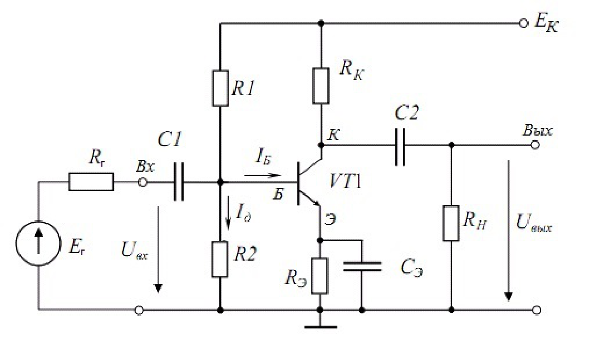

*Рис. 1. Усилительный каскад на биполярном транзисторе, работающем по схеме с общим эмиттером*

На рис. 1 представлена схема усилительного каскада на транзисторе, включенном с общим эмиттером. Характерной особенностью таких усилителей является работа в линейном режиме, который обеспечивает минимальные искажения формы усиленного выходного сигнала [1].

### 1.5.2.1. Назначение элементов схемы

Транзистор $VT1$ – основной элемент усилителя, работает в нормальном активном режиме.

Резисторы $R_{\text{К}}$, $R_1$, $R_2$ – обеспечивают статический режим рабочей точки.

Конденсаторы $C_1$, $C_2$ – развязывающие конденсаторы, они изолируют каскад по постоянному току от входной и выходной схем, благодаря большой величине емкости, они свободно пропускают переменный сигнал.

Резистор $R_{\text{Э}}$, конденсатор $C_{\text{Э}}$ – цепь температурной стабилизации. Стабилизация по температуре происходит следующим образом: с ростом температуры растет ток эмиттера, который течет через резистор $R_{\text{Э}}$, падение напряжения на этом резисторе увеличивается и, тем самым, увеличивается потенциал эмиттера. Поскольку потенциал базы от температуры практически не зависит, напряжение база – эмиттер $U_{\text{БЭ}}$ уменьшается и, благодаря этому, уменьшается ток эмиттера, т.е. статический режим рабочей точки остается стабильным. Чтобы динамический коэффициент усиления не снижался, параллельно резистору $R_{\text{Э}}$, ставится конденсатор $C_{\text{Э}}$, имеющий большую емкость, переменный сигнал свободно проходит через него и динамический коэффициент усиления не уменьшается.

Источник питания $E_{\text{К}}$ – имеет стабильное постоянное напряжение.

Источник переменного сигнала $E_{\text{Г}}$ имеет внутреннее сопротивление $R_{\text{Г}}$.

Сопротивление нагрузки $R_{\text{Н}}$ – равно входному сопротивлению внешних элементов, подключаемых к выходу исследуемого усилителя.

### 1.5.2.2. Рабочая точка

В режиме покоя усилительного каскада, когда на входе нет переменного сигнала, нужно правильно выбрать статическую рабочую точку для того, чтобы параметры транзистора могли считаться постоянными и усилитель мог работать в линейном режиме.

На рис. 2 показано положение рабочей точки (р. т.) на входных и выходных характеристиках транзистора. Рабочая точка ($I_{\text{Б}}^*$, $U_{\text{БЭ}}^*$) выбирается в центре линейного участка входной характеристики (см. рис. 2,а). На семействе выходных характеристик транзистора (см. рис. 2,б) рабочая точка ($I^*_{\text{К}}$, $U^*_{\text{КЭ}}$) также выбирается примерно посередине плоского линейного участка соответствующей ветви характеристики $I_{\text{К}} = f(U_{\text{КЭ}})$ при $I_{\text{Б}} = I^*_{\text{Б}}$. Через эту точку, как известно, проходят две линии нагрузки: статическая $R_{\text{К}}$ и динамическая $R_{\text{К}} \parallel R_{\text{Н}}$.

Статическая нагрузочная прямая описывается уравнением:

$$
I_{\text{К}} = (E - U_{\text{КЭ}}) / (R_{\text{К}} + R_{\text{Э}} / \alpha) \tag{1}
$$

Динамическая нагрузочная прямая проходит через рабочую точку и имеет коэффициент угла наклона $\mathrm{tg}\gamma = 1/R_{\text{Н}\sim}$:

$$
R_{\text{Н}\sim} = R_{\text{К}} \parallel R_{\text{Н}} = \frac{R_{\text{К}} R_{\text{Н}}}{R_{\text{К}} + R_{\text{Н}}} \tag{2}
$$

Рабочая точка выбирается так, чтобы обеспечивать получение на нагрузке требуемых амплитуд напряжения и тока.

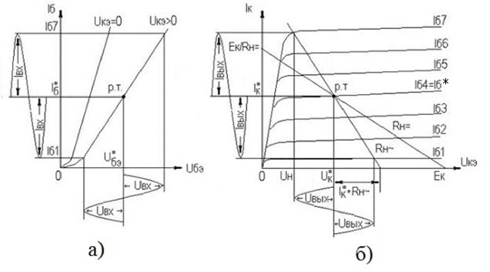

*Рис. 2. Положение рабочей точки на входных (а) и выходных (б) характеристиках транзистора*

### 1.5.2.3. Малосигнальная модель каскада

Поскольку такой каскад усиливает малый сигнал – т.е. отклонение тока и напряжения от их значений в рабочей точке (амплитуда сигнала) малы по сравнению с самими значениями токов и напряжений в рабочей точке, то это позволяет считать характеристики транзистора на выбранном участке линейными. Для целей расчета усилительный каскад с ОЭ можно представить в виде упрощенной малосигнальной линейной модели (см. рис. 3).

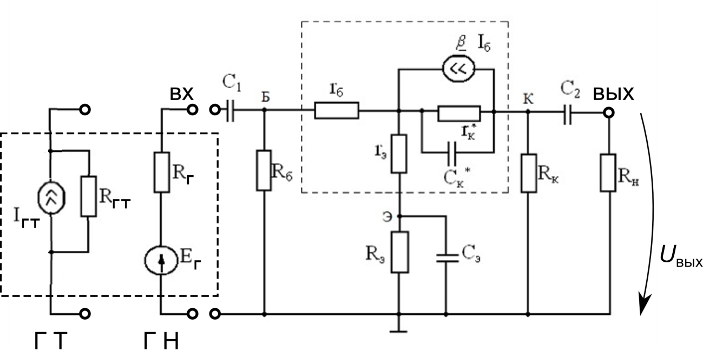

*Рис. 3. Малосигнальная модель усилителя с общим эмиттером*

Малосигнальная модель получается следующим образом: поскольку внутреннее сопротивление источника питания $E_{\text{К}}$ пренебрежимо мало, для переменного сигнала он является коротким замыканием резисторов $R_{\text{К}}$ и $R_1$ с землёй. В схеме рис. 1 транзистор заменяется своей линейной эквивалентной схемой, обведенной на рис. 3 пунктиром и состоящей из управляемого источника тока $\beta \cdot I_{\text{Б}}$, дифференциального сопротивления коллекторного p-n перехода $r_{\text{К}}^*$, обусловленного эффектом Эрли, емкости коллекторного p-n перехода $C_{\text{К}}^*$, сопротивления базовой области $r_{\text{Б}}$, дифференциального сопротивления эмиттерного p-n перехода $r_{\text{Э}} = dU_{\text{БЭ}} / dI_{\text{Э}}$, вычисленного в статической рабочей точке ($U^*_{\text{БЭ}}, I^*_{\text{Э}}$ на рис. 2). Параллельное соединение резисторов $R_1$ и $R_2$ представлено резистором $R_{\text{Б}} = R_1 R_2 / (R_1 + R_2)$. Ко входу каскада с ОЭ подключается генератор напряжения ГН или генератор тока ГТ (в случае расчёта коэффициента усиления по току $K_I$).

Частотный диапазон работы усилителя разбивается на три области (нижние частоты, средние частоты, верхние частоты), в которых усилитель работает по-разному. Зависимость модуля коэффициента усиления от частоты (амплитудно-частотная характеристика – АЧХ) представлена на рис. 4. Границами областей являются точки, в которых модуль коэффициента усиления уменьшается в $\sqrt{2}$ раз по сравнению с максимальным значением, достигаемым в области средних частот.

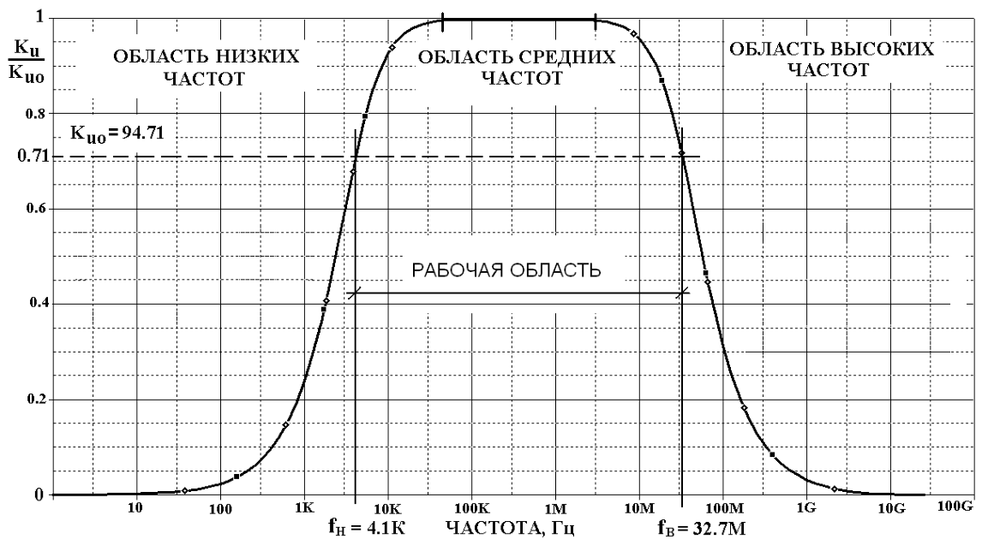

*Рис. 4. Амплитудно-частотная характеристика усилителя*

**1. Средние частоты.** Это основной рабочий диапазон усилителя, на нём коэффициент усиления принимает максимальное значение и имеет достаточно протяженный плоский участок на АЧХ усилителя рис. 4.

Ввиду того, что номиналы конденсаторов $C_1$, $C_2$ и $C_{\text{Э}}$ велики, их сопротивление на средних и высоких частотах пренебрежимо мало, и их можно считать закороченными элементами. Емкость коллекторного p-n перехода $C_{\text{К}}^*$ очень мала, поэтому на низких и средних частотах её сопротивление очень велико и её можно считать разрывом цепи. Исходя из этого, можно вывести выражения для входного сопротивления ($R_{\text{вх}} = U_{\text{вх}} / I_{\text{вх}}$), коэффициентов усиления по напряжению ($K_U = U_{\text{вых}} / E_{\text{Г}}$) и по току ($K_I = I_{\text{Н}}/I_{\text{Г}}$):

$$
R_{\text{вх}} = r_{\text{б}} + (1 + \beta) r_{\text{э}}, \tag{3}
$$

$$
K_U = \frac{\beta (R_{\text{К}} \parallel R_{\text{н}} \parallel r_{\text{к}}^*)}{R_{\text{Г}} + R_{\text{вх}}}, \quad R_{\text{К}} \parallel R_{\text{н}} \parallel r_{\text{к}}^* = \left( \frac{1}{R_{\text{К}}} + \frac{1}{R_{\text{н}}} + \frac{1}{r_{\text{к}}^*} \right)^{-1}, \tag{4}
$$

$$
K_I = \beta \cdot \frac{R_{\text{К}}}{R_{\text{К}} + R_{\text{н}}} \cdot \frac{R_{\text{ГТ}}}{R_{\text{ГТ}} + R_{\text{вх}}}. \tag{5}
$$

Не следует путать в формулах (4) и (5) внутренние сопротивления генераторов напряжения $R_{\text{Г}}$ и тока $R_{\text{ГТ}}$ (для идеальных ГН и ГТ $R_{\text{Г}} \to 0$ и $R_{\text{ГТ}} \to \infty$).

**2. Нижние частоты (большие времена).** В области нижних частот существенное влияние оказывают емкости $C_1$, $C_2$ и $C_{\text{Э}}$. С понижением частоты реактивное сопротивление указанных емкостей $X_C = 1 / (\omega C)$ увеличивается. При этом емкости $C_1$ и $C_2$ препятствуют прохождению сигнала со входа каскада на его выход, уменьшая тем самым коэффициент усиления каскада в области нижних частот. Емкость $C_{\text{Э}}$ в области нижних частот перестает шунтировать резистор $R_{\text{Э}}$ и коэффициент усиления каскада уменьшается за счет падения напряжения отрицательной обратной связи на резисторе $R_{\text{Э}}$.

Учтем влияние трех емкостей по отдельности. Для линейной модели усилителя рис. 3 применим принцип суперпозиции. Сначала рассмотрим влияние только одной емкости $C_1$ (две другие закорочены) и получим для нее частное решение. Потом рассмотрим влияние только второй емкости $C_2$; также получим для нее частное решение. Аналогично и для третьей емкости $C_{\text{Э}}$. В результате общее решение, обусловленное одновременным влиянием всех трех емкостей, будет представлять собой сумму трех частных решений.

При наличии только емкости $C_1$ или только емкости $C_2$ комплексный коэффициент усиления имеет вид:

$$
\begin{aligned}
\underline{K}_{Um}(j\omega) &= \frac{K_{U0}}{1 + \dfrac{1}{j\omega\tau_{\text{н}m}}}, \quad m = 1, 2, \\
\tau_{\text{н}1} &= C_1 (R_{\text{Г}} + R_{\text{вх}}), \quad \tau_{\text{н}2} = C_2 (R_{\text{К}} + R_{\text{н}}),
\end{aligned} \tag{6}
$$

где $K_{U0}$ – коэффициент усиления в области средних частот (см. формулу (4)).

С учетом только емкости $C_{\text{Э}}$ комплексный коэффициент усиления принимает вид:

$$
\begin{aligned}
\underline{K}_{U\text{Э}}(j\omega) &= \frac{K_{U0}}{1 + \dfrac{(1 + \beta) R_{\text{Э}}}{(R_{\text{Г}} + R_{\text{вх}})(1 + j\omega R_{\text{Э}} C_{\text{Э}})}} \approx \frac{K_{U0}}{1 + \dfrac{1}{j\omega\tau_{\text{нЭ}}}}, \\
\tau_{\text{нЭ}} &= C_{\text{Э}} \frac{R_{\text{Г}} + R_{\text{вх}}}{1 + \beta} = C_{\text{Э}} \left( r_{\text{э}} + \frac{R_{\text{Г}} + r_{\text{б}}}{1 + \beta} \right).
\end{aligned} \tag{7}
$$

С учетом всех трех емкостей коэффициент усиления можно оценить по формуле:

$$
\underline{K}_U(j\omega) \approx \frac{K_{U0}}{1 + \dfrac{1}{j\omega\tau_{\text{н}}}}, \quad \tau_{\text{н}} = \left( \frac{1}{\tau_{\text{н}1}} + \frac{1}{\tau_{\text{н}2}} + \frac{1}{\tau_{\text{нЭ}}} \right)^{-1}. \tag{8}
$$

Граничные частоты, обусловленные влиянием каждой емкости в отдельности, равны величинам, обратным соответствующим постоянным времени, а результирующая нижняя граничная частота усилителя $\omega_{\text{н}}$ приблизительно равна их сумме:

$$
\omega_{\text{н}} = \frac{1}{\tau_{\text{н}1}} + \frac{1}{\tau_{\text{н}2}} + \frac{1}{\tau_{\text{нЭ}}}. \tag{9}
$$

Результирующий вид графика АЧХ при низких значениях частоты приведён на рис. 4 (левая часть).

При переходе от переменных гармонических сигналов в комплексной частотной области ($j\omega$) к импульсным сигналам во временной области $t$ необходимо иметь ввиду, что спад АЧХ в области нижних частот на рис. 4 соответствует спаду плоской части импульса в области больших времен на рис. 5, а спад АЧХ в области высоких частот соответствует появлению фронта, замедляющего рост импульса в области малых времен (см. рис. 5).

При передаче импульсного сигнала по мере зарядки конденсаторов $C_1$, $C_2$ и $C_{\text{Э}}$ напряжение вершины импульса спадает. Полный спад вершины импульса, с учетом всех трех конденсаторов оценивается по формуле:

$$
\delta = \frac{\Delta U_{\text{вых}}}{U_{\max}} = t_{\text{и}} \cdot \left( \frac{1}{\tau_{\text{н}1}} + \frac{1}{\tau_{\text{н}2}} + \frac{1}{\tau_{\text{нЭ}}} \right) = \frac{t_{\text{и}}}{\tau_{\text{н}}}, \tag{10}
$$

где $t_{\text{и}}$ – длительность импульса.

**3. Верхние частоты (малые времена).** На верхних частотах коэффициент усиления падает из-за инерционности транзистора – зависимости коэффициента $\beta$ от частоты (или от времени):

$$
\underline{\beta}(j\omega) = \frac{\beta_0}{1 + j\omega\tau_\beta} \quad \text{или} \quad \beta(t) = \beta_0 \left( 1 - \exp(-t/\tau_\beta) \right). \tag{11}
$$

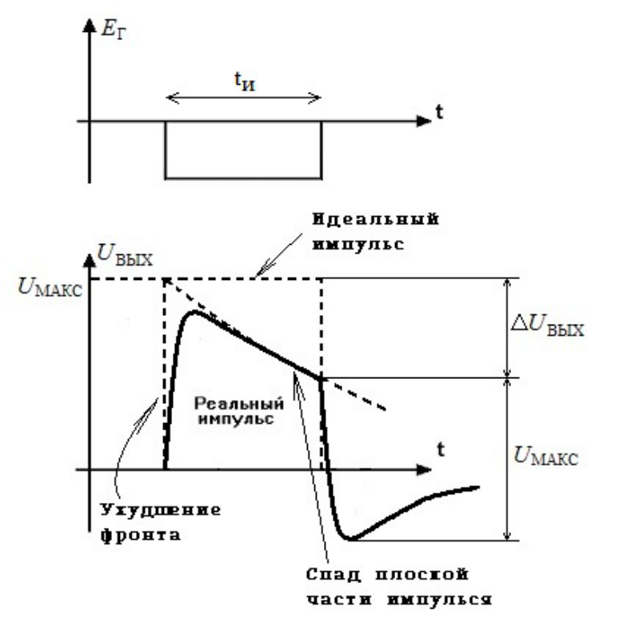

*Рис. 5. Искажение реального импульса на выходе каскада с ОЭ*

Другим фактором, способствующим снижению $K_U(j\omega)$ в области ВЧ, является шунтирующее действие емкости коллекторного перехода $C_{\text{к}}^*$.

Учитывая оба эффекта, получаем следующее выражение для коэффициента усиления на верхних частотах:

$$
\underline{K}_U(j\omega) = \frac{K_{U0}}{1 + j\omega\tau_{\text{в}}}. \quad \text{или} \quad K_U(t) = K_{U0} \left( 1 - \exp(-t/\tau_{\text{в}}) \right), \tag{12}
$$

$$
\text{где } \tau_{\text{в}} \approx \tau_\beta + C_K^* \frac{R_{\text{К}} R_{\text{н}}}{R_{\text{К}} + R_{\text{н}}}.
$$

Верхняя граничная частота усилителя с ОЭ – величина, обратная постоянной времени $\tau_{\text{в}}$:

$$
\omega_{\text{в}} = 1/\tau_{\text{в}}. \tag{13}
$$

Результирующий вид графика АЧХ при больших значениях частоты приведён на рис. 4 (правая часть).

Время нарастания фронта на рис. 5 равно:

$$
t_{\text{Ф}} = 2{,}2 \cdot \tau_{\text{в}}. \tag{14}
$$

### 1.5.2.4. Коррекция вершины и фронта импульса

Для уменьшения искажений (спада) *плоской вершины импульса* применяется коррекция в области больших времен, чаще всего для коррекции вершины используются RC-фильтры, которые включаются в коллекторную цепь каскада (рис. 6). Корректирующая цепочка $R_{\text{ф}}$, $C_{\text{ф}}$ обеспечивает увеличение сопротивления коллекторной цепи в области больших времен (низших частот), следовательно, и увеличение усиления в этой области, которое частично компенсирует спад усиления, вызванный влиянием разделительных $C_1$, $C_2$ и блокирующего $C_{\text{Э}}$ конденсаторов. Условие оптимальной коррекции вершины определяется следующей формулой:

$$
C_{\text{Ф}} \cdot R_{\text{К}} \approx \tau_{\text{н}}, \quad \frac{1}{\tau_{\text{н}}} \approx \frac{1}{\tau_{\text{н}1}} + \frac{1}{\tau_{\text{н}2}} + \frac{1}{\tau_{\text{нЭ}}} \tag{15}
$$

Если $C_{\text{Ф}} R_{\text{К}} < \tau_{\text{н}}$, т.е. заряд емкости $C_{\text{ф}}$ идет с большей скоростью, чем при оптимальной коррекции, то возникает перекоррекция, что проявляется в подъеме плоской вершины (или подъеме амплитудно-частотной характеристики в области низших частот). При $C_{\text{Ф}} R_{\text{К}} > \tau_{\text{н}}$ имеет место недокоррекция (см. рис. 7).

Коррекцию характеристик усилителя в *области малых времен* осуществляют при помощи комплексных обратных связей. Охват усилителя обратной связью по току с помощью включения в цепь эмиттера небольшого сопротивления $R_0$ уменьшает время нарастания фронта, но одновременно уменьшает и коэффициент усиления:

$$
K_{U\text{кор}} = \frac{\beta R_{\text{К}} \parallel R_{\text{н}}}{R_{\text{Г}} \parallel R_\delta + r_\delta + (1 + \beta)(R_0 + r_{\text{Э}})} < K_{U0}. \tag{16}
$$

Чтобы сохранить добротность каскада, сопротивление обратной связи $R_0$ шунтируют небольшой емкостью $C_0$ (см. рис. 6). В результате коэффициент усиления в начальный момент подачи сигнала имеет ту же величину, что и в усилителе без обратной связи; это приводит к быстрому нарастанию фронта импульса. Слишком большое значение емкости $C_0$ приводит к образованию выбросов выходного тока и напряжения (см. рис. 8).

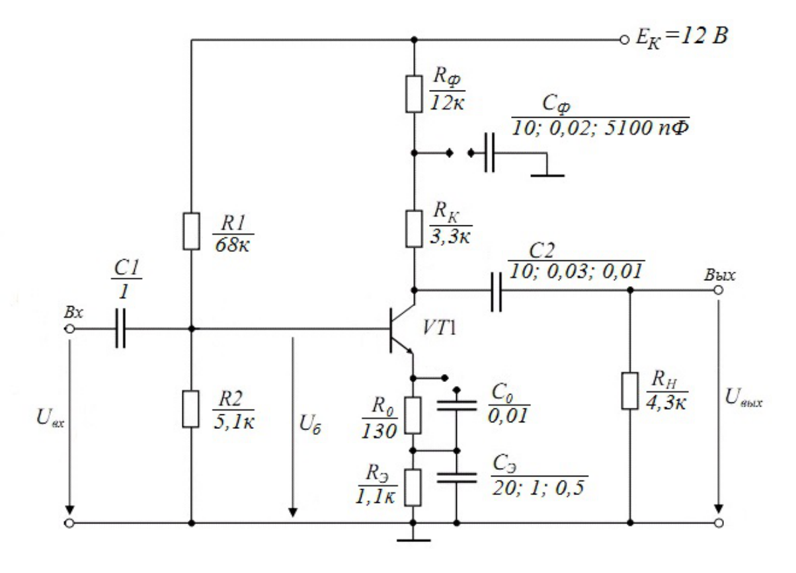

*Рис. 6. Усилитель с ОЭ с корректирующими цепями*

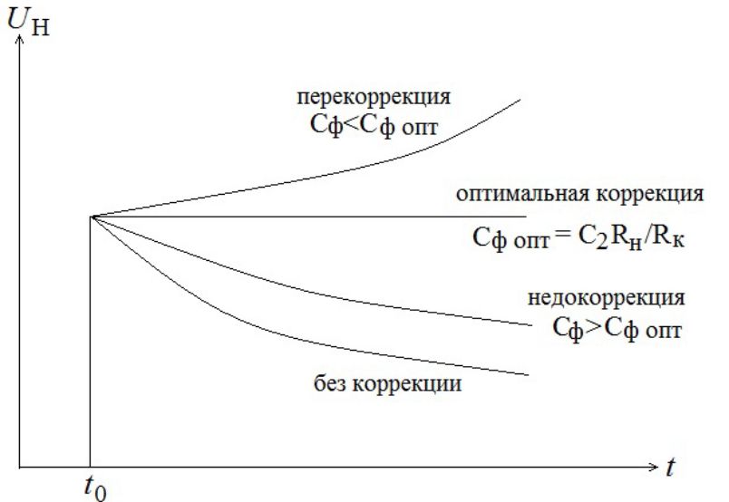

*Рис. 7. Переходная характеристика каскада с ОЭ с учётом коррекции плоской вершины импульса*

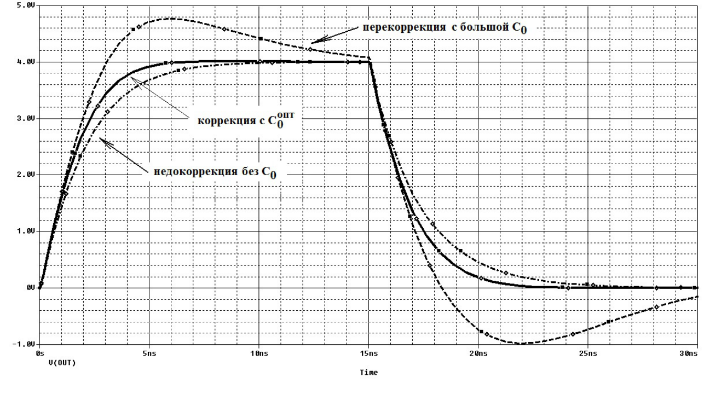

*Рис. 8. Переходная характеристика каскада с ОЭ с учётом коррекции фронта импульса*

Величина оптимальной корректирующей емкости $C_0$, не дающей выбросов, рассчитывается по формуле:

$$
R_0 C_0^{\text{опт}} \approx \tau_\alpha + C_{\text{К}} (R_{\text{Кн}} + \mathrm{r}_\delta + R_\delta \parallel R_{\text{Г}}). \tag{17}
$$

При этой величине емкости $C_0^{\text{опт}}$ время нарастания определяется формулой:

$$
t_{\text{н}} = 2{,}2 \cdot \left[ \tau_\beta + C_{\text{К}}^* (1 + \beta) R_{\text{К}} \parallel R_{\text{н}} \right] \cdot \frac{r_\delta + r_{\text{Э}} + R_\delta \parallel R_{\text{Г}}}{r_\delta + R_\delta \parallel R_{\text{Г}} + (1 + \beta) \cdot (r_{\text{Э}} + R_0)},
$$

и добротность каскада остается равной добротности каскада при $R_0 = 0$.

## 1.5.3. Описание лабораторного стенда

В лабораторной работе используется блок стенда, показанный на рис. 9. Чтобы собрать обе схемы усилителя (рис. 1 и 6), необходимо использовать блоки резисторов и конденсаторов различных номиналов, имеющиеся на стенде. Следует отметить, что установленные в этом блоке резисторы могут не обеспечить значения резисторов $R_1$, $R_2$, необходимых для оптимального выбора режима рабочей точки усилителя, поэтому в лабораторной работе к базе транзистора через резистор подключается регулируемый источник питания, с помощью которого настраивается рабочая точка.

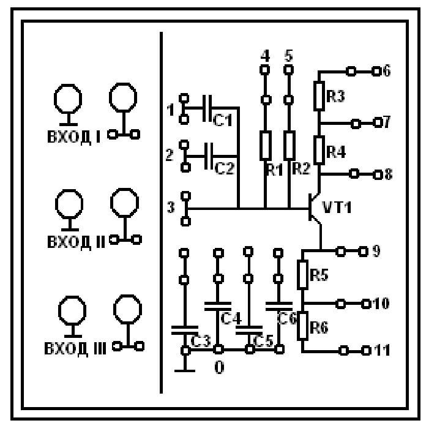

*Рис. 9. Блок лабораторного стенда*

## 1.5.4. Задание для работы в лаборатории

### 1.5.4.1. Исследование статического режима усилителя

Собрать схему рис. 10 (второй вход осциллографа включить в положение Осц 2). На вывод *+12В* подать постоянное напряжение. На вход $E$ подать напряжение с регулируемого источника питания. Установить $C_6$ = 20 мкФ. На вход схемы подать от генератора синусоидальных сигналов напряжение с частотой $f$ = 10 кГц максимальной амплитуды, при которой на выходе усилителя отсутствуют заметные на глаз нелинейные искажения. Снять показания с амперметра и измерить вольтметром напряжения: источника питания, базы, коллектора и эмиттера транзистора по отношению к земле. Результаты занести в таблицу.

*Указания:* для того, чтобы добиться отсутствия нелинейных искажений, необходимо установить, во-первых, хорошую рабочую точку транзистора, соответствующую середине нагрузочной прямой (вращением ручки регулируемого источника питания, подключенного к $R_2$, добиться симметричного ограничения выходного синусоидального сигнала сверху и снизу) и, во-вторых, наибольшую амплитуду входного сигнала (на генераторе синусоидальных сигналов) без искажений выходного сигнала. При возникновении искажений только в верхней или нижней части выходного сигнала усилителя, следует сместить рабочую точку в противоположную сторону с помощью регулируемого источника питания; в случае искажений выходного сигнала и сверху, и снизу, следует уменьшить амплитуду входного сигнала.

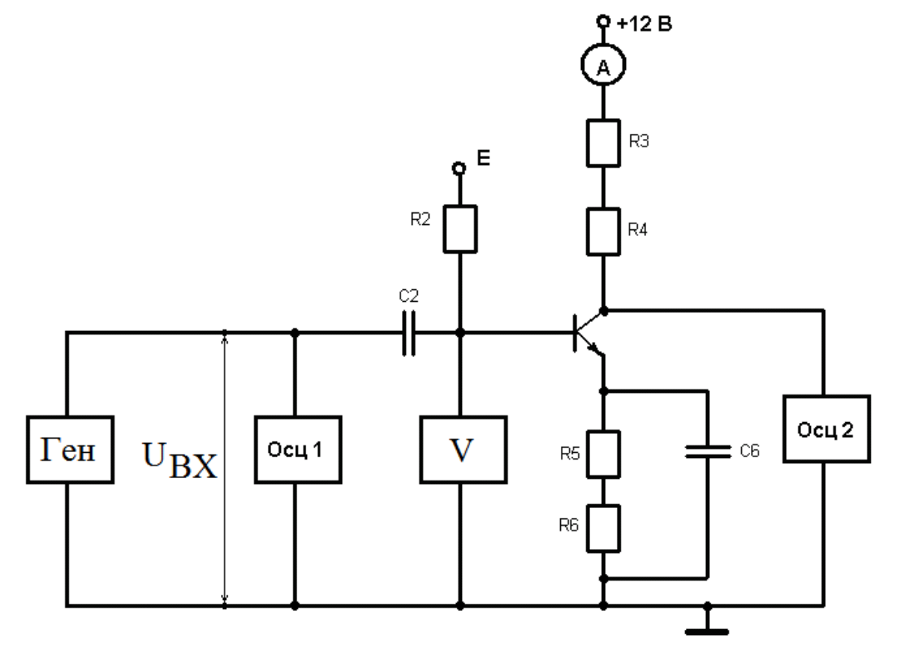

*Рис. 10. Схема усилителя, используемая в лабораторной работе для определения $K_{U\text{о}}$*

\* После установки оптимального режима рабочей точки, значения регулируемого источника и амплитуду генератора не менять!!

### 1.5.4.2. Исследование малосигнального режима усилителя

1. Измерить максимальную амплитуду входного сигнала $u_{\text{вх}\,\max}$, при которой еще не наблюдается заметных нелинейных искажений выходного сигнала, и соответствующую ей амплитуду выходного сигнала $u_{\text{вых}\,\max}$.
2. Определить значения $K_{U\text{о}}$, проводя измерения по схеме рис. 10, и $R_{\text{вх}}$, проводя измерения по схеме рис. 11 с дополнительным сопротивлением $R$ = 1 кОм, при $C_{\text{Э}}$ = 20 мкФ и отключенном $C_{\text{Э}}$ ($C_6$ на лабораторном стенде рис. 9).

$$
K_{Uo} = \frac{U_{\text{вых}}}{U_{\text{вх}}}; \quad R_{\text{вх}} = \frac{U_{\text{Б}}}{U_{\text{вх}} - U_{\text{Б}}} \cdot R, \quad R = 1\ \text{кОм}.
$$

$U_{\text{Б}}$ ‒ напряжение входного сигнала, измеренное осциллографом на базе транзистора (после резистора $R$ и ёмкости $C_2$ в схеме рис. 11).

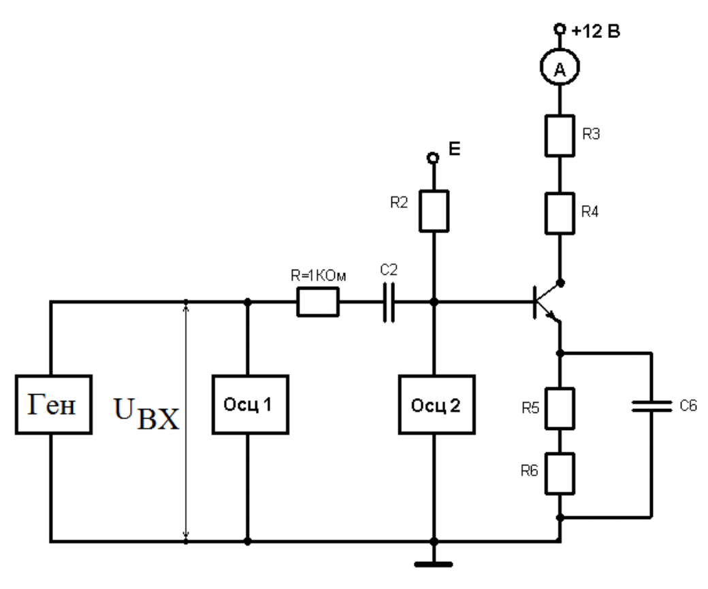

*Рис. 11. Схема усилителя, используемая в лабораторной работе для определения входного сопротивления $R_{\text{вх}}$*

3. Определить граничные частоты каскада для различных емкостей. Измерения проводить по схеме рис. 10.

   Не изменяя амплитуды генератора сигналов, уменьшать частоту генератора от 10 кГц до единиц герц. Определить по шкале генератора частоту, на которой амплитуда выходного сигнала уменьшается до 0,707 от значения амплитуды на 10 кГц. Повторить эти измерения для трех емкостей в цепи эмиттера и двух емкостей в цепи базы. Записать значения частот. Обратить внимание, что усилитель с общим эмиттером инвертирует сигнал.

4. Установить $C_2$ = 10мкФ, $C_{\text{Э}}$ = 20 пкФ, отключить $C_0$ и $C_{\text{ф}}$ и подать на вход усилителя сигнал с генератора импульсов длительностью $t_{\text{и}}$ = 100 мкс, частотой $f$ = 2 кГц и амплитудой меньше $u_{\text{вх}\,\max}$, измеренной в п. 2. В одном временном масштабе зарисовать осциллограммы входного и выходного напряжений.
5. Исследовать влияние величины емкости конденсатора $C_{\text{Э}}$ на передачу вершины импульса. $C_0$ и $C_{\text{ф}}$ отключить, установить $C_2$ = 10 мкФ, зарисовать осциллограммы выходного напряжения и измерить относительный спад вершины импульса при $C_{\text{Э}}$ = 20 мкФ, $C_{\text{Э}}$ = 1 мкФ, $C_{\text{Э}}$ = 0,5 мкФ.
6. Исследовать влияние величины емкости конденсатора $C_2$ на передачу вершины импульса. $C_0$ и $C_{\text{ф}}$ отключить, установить $C_{\text{Э}}$ = 20 мкФ, зарисовать осциллограммы выходного напряжения и измерить относительный спад вершины импульса при $C_2$ = 10 мкФ, $C_2$ = 0,03 мкФ, $C_2$ = 0,01 мкФ.
7. Исследовать влияние величины емкости корректирующего конденсатора $C_{\text{ф}}$ на передачу вершины импульса. $C_0$ отключить, установить $C_{\text{Э}}$ = 1 мкФ, $C_2$ = 0,03 мкФ, зарисовать осциллограммы выходного напряжения и измерить относительный спад вершины импульса при $C_{\text{ф}}$ = 10 мкФ, $C_{\text{ф}}$ = 0,02 мкФ, $C_{\text{ф}}$ = 100 пФ.
8. Исследовать влияние емкости конденсатора $C_0$ на длительность фронта. Для этого установить $C_{\text{ф}}$ = 10 мкФ, $C_2$ = 10 мкФ, $C_{\text{Э}}$ = 20 мкФ, зарисовать осциллограммы выходного напряжения и измерить длительность фронта выходного импульса при отключенном $C_0$ и $C_0$ = 0,01 мкФ, определить относительную величину выброса (если он есть).

## 1.5.5. Задание для работы с программой SPICE-моделирования

1. Собрать схемы усилителя рис. 1 и 6. Параметры транзистора взять из результатов лабораторной работы «Исследование характеристик биполярного транзистора», емкость эмиттерного перехода взять равной `Cje=0.3pF`, емкость коллекторного перехода `Cjc=1.0pF`, время пролета взять равным `Tf=3nsec`, параметры других элементов схемы взять с рис. 6. Пример схемы для моделирования приведён на рис. 12.
2. Рассчитать статический режим усилителей рис. 1 и 6.
3. Если рабочая точка выбрана правильно, потенциал коллектора должен быть немного больше половины напряжения питания.
4. Если условие п. 2 не выполнено, добиться его выполнения, меняя номиналы резисторов $R_1$, $R_2$.
5. Рассчитать с помощью программы SPICE усиление синусоидального сигнала обоими усилителями (рис. 1 и 6). Амплитуду входного сигнала взять равной 10 мВ. Вывести графики токов и напряжений на входе и выходе. Постепенно увеличивая амплитуду входного сигнала, найти его максимально допустимую амплитуду (при которой еще нет нелинейных искажений). Для этого задать источник входного синусоидального сигнала с параметрами:

   ```
   SINE(0 10m 10k 0 0 0 10)
   ```

   а также задать режим расчета схемы:

   ```
   .tran 1m
   ```

6. Рассчитать реакцию обоих усилителей на входной импульс с примерными параметрами: $u_{\text{ВХ}}$ = 10 мВ, длительность фронтов $t_{\text{Ф}}^{+} = t_{\text{Ф}}^{-}$ = 0,1 мкс, длительность вершины импульса 30 мкс, период следования импульсов 32 мкс. Проанализировать влияние корректирующих цепей на спад вершины и длительность фронтов выходного импульса. Для этого задать источник входного импульсного сигнала с параметрами:

   ```
   PULSE(0 10m 1u 0.1u 0.1u 30u 32u 1)
   ```

   и режим расчета:

   ```
   .tran 100u
   ```

7. Рассчитать частотные характеристики обоих усилителей, найти граничные частоты. SPICE позволяет строить графики арифметических выражений от рассчитываемых токов и напряжений; воспользоваться этой возможностью для построения графиков частотных характеристик. Для этого задать синусоидальный входной источник с амплитудой 10 мВ и начальной фазой 0°:

   ```
   AC 10m 0
   ```

   и режим расчета частотной полосы 1 Гц … 100 МГц, 10000 точек, частоты меняются по закону десятичного логарифма:

   ```
   .ac dec 10000 1 1meg
   ```

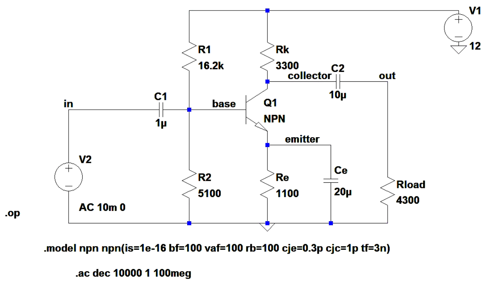

*Рис. 12. Пример задания для расчета АЧХ усилительного каскада с ОЭ с помощью программы LTSpice [4]*

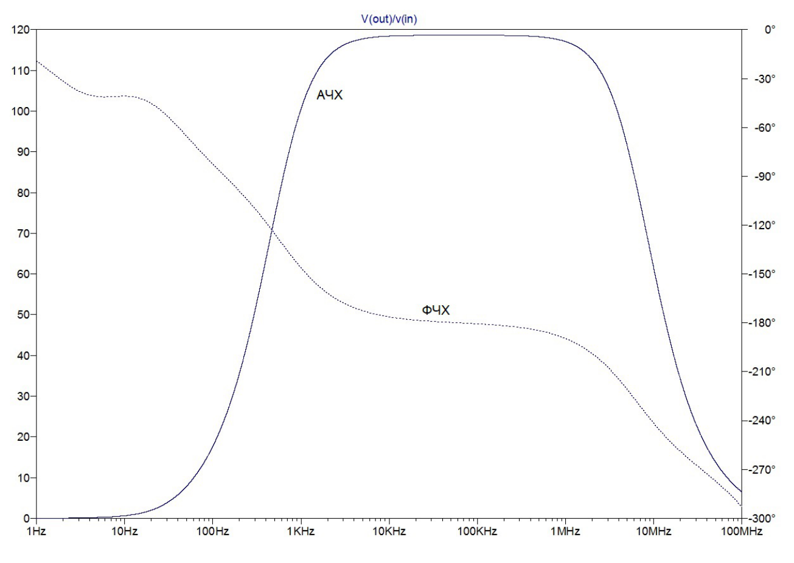

*Рис. 13. Пример результатов расчёта с помощью LTSpice АЧХ и ФЧХ каскада рис. 12*

## 1.5.6. Контрольные вопросы

1. Выбор рабочей точки усилительного каскада.
2. Какими элементами схемы обеспечивается статический режим усилительного каскада?
3. Обеспечение стабильности рабочей точки?
4. Назначение конденсаторов $C_1$ и $C_2$ в схеме усилителя.
5. Назначение конденсатора $C_{\text{э}}$ в схеме усилителя.
6. Влияние конденсаторов $C_1$ и $C_2$ на переходную характеристику усилителя.
7. Влияние конденсаторов $C_1$ и $C_2$ на АЧХ усилителя.
8. Влияние конденсатора $C_{\text{э}}$ на переходную характеристику усилителя.
9. Влияние конденсатора $C_{\text{э}}$ на АЧХ усилителя.
10. Способ корректировки переходной характеристики усилителя в области больших времён.
11. Причина появления линейных искажений усилителя в области малых времен. В чём они проявляются?
12. Способ корректировки переходной характеристики усилителя в области малых времен?
13. Влияние резистора $R_0$ на параметры усилителя.
14. Экспериментальный способ определения входного сопротивления усилителя.

## 1.5.7. Рекомендуемая литература

1. Перепелкин Д.А. Схемотехника усилительных устройств. Учебное пособие. ‒М.: Горячая линия-Телеком, 2013. ‒ 238 с.;
2. Волович Г. И., Схемотехника аналоговых и аналогово-цифровых электронных устройств. – М.: Додэка XXI, ДМК Пресс, 2015. – 528 с.;
3. Павлов В. Н., Схемотехника аналоговых электронных устройств. – М.: Academia, 2008. – 288 с.;
4. Сохор Ю.Н. Моделирование устройств в пакете LTspice. – Псков: ППИ, 2008.
5. Миловзоров О. В., Панков И. Г., Основы электроники. Учебник. – М.: Юрайт, 2016. – 407 с.
6. Ровдо А. А., Схемотехника усилительных каскадов на биполярных транзисторах. – М.: Додэка XXI, 2009. – 256 с.
