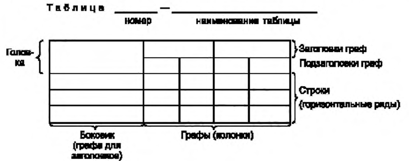

# Требования к оформлению отчетов и домашних заданий

Официальные требования кафедры к оформлению отчетов по лабораторным работам и домашних заданий. Требования взяты из ГОСТ 2.105.

## Общие требования

1. При оформлении документа используют гарнитуры шрифта Times New Roman или Arial размером 14 для основного текста и размером 12 для приложений, примечаний, сносок и примеров. Допускается использование шрифта размером 13 и 11 для основного текста и размером 12 и 10 для приложений, примечаний, сносок и примеров соответственно. Использование различных сочетаний размеров шрифта в одном документе не допускается. Использование различных гарнитур шрифта в одном документе не рекомендуется.
2. При оформлении документа допускается использовать перенос в словах, кроме заголовков.
3. Текст оформляют с использованием полуторного межстрочного интервала. Допускается использование двойного межстрочного интервала.
4. Абзацы в тексте начинают отступом, равным пяти знакам используемой гарнитуры шрифта (от 12,5 до 17 мм). Абзацный отступ должен быть одинаковым по всему тексту документа.
5. Листы документа сопровождают основной надписью (форма основной надписи дана в приложении к требованиям кафедры).
6. Заголовки следует печатать с прописной буквы без точки в конце, полужирным шрифтом, не подчеркивая. Переносы слов в заголовках не допускаются. Если заголовок состоит из двух предложений, их разделяют точкой.
7. Между заголовком раздела и предыдущим или последующим текстом ставится пустая строка.
8. Между заголовком подраздела (пункта) и предыдущим или последующим текстом пустая строка не ставится.
9. Каждый раздел рекомендуется начинать с нового листа (страницы).

## Таблицы

1. Наименование следует помещать над таблицей. При переносе части таблицы на ту же или другие страницы наименование помещают только над первой частью таблицы.
2. Таблицы, за исключением таблиц приложений, следует нумеровать арабскими цифрами сквозной нумерацией. Таблицы каждого приложения обозначают отдельной нумерацией арабскими цифрами с добавлением перед цифрой обозначения приложения. Например, если в документе одна таблица, она должна быть обозначена «Таблица 1» или «Таблица В.1» в случае, когда она приведена в приложении В. Допускается нумеровать таблицы в пределах раздела. В этом случае номер таблицы состоит из номера раздела и порядкового номера таблицы, разделенных точкой.
3. На все таблицы документа должны быть приведены ссылки в тексте документа, при ссылке следует писать слово «таблица» с указанием ее номера.
4. Таблицы слева, справа и снизу, как правило, ограничивают линиями. Допускается не ограничивать таблицы линиями слева и справа. Разделять заголовки и подзаголовки боковика и граф диагональными линиями не допускается. Горизонтальные и вертикальные линии, разграничивающие строки таблицы, допускается не проводить, если их отсутствие не затрудняет пользование таблицей.
5. Таблицу, в зависимости от ее размера, помещают под текстом, в котором впервые дана ссылка на нее, или на следующей странице, а при необходимости в приложении к документу. Допускается помещать таблицу вдоль длинной стороны страницы документа.
6. Если строки или графы таблицы выходят за формат страницы, ее делят на части, помещая одну часть под другой или рядом, при этом в каждой части таблицы повторяют ее головку и боковик (см. рисунок 1).

*Рисунок 1. Обозначение элементов таблицы*

На рисунке 1 над таблицей слева написано слово «Таблица», за ним номер таблицы и через тире ее наименование. Головка таблицы состоит из заголовков и подзаголовков граф. Слева расположен боковик (графа для заголовков строк), правее идут графы (колонки), горизонтальные ряды таблицы называются строками.

При делении таблицы на части допускается ее головку или боковик заменять соответственно номером граф и строк. При этом нумеруют арабскими цифрами графы и (или) строки первой части таблицы. Если в конце страницы таблица прерывается и ее продолжение будет на следующей странице, в первой части таблицы нижнюю горизонтальную линию, ограничивающую таблицу, рекомендуется не проводить.

7. В графах таблицы после названия через запятую следует ставить единицы измерения, в которых приведены значения в столбцах.
8. Названия физических величин в графах и боковике могут быть заменены на буквенные обозначения при условии, что ранее в тексте эти обозначения были расшифрованы.

## Графический материал

1. Графический материал, за исключением графического материала приложений, следует нумеровать арабскими цифрами сквозной нумерацией, приводя эти номера после слова «Рисунок». Если рисунок один, то его обозначают «Рисунок 1».
2. Графический материал каждого приложения нумеруют арабскими цифрами отдельной нумерацией, добавляя перед каждым номером обозначение данного приложения и разделяя их точкой.
3. Допускается не нумеровать небольшие рисунки, размещенные непосредственно в тексте и на которые в дальнейшем нет ссылок.
4. Допускается нумеровать графический материал в пределах раздела. В этом случае номер графического материала состоит из номера раздела и порядкового номера графического материала, разделенных точкой.

## Правила обозначения элементов на электрических схемах

1. Обозначение должно состоять из буквы и порядкового номера. Резисторы обозначаются буквой R, конденсаторы буквой C, индуктивности буквой L, источники ЭДС буквой E, источники тока буквой I. Нумерация у каждого типа компонентов своя.
2. Нумерация компонентов производится слева направо и сверху вниз.
3. Числа при нумерации должны идти подряд. Пропуск номеров компонентов не допускается.

Правильно: R1, R2, R3, R4.

Неправильно: R1, R3, R5, R6.

## Формулы

1. В формулах в качестве символов следует применять стандартные обозначения для математических действий. Пояснения символов и числовых коэффициентов, входящих в формулу, если они не пояснены ранее в тексте, должны быть приведены непосредственно под формулой. Пояснения каждого символа следует давать с новой строки в той последовательности, в которой символы приведены в формуле. Первая строка пояснения должна начинаться со слова «где» без двоеточия после него.
2. Формулы, следующие одна за другой и не разделенные текстом, разделяют запятой.
3. Переносить формулы на следующую строку допускается только на знаках выполняемых операций, причем знак в начале следующей строки повторяют. При переносе формулы на знаке умножения применяют знак «×».
4. Формулы, за исключением формул, помещаемых в приложении, должны нумероваться сквозной нумерацией арабскими цифрами, которые записывают на уровне формулы справа в круглых скобках. Одну формулу обозначают (1).
5. Ссылки в тексте на порядковые номера формул дают в скобках.
